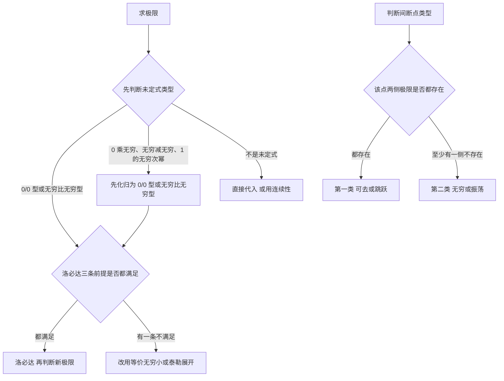

# 核心讲解

## 【连续与间断点分类】

- **连续的定义**要求下列三件事**同时**成立：$f$ 在 $x_0$ 处**有定义**、极限 $\lim_{x\to x_0}f(x)$ 存在、两者相等。
- **分段函数的分界点**只能算左右极限再与函数值比较，不能直接把分界点代进分段的表达式。
- **找间断点的位置**只看两类地方：函数表达式失去定义的点，以及分段函数的分界点。
- **第一类间断点**：两侧极限**都存在**。相等时叫**可去间断点**（该点可以没有定义），不等时叫**跳跃间断点**。
- **第二类间断点**：至少有一侧极限**不存在**，包括**无穷间断点**与**振荡间断点**。

| 间断点类型 | 两侧极限 | 判定要点 |
| --- | --- | --- |
| **可去间断点**（第一类） | 都存在且相等 | 该点可以没有定义，补上定义即可连续 |
| **跳跃间断点**（第一类） | 都存在但不相等 | 极限不存在，跳跃高度等于两侧极限之差 |
| **无穷间断点**（第二类） | 至少一侧为无穷大 | 只要有一侧发散到无穷就归入此类 |
| **振荡间断点**（第二类） | 至少一侧振荡不存在 | 函数值不趋于任何数，也不趋于无穷 |

【核心公式】

$$ \lim_{x\to x_0^-}f(x)=\lim_{x\to x_0^+}f(x)=f(x_0) $$

【适用条件】

1. $f$ 在 $x_0$ 的某邻域内**有定义**（含 $x_0$ 本身）；
2. 左极限与右极限**都存在**；
3. 两者**相等**，且这个公共值恰好等于 $f(x_0)$。

> ⚠️ **易错点**：极限只与**去心邻域**有关，$f(x_0)$ 是否存在、等于多少都不影响 $\lim_{x\to x_0}f(x)$ —— 这正是可去间断点的来源；判断间断点必须两侧都算，只要有一侧为无穷大或振荡不存在，该点就是第二类。

## 【两个重要极限】

- **第一个重要极限**是 $\frac00$ 型未定式的基准，也是等价无穷小 $\sin x\sim x$ 的来源。
- **第二个重要极限**是 $1^{\infty}$ 型未定式的基准，处理办法是先取对数或凑成它的标准形式。
- 两个极限中的变量都可以换成**任何趋于零的因式**，结论不变。
- $1^{\infty}$ 型未定式有两条化归路线：凑成第二个重要极限的标准形式，或取对数化为乘积型再用洛必达法则。

【核心公式】

$$ \lim_{x\to 0}\frac{\sin x}{x}=1 $$

$$ \lim_{x\to\infty}\left(1+\frac1x\right)^x=e,\qquad \lim_{u\to 0}(1+u)^{\frac1u}=e $$

【适用条件】

1. 第一个重要极限要求分子与分母**同时趋于 0**，且两者是同一个变量；
2. 第二个重要极限要求括号内是 $1$ 加上一个**趋于 0** 的量，而指数恰好是该量的**倒数**；
3. $1^{\infty}$ 型未定式必须**先化归**成上述标准形式，不能直接代入。

> ⚠️ **秒杀技**：见到 $1^{\infty}$ 型就朝 $(1+u)^{1/u}$ 的结构上凑；指数与括号内的量凑不成倒数时，先取对数把幂指型化为乘积型。

## 【无穷小比较】

- **乘除因子**上的等价无穷小替换**无条件成立**。
- **加减项**只有在替换后**不发生同阶相消**时才可用。
- 一旦发生**同阶相消**，必须**升阶**：换用更高阶的等价无穷小。
- 三阶等价无穷小都出现在两个一阶无穷小**相减**的场合，此时不能用一阶主部。
- 判断办法：把各项都换成主部后相减，若最高阶项被消掉，就说明替换的阶数不够。

| 阶数 | 等价无穷小（$x\to 0$） | 使用场合 |
| --- | --- | --- |
| **一阶** | $\sin x\sim\tan x\sim\arcsin x\sim\arctan x\sim x$ | 乘除因子直接替换 |
| **一阶** | $\ln(1+x)\sim e^x-1\sim x$ | 乘除因子直接替换 |
| **二阶** | $1-\cos x\sim\frac{x^2}{2}$ | 与一阶项相减时使用 |
| **三阶** | $x-\sin x\sim\frac{x^3}{6}$ | 一阶相消后升阶 |
| **三阶** | $\tan x-x\sim\frac{x^3}{3}$ | 一阶相消后升阶 |

【核心公式】

$$ \sin x\sim\tan x\sim\arcsin x\sim\arctan x\sim x,\qquad \ln(1+x)\sim e^x-1\sim x $$

$$ 1-\cos x\sim\frac{x^2}{2},\qquad x-\sin x\sim\frac{x^3}{6},\qquad \tan x-x\sim\frac{x^3}{3} $$

$$ \lim_{x\to 0}\frac{\tan x-\sin x}{x^3}=\frac12 $$

【适用条件】

1. 替换只针对**整个乘积因子或分母**，不能对和式中的个别项单独替换；
2. 式中的无穷小必须趋于**同一个点**；
3. 替换后若最高阶项被消掉，必须**升阶**重新替换。

> ⚠️ **易错点**：把分子两项都换成一阶主部会算出极限 $0$，正确结果是 $\frac12$ —— 因为替换后同阶项相消，必须升到三阶。

## 【洛必达法则】

- 求极限有**三条主线**：等价无穷小替换、洛必达法则、泰勒展开，洛必达只是其中一条。
- 洛必达法则只适用于 $\frac00$ 型与 $\frac{\infty}{\infty}$ 型两种未定式。
- 其它未定式（$0\cdot\infty$、$\infty-\infty$、$1^{\infty}$ 等）必须先**化归**为上述两种。
- 第三条前提不成立时洛必达**失效**，但原极限未必不存在。
- 洛必达失效时应改用**等价无穷小**或**泰勒展开**。

【核心公式】

$$ \lim_{x\to x_0}\frac{f(x)}{g(x)}=\lim_{x\to x_0}\frac{f'(x)}{g'(x)} $$

$$ \text{反例：}\ \lim_{x\to\infty}\frac{x+\sin x}{x}=1,\qquad \text{而}\ \lim_{x\to\infty}(1+\cos x)\ \text{不存在} $$

【适用条件】

1. 所求极限为 $\frac00$ 型或 $\frac{\infty}{\infty}$ 型；
2. 在 $x_0$ 的某**去心邻域**内 $f$ 与 $g$ 都**可导**，且 $g'(x)\neq 0$；
3. 导数之比的极限 $\lim_{x\to x_0}\frac{f'(x)}{g'(x)}$ **存在或为无穷大**。

> ⚠️ **易错点**：见到 $\frac00$ 型就直接洛必达，忘记核对前提。若导数之比的极限振荡不存在，只能换方法，**不能断言原极限不存在** —— 上面的反例中导数之比不收敛，而原极限确为 $1$。

## 【数列极限与单调有界准则】

- **单调有界准则**：单调且有界的数列**必收敛**，它是极限存在的**充分条件**。
- 递推数列的固定两步：先证**极限存在**，再对递推式**取极限**。
- 证存在性用单调有界准则：先用数学归纳法证单调，再找出上界或下界。
- 求值则把递推式两端同时取 $n\to\infty$，解出关于极限的方程。
- 解出的根可能不止一个，要用**单调性**或**有界性**舍去不合理的根。

【核心公式】

$$ x_{n+1}=\varphi(x_n)\ \Longrightarrow\ A=\varphi(A) $$

【适用条件】

1. 数列**单调**（单调增或单调减）；
2. 数列**有界**（有上界或有下界）；
3. 对递推式取极限时要求 $\varphi$ 在 $A$ 处**连续**，否则不能把极限号移进函数记号内。

> ⚠️ **秒杀技**：先算前几项定出单调方向与界，再用数学归纳法证明，最后令 $n\to\infty$ 解方程。**不要**跳过存在性直接解方程 —— 那样解出的根未必是极限。

# 关键结论速记

- $\lim_{x\to 0}\frac{\sin x}{x}=1$ —— 第一个重要极限，也是 $\sin x\sim x$ 的来源，$x$ 可换成任何趋于零的因式。
- $\lim_{x\to\infty}\left(1+\frac1x\right)^x=e$ —— 第二个重要极限，$1^{\infty}$ 型先取对数或凑成它的形式。
- $1-\cos x\sim\frac{x^2}{2}$，$x-\sin x\sim\frac{x^3}{6}$，$\tan x-x\sim\frac{x^3}{3}$ —— 二阶与三阶等价无穷小，加减相消时必须升阶。
- $f$ 在 $x_0$ 连续 $\iff \lim_{x\to x_0^-}f(x)=\lim_{x\to x_0^+}f(x)=f(x_0)$ —— 分段函数分界点只能用这条，不能只看表达式。
- 第一类间断点 等价于 两侧极限都存在 —— 相等为可去、不等为跳跃，只要有一侧极限不存在就是第二类。
- 单调有界数列必收敛 —— 递推数列先证单调有界，再令 $n\to\infty$ 解 $A=\varphi(A)$。
- 闭区间上连续 $\Rightarrow$ 有界、取到最值、介值、零点存在 —— 证明方程有根优先用零点定理。

# 示意图

# 易错点

- **错在见到 $\frac00$ 型就直接洛必达，忘记核对前提。**正确做法是先验证去心邻域内 $f$ 与 $g$ 可导、$g'(x)\neq 0$、导数之比的极限存在；若 $\lim\frac{f'}{g'}$ 振荡不存在，只能换方法，不能断言原极限不存在，例如 $\lim_{x\to\infty}\frac{x+\sin x}{x}=1$。
- **错在加减法中随手用等价无穷小替换，把 $\frac{\tan x-\sin x}{x^3}$ 里的两项都换成 $x$ 而算出极限 0。**正确结果是 $\frac12$，因为替换后发生了同阶相消，此时必须升到三阶用 $\tan x-\sin x\sim\frac{x^3}{2}$。
- **错在认为极限存在必须要求函数在该点有定义。**正确结论是极限只与去心邻域有关，$f(x_0)$ 是否存在、等于多少都不影响 $\lim_{x\to x_0}f(x)$，这正是可去间断点的来源。
- **错在只算一侧极限就把间断点归入第一类。**正确做法是两侧都要算：只要有一侧极限为无穷大或振荡不存在，该点就是第二类间断点。

# 真题示例

**2024 年数二第 1 题（选择题，5 分）**

函数 $f(x)=|x|^{\frac{1}{(1-x)(x-2)}}$ 的第一类间断点的个数为（ ）

A. 3

B. 2

C. 1

D. 0

> 解析：间断点只可能出现在 $x=0,1,2$ 三处（$x=0$ 使幂函数失去意义，$x=1,2$ 使指数没有定义）。$x\to 0$ 时 $\frac{\ln|x|}{(1-x)(x-2)}\to+\infty$，故 $f(x)\to+\infty$，两侧极限都不存在，$x=0$ 是第二类间断点。$x\to 1$ 时记 $x=1+\varepsilon$，则 $(1-x)(x-2)\approx\varepsilon$、$\ln|x|\approx\varepsilon$，指数与 $\ln|x|$ 之积趋于 1，故 $f(x)\to e$，左右极限都存在且相等，$x=1$ 是可去间断点。$x\to 2^-$ 时 $f(x)\to+\infty$，$x\to 2^+$ 时 $f(x)\to 0$，$x=2$ 也是第二类间断点。所以第一类间断点只有 $x=1$ 一个，选 **C**。
