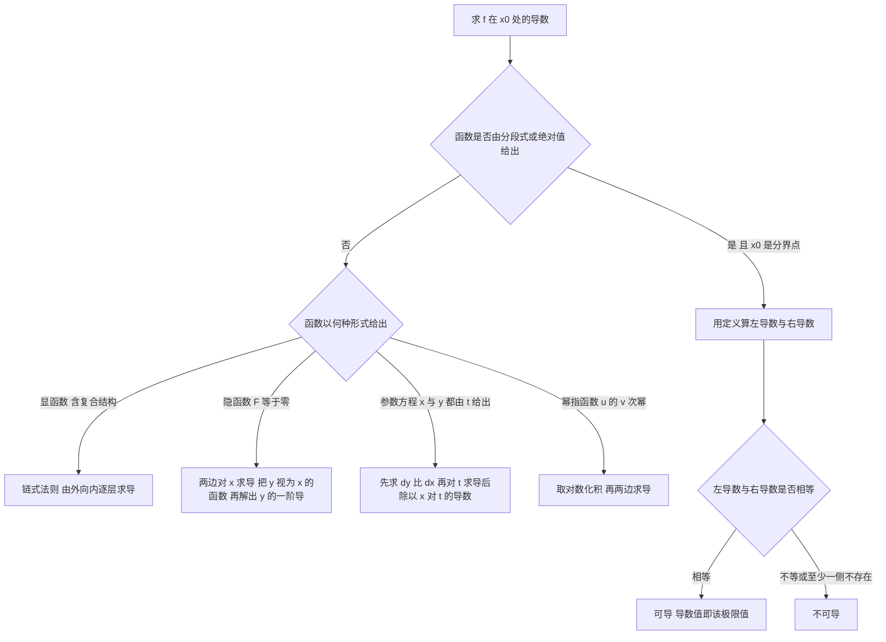

# 核心讲解

## 【导数的定义与可导性判定】

- **导数是差商的极限**，表示函数在该点的**瞬时变化率**。
- **几何意义**是曲线在点 $(x_0,f(x_0))$ 处**切线**的斜率。
- **可导必连续，连续不一定可导**，所以验证可导性只有**定义**与**公式**两条路。
- 能化为基本初等函数复合的，用**求导公式**直接算。
- 含**分段点、绝对值或最值符号**的，必须在分界点用**定义**算左右导数。
- 分段的求导公式只在各自的开区间内成立，分界点必须单独验证。

【核心公式】

$$ f'(x_0)=\lim_{\Delta x\to 0}\frac{f(x_0+\Delta x)-f(x_0)}{\Delta x} $$

$$ f'(x_0)\ \text{存在}\iff f'_-(x_0)=f'_+(x_0) $$

【适用条件】

1. $f$ 在 $x_0$ 的某邻域内**有定义**；
2. 左导数与右导数**都存在**；
3. 两者**相等**，这个公共值才是 $f'(x_0)$。

> ⚠️ **易错点**：把**连续**当成可导的充分条件。$|x|$ 在 $x=0$ 处连续，但左右导数分别为 $-1$ 与 $1$，故不可导。

## 【四类函数的求导法则】

- 求导前先**辨认函数形式**：四则运算、复合、隐函数、参数方程、幂指函数、反函数，形式决定方法。
- **复合结构**用链式法则，由外向内逐层求导，不要漏乘内层导数。
- **隐函数**把 $y$ 看作 $x$ 的函数，两边对 $x$ 求导后再解出 $y'$。
- **参数方程**先求一阶导，再对 $t$ 求导后**除以** $x'(t)$ 得二阶导。
- **幂指函数**先取对数化积，再两边求导，最后乘回原函数。
- **反函数**的导数与原函数的导数互为**倒数**，且自变量要换成对应的值。

| 函数形式 | 求导方法 | 适用条件 | 关键提醒 |
| --- | --- | --- | --- |
| **四则运算** | 和差积商的求导法则 | 各函数在该点**可导** | 商的法则要求分母**不为 0** |
| **复合函数** | 链式法则 | 内层与外层都**可导** | 由外向内逐层求导，不漏乘内层导数 |
| **隐函数** | 两边对 $x$ 求导 | $y$ 是 $x$ 的**可导**函数 | 求导后把 $y'$ 当作未知量解出 |
| **参数方程** | 参数求导公式 | $x'(t)$ **不为 0** | 二阶导要对 $t$ 求导后除以 $x'(t)$ |
| **幂指函数** | 对数求导法 | $u(x)>0$ 且 $u$ 与 $v$ 都**可导** | 先取对数化积，再两边求导 |
| **反函数** | 反函数求导公式 | 直接函数**单调可导**且导数**不为 0** | 导数互为倒数，求完别忘了换回自变量 |

【核心公式】

$$ \{f[\varphi(x)]\}'=f'[\varphi(x)]\varphi'(x) $$

$$ \frac{\mathrm{d}y}{\mathrm{d}x}=\frac{y'(t)}{x'(t)},\qquad \frac{\mathrm{d}^2y}{\mathrm{d}x^2}=\frac{x'(t)y''(t)-y'(t)x''(t)}{[x'(t)]^3} $$

$$ y=u(x)^{v(x)}\ \Longrightarrow\ y'=y\left(v'\ln u+v\frac{u'}{u}\right) $$

【适用条件】

1. 链式法则要求内层与外层都**可导**；
2. 隐函数求导要求 $y$ 是 $x$ 的**可导**函数；
3. 参数方程求导要求 $x'(t)$ **不为 0**；
4. 对数求导法要求 $u(x)>0$。

> ⚠️ **易错点**：把参数方程的二阶导写成 $\frac{y''(t)}{x''(t)}$。正确公式是 $\frac{\mathrm{d}^2y}{\mathrm{d}x^2}=\frac{x'y''-y'x''}{(x')^3}$，例如 $x=t^2$、$y=t^3$ 在 $t=1$ 处 $\frac{\mathrm{d}y}{\mathrm{d}x}=\frac32$、$\frac{\mathrm{d}^2y}{\mathrm{d}x^2}=\frac34$。

## 【高阶导数与莱布尼茨公式】

- 高阶导数只需记住几个**通项公式**与**莱布尼茨公式**。
- 乘积求高阶导用莱布尼茨公式，它与二项式展开的形式完全平行。
- 当乘积中**一个因子是多项式**时，求和自动只剩**有限几项**。
- 求高阶导之前常先做**部分分式分解**或有理化，把函数拆成便于逐阶求导的形式。
- $n$ 阶导的通项既可以用数学归纳法证明，也可以由逐阶求导观察规律得到。

【核心公式】

$$ (uv)^{(n)}=\sum_{k=0}^{n}C_n^k u^{(k)}v^{(n-k)} $$

$$ (\sin x)^{(n)}=\sin\left(x+\frac{n\pi}{2}\right),\qquad \left(\ln(1+x)\right)^{(n)}=\frac{(-1)^{n-1}(n-1)!}{(1+x)^n} $$

【适用条件】

1. $u$ 与 $v$ 都**具有 $n$ 阶导数**；
2. 其中一个因子为多项式时，它的高阶导**恒等于 0**，求和自动截断；
3. 组合数与求导次序无关，展开式两端分别只含 $u^{(n)}$ 与 $v^{(n)}$。

> ⚠️ **秒杀技**：乘积中见到多项式因子 $x^m$，只算到 $k=m$ 项即可 —— 更高阶导全为 $0$，能省掉大半计算量。

## 【微分与曲率】

- **微分**是函数增量的**线性主部**，一元函数中**可导与可微等价**。
- **曲率**刻画曲线的弯曲程度，**曲率半径**与曲率互为倒数。
- **曲率圆的圆心**在曲线**凹向一侧的法线**上，半径等于曲率半径。
- 竖直切线处 $y'$ 为无穷大，直接套曲率公式会失效，此时按**参数方程**计算。
- 求曲率前先确认曲线在该点**二阶可导**，否则改走参数方程路线。

【核心公式】

$$ \mathrm{d}y=f'(x)\,\mathrm{d}x $$

$$ K=\frac{|y''|}{(1+y'^2)^{3/2}},\qquad R=\frac1K $$

$$ y^2=x\ \text{在原点处}:\quad K=2,\qquad R=\frac12,\qquad \text{曲率圆为}\ x^2+y^2=x $$

【适用条件】

1. $f$ 在 $x$ 处**可导**，微分才存在；
2. 曲率公式要求 $y$ 具有**二阶导数**，且分母**不为 0**；
3. $y'$ 不存在或为无穷大时，必须改用**参数方程**形式的曲率公式。

> ⚠️ **易错点**：把**曲率**与**曲率半径**混用，或忘记分母是 $(1+y'^2)^{3/2}$。正确关系是 $R=\frac1K$；$y^2=x$ 在原点处 $K=2$、$R=\frac12$，圆心在凹向一侧的法线上，即 $\left(\frac12,0\right)$。

# 关键结论速记

- $(x^{\mu})'=\mu x^{\mu-1}$，$(e^x)'=e^x$，$(\ln x)'=\frac1x$ —— 最常用的基本导数，一切求导最终都归结到基本导数表。
- 参数方程：$\frac{dy}{dx}=\frac{y'(t)}{x'(t)}$，$\frac{d^2y}{dx^2}=\frac{x'y''-y'x''}{(x')^3}$ —— 二阶导必须再对 $t$ 求导后除以 $x'(t)$，不能上下分别求二阶导。
- $(uv)^{(n)}=\sum_{k=0}^{n}C_n^k u^{(k)}v^{(n-k)}$ —— 莱布尼茨公式，含多项式因子时只有前几项非零。
- $(\sin x)^{(n)}=\sin\left(x+\frac{n\pi}{2}\right)$，$(\ln(1+x))^{(n)}=\frac{(-1)^{n-1}(n-1)!}{(1+x)^n}$ —— 高阶导数通项，$n$ 阶导直接代入。
- 可导必连续，连续不一定可导 —— $|x|$ 在 $x=0$ 处连续但不可导，分界点必须单独验证。
- $dy=f'(x)dx$，一元函数可导与可微等价 —— 微分是函数增量的线性主部。
- $K=\frac{|y''|}{(1+y'^2)^{3/2}}$，$R=\frac1K$ —— 曲率与曲率半径，如 $y^2=x$ 在原点 $K=2$、$R=\frac12$，曲率圆为 $x^2+y^2=x$。

# 示意图

# 易错点

- **错在把连续当成可导的充分条件**。正确结论是可导必连续、连续不一定可导，例如 $|x|$ 在 $x=0$ 处连续但左右导数分别为 $-1$ 与 $1$，不可导。
- **错在分段函数在分界点处先分段求导再代入**。正确做法是分界点必须用定义算左右导数（或验证 $f'$ 在该点的左右极限与定义值是否一致），因为分段的求导公式只在各自的开区间内成立。
- **错在参数方程的二阶导写成 $\frac{y''(t)}{x''(t)}$**。正确公式是 $\frac{d^2y}{dx^2}=\frac{x'y''-y'x''}{(x')^3}$，例如 $x=t^2$、$y=t^3$ 在 $t=1$ 处 $\frac{dy}{dx}=\frac32$、$\frac{d^2y}{dx^2}=\frac34$。
- **错在曲率与曲率半径混用，或忘记分母是 $(1+y'^2)^{3/2}$**。正确关系是 $R=\frac1K$，如 $y^2=x$ 在原点 $K=2$、$R=\frac12$，圆心在凹向一侧的法线上，即 $\left(\frac12,0\right)$。

# 真题示例

**2024 年数二第 14 题（填空题，5 分）**

已知函数 $f(x)=(e^x+1)x^2$，则 $f^{(5)}(1)=$ ______。

> 解析：
>
> $x^2$ 的三阶及以上导数恒为零，故 $f^{(5)}(x)=(x^2e^x)^{(5)}+0$。
>
> 对 $u=x^2$、$v=e^x$ 用莱布尼茨公式，利用 $v^{(k)}=e^x$ 得
>
> $$(x^2e^x)^{(5)}=C_5^0x^2e^x+C_5^1\cdot 2x\cdot e^x+C_5^2\cdot 2\cdot e^x=e^x(x^2+10x+20)$$
>
> $x^2$ 的三阶导为零使 $k\ge 3$ 的项全部消失。
>
> 代入 $x=1$ 得 $f^{(5)}(1)=31e$。
