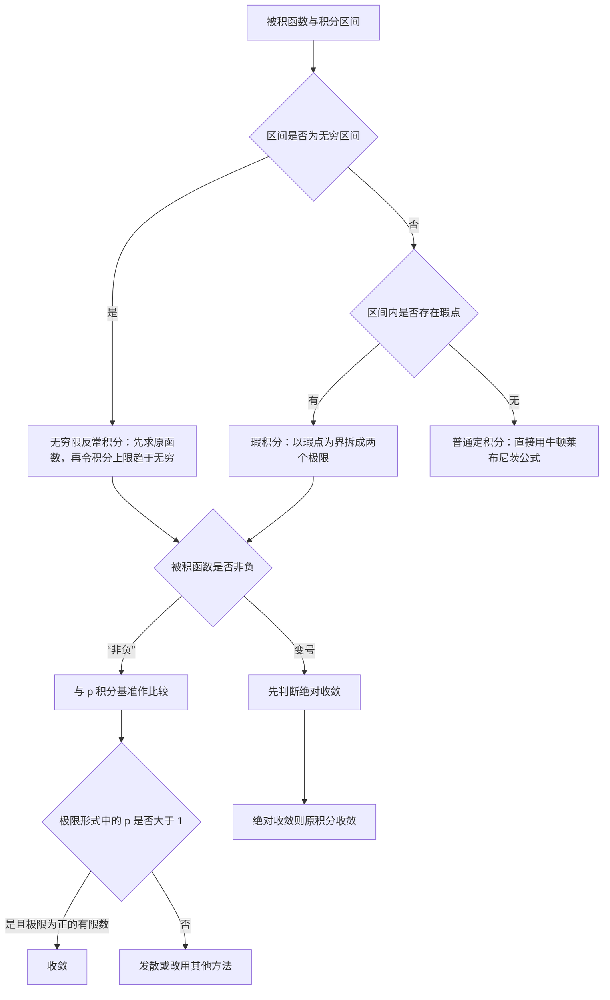

# 核心讲解

## 【定积分的定义与可积条件】

- **本质**：定积分是一个**确定的数**，只与 $f$ 和区间 $[a,b]$ 有关，与积分变量用什么字母无关。
- **可积的必要条件**：$f(x)$ 在 $[a,b]$ 上**有界**。
- **可积的充分条件**：$f(x)$ 在 $[a,b]$ 上**连续**；或 $f(x)$ 在 $[a,b]$ 上**有界且只有有限个间断点**。
- **几何意义**：$f(x)\geqslant 0$ 时等于曲边梯形面积；$f$ 变号时是面积的**代数和**。

【核心公式】

$$ \int_a^b f(x)\,\mathrm{d}x=\lim_{\lambda\to 0}\sum_{i=1}^{n}f(\xi_i)\Delta x_i $$

其中 $\lambda$ 是所有子区间的**最大长度**（不是个数）。

$$ \left|\int_a^b f(x)\,\mathrm{d}x\right|\leqslant\int_a^b|f(x)|\,\mathrm{d}x $$

> ⚠️ **易错点**：$\lambda\to 0$ 不能写成 $n\to\infty$。分割再细，只要有一个子区间长度不趋于 $0$，黎曼和就不保证收敛。

## 【变限积分与牛顿-莱布尼茨公式】

**变限积分** $\Phi(x)=\int_a^xf(t)\,\mathrm{d}t$ 在 $f$ **连续**时可导，且 $\Phi'(x)=f(x)$。

【核心公式】

$$ \frac{\mathrm{d}}{\mathrm{d}x}\int_{\alpha(x)}^{\beta(x)}f(t)\,\mathrm{d}t=f\bigl(\beta(x)\bigr)\beta'(x)-f\bigl(\alpha(x)\bigr)\alpha'(x) $$

【适用条件】

1. $f$ **连续**；
2. $\alpha(x)$ 与 $\beta(x)$ 都**可导**；
3. 下限为常数时，第二项为 $0$。

**牛顿-莱布尼茨公式**：

$$ \int_a^bf(x)\,\mathrm{d}x=F(b)-F(a) $$

【适用条件】$f(x)$ 在 $[a,b]$ 上**连续**，且 $F'(x)=f(x)$ 在 $[a,b]$ 上**处处成立**。

> ⚠️ **易错点**：区间含**瑕点**或为**无穷区间**时不能直接代端点，必须先按定义取极限。用牛顿-莱布尼茨硬算一个发散的反常积分，会得到一个看似正确的错误答案。

## 【定积分中值定理】

【适用条件】$f(x)$ 在**闭区间** $[a,b]$ 上**连续**。

$$ \int_a^bf(x)\,\mathrm{d}x=f(\xi)(b-a),\qquad \xi\in[a,b] $$

**推广形式**：$f$ 在 $[a,b]$ 上连续、$g$ 在 $[a,b]$ 上可积且**不变号**（恒 $\geqslant 0$ 或恒 $\leqslant 0$），则

$$ \int_a^bf(x)g(x)\,\mathrm{d}x=f(\xi)\int_a^bg(x)\,\mathrm{d}x $$

> ⚠️ **易错点**：$g$ **不变号**这一条最容易漏。若 $g$ 变号，结论不成立。

## 【对称性与周期性】

- **偶函数**（$f$ 在对称区间上可积）：$\displaystyle\int_{-a}^{a}f(x)\,\mathrm{d}x=2\int_0^{a}f(x)\,\mathrm{d}x$
- **奇函数**：$\displaystyle\int_{-a}^{a}f(x)\,\mathrm{d}x=0$
- **周期函数**（以 $T$ 为周期且可积）：$\displaystyle\int_a^{a+T}f(x)\,\mathrm{d}x=\int_0^{T}f(x)\,\mathrm{d}x$

> ⚠️ **秒杀技**：先看奇偶性再算积分。对称区间上的奇函数直接写 $0$，比硬算省一半时间——但**必须**先确认区间关于原点对称。

## 【反常积分：两类与敛散性】

做题时**必须先把区间内的无穷限与瑕点全部找出，再逐个讨论**。

| 类型 | 定义式 | 收敛判据 | 常见错误 |
| --- | --- | --- | --- |
| **无穷限积分** | $\displaystyle\int_a^{+\infty}f\,\mathrm{d}x=\lim_{b\to+\infty}\int_a^{b}f\,\mathrm{d}x$ | 极限存在则收敛 | 忘记取极限，直接代 $+\infty$ |
| **瑕积分**（$b$ 为瑕点） | $\displaystyle\int_a^{b}f\,\mathrm{d}x=\lim_{\varepsilon\to0^+}\int_a^{b-\varepsilon}f\,\mathrm{d}x$ | 极限存在则收敛 | 没先找瑕点就用牛顿-莱布尼茨 |
| **$p$ 积分（无穷限）** | $\displaystyle\int_1^{+\infty}\frac{\mathrm{d}x}{x^{p}}$ | $p>1$ 收敛，值为 $\dfrac{1}{p-1}$ | 记成 $p<1$ |
| **$p$ 积分（瑕点）** | $\displaystyle\int_0^{1}\frac{\mathrm{d}x}{x^{p}}$ | $p<1$ 收敛，值为 $\dfrac{1}{1-p}$ | 与无穷限的方向记反 |

> ⚠️ **易错点**：两个 $p$ 积分的方向**正好相反**——无穷限要 $p>1$，瑕点要 $p<1$。这是最容易被记反的一对结论。

**比较判别法**：设 $f,g$ 在 $[a,+\infty)$ 上连续且 $0\leqslant f(x)\leqslant g(x)$。

1. $\int_a^{+\infty}g$ 收敛 $\Rightarrow$ $\int_a^{+\infty}f$ 收敛；
2. $\int_a^{+\infty}f$ 发散 $\Rightarrow$ $\int_a^{+\infty}g$ 发散。

**极限形式**：$\lim_{x\to+\infty}x^{p}f(x)=\lambda$ 时

- $0<\lambda<+\infty$：与 $\int_1^{+\infty}\frac{\mathrm{d}x}{x^{p}}$ **同敛散**；
- $\lambda=0$：还需 $p>1$ 才收敛；
- $\lambda=+\infty$：$p\leqslant 1$ 时发散。

**变号函数**：用 $\int_a^{+\infty}|f(x)|\,\mathrm{d}x$ 收敛推出 $\int_a^{+\infty}f(x)\,\mathrm{d}x$ 收敛。

**对照实例**（记数值比记符号更牢）：

$$ \int_1^{+\infty}\frac{\mathrm{d}x}{x^2}=1,\qquad \int_0^1\frac{\mathrm{d}x}{\sqrt{x}}=2,\qquad \int_1^{10}\frac{\mathrm{d}x}{x}=\ln 10\approx 2.303\ (\text{上限增大仍无界}) $$

> ⚠️ **秒杀技**：判断敛散先找**主导阶**。把被积函数在瑕点或无穷远处等价成 $x^{-p}$，直接套 $p$ 积分结论，不必列比较判别法的完整不等式。

# 关键结论速记

- $\int_1^{+\infty}\frac{\mathrm{d}x}{x^p}$ 收敛当且仅当 $p>1$，值为 $\frac1{p-1}$ —— 无穷限情形的比较基准。
- $\int_0^1\frac{\mathrm{d}x}{x^p}$ 收敛当且仅当 $p<1$，值为 $\frac1{1-p}$ —— 瑕点在端点时的比较基准，与上式条件相反。
- $\int_2^{+\infty}\frac{\mathrm{d}x}{x(\ln x)^p}$ 收敛当且仅当 $p>1$ —— 出现对数因子时的基准，如 $\int_2^{+\infty}\frac{\mathrm{d}x}{x(\ln x)^2}=\frac1{\ln2}\approx1.443$。
- $0\leqslant f\leqslant g$ 时，大收敛推小收敛、小发散推大发散 —— 比较判别法只能朝这两个方向用。
- $\lim_{x\to+\infty}x^pf(x)=\lambda$：$0<\lambda<+\infty$ 时与 $\int_1^{+\infty}x^{-p}\mathrm{d}x$ 同敛散 —— 极限形式；$\lambda=0$ 时还必须 $p>1$ 才收敛。
- $\left(\int_a^xf(t)\,\mathrm{d}t\right)'=f(x)$（$f$ 连续） —— 变限积分把积分与求导接通，是处理“积分上限函数”的钥匙。
- $\int_a^bf(x)\,\mathrm{d}x=f(\xi)(b-a)$（$f$ 在 $[a,b]$ 上连续） —— 中值定理把积分换成“函数值乘区间长”，证明题常用。
- 偶函数在对称区间上积分为 $2\int_0^af$，奇函数积分为 $0$ —— 前提是 $f$ 在 $[-a,a]$ 上可积，先化简再计算。

# 示意图

# 易错点

- 把两个 $p$ 积分的条件记混。 错在认为“$p$ 大就收敛”：无穷远处要 $p>1$ 才收敛，而瑕点处要 $p<1$ 才收敛（$x\to0^+$ 时 $\frac1{x^p}$ 增长得更慢才可积），例如 $\int_1^{+\infty}\frac{\mathrm{d}x}{x^{0.5}}$ 发散而 $\int_0^1\frac{\mathrm{d}x}{x^{0.5}}=2$ 收敛。
- 对含瑕点的积分直接用牛顿-莱布尼茨公式。 错在把 $\int_{-1}^1\frac{\mathrm{d}x}{x^2}$ 算成 $\left[-\frac1x\right]{-1}^{1}=-2$：$x=0$ 是瑕点，必须拆成 $\int{-1}^0$ 与 $\int_0^1$ 两个极限，二者都发散，所以原积分发散，绝不能代端点相减。
- 用比较判别法时漏掉“非负”或“区间上处处成立”的条件。 正确用法是：只对 $f(x)\geqslant0$ 的积分作比较，不等式 $f\leqslant g$ 要在 $[a,+\infty)$（或某个 $[X,+\infty)$）上成立；变号函数先看 $\int|f|$，绝对收敛才能断言原积分收敛。
- 用定积分中值定理时不写全条件。 错在直接对含变号的 $g$ 使用 $\int fg=f(\xi)\int g$：推广形式要求 $f$ 在 $[a,b]$ 上连续、$g$ 在 $[a,b]$ 上可积且不变号，少一个条件结论就可能不成立。

# 真题示例

**2024 年数二第 7 题（选择题，5 分）**

设非负函数 $f(x)$ 在 $[0,+\infty)$ 上连续，给定以下三个命题：

（1）若 $\int_0^{+\infty}f^2(x)\,\mathrm{d}x$ 收敛，则 $\int_0^{+\infty}f(x)\,\mathrm{d}x$ 收敛；

（2）若存在 $p>1$，使极限 $\lim_{x\to+\infty}x^pf(x)$ 存在，则 $\int_0^{+\infty}f(x)\,\mathrm{d}x$ 收敛；

（3）若 $\int_0^{+\infty}f(x)\,\mathrm{d}x$ 收敛，则存在 $p>1$，使极限 $\lim_{x\to+\infty}x^pf(x)$ 存在。

其中正确的个数为（　）

A. 0　　B. 1　　C. 2　　D. 3

> 解析：
>
> 1. 命题（1）错：取 $f(x)=\frac{1}{x+1}$（在 $[0,+\infty)$ 上非负连续），则
>
> $$\int_0^{+\infty}f^2(x)\,\mathrm{d}x=\int_0^{+\infty}\frac{\mathrm{d}x}{(x+1)^2}=1$$
>
> 收敛，但
>
> $$\int_0^{+\infty}\frac{\mathrm{d}x}{x+1}$$
>
> 发散，可见 $f^2$ 收敛推不出 $f$ 收敛。
>
> 2. 命题（2）对：设 $\lim_{x\to+\infty}x^pf(x)=\lambda$ 存在且 $p>1$。
>
> 若 $\lambda>0$，则 $f(x)\sim\frac{\lambda}{x^p}$，由极限形式比较判别法（$p>1$）知积分收敛；
>
> 若 $\lambda=0$，则存在 $X>0$，
>
> 当 $x>X$ 时 $x^pf(x)<1$，即
>
> $$0\leqslant f(x)<\frac1{x^p}$$
>
> 由比较判别法知积分收敛。
>
> 3. 命题（3）错：收敛推不出 $x^pf(x)$ 存在极限。
>
> 反例：令 $f$ 在每个区间 $[n,n+n^{-3}]$（$n=1,2,\cdots$）
>
> 上取值为 $1$（端点光滑过渡），其余点取 $e^{-x}$，则
>
> $$\int_0^{+\infty}f(x)\,\mathrm{d}x\leqslant1+\sum_{n=1}^{\infty}\frac1{n^3}=1+\zeta(3)\approx2.202$$
>
> 收敛，而 $x^pf(x)$ 沿 $x=n$ 趋于 $+\infty$、
>
> 沿 $x=n+\frac12$ 趋于 $0$，极限不存在。
>
> 结论：三个命题中只有（2）正确，正确的个数为 $1$，选 B。
