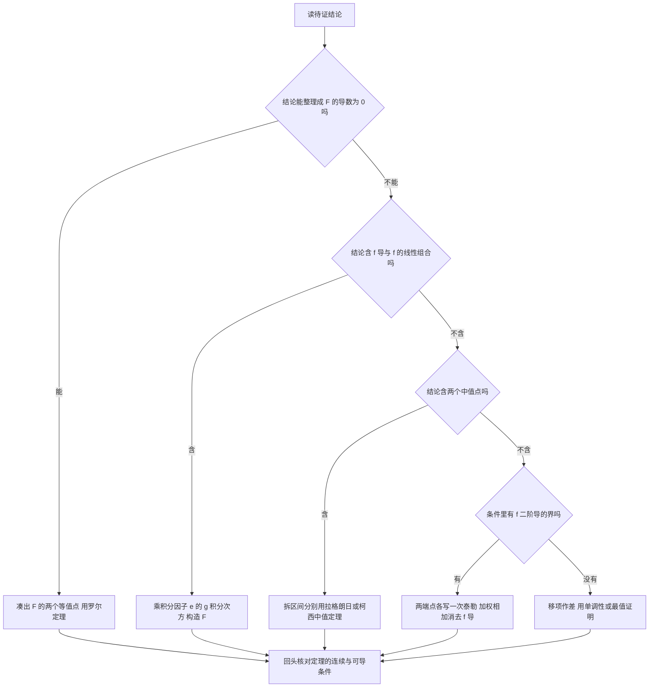

# 核心讲解

## 【综合题的三步框架】

- **第一步 逐句翻译**：把几何语言（切线、截距、面积、旋转体）换成含 $y'$ 或变限积分的等式，把"某点处取得最值"换成 $f'=0$。
- **第二步 定工具**：见到变限积分就求导，见到数列极限就用单调有界准则或夹逼准则，见到被积函数含 $x^2+y^2$ 就换极坐标，见到证明题就找中值定理。
- **第三步 回头验条件**：把用到的定理前提（**连续**、**可导**、$F_z\neq0$、区间开闭）逐条对照。
- **两段式结构**：数二的跨章综合题基本是"先由题给条件求出某个函数，再拿这个函数去算极限、极值、面积或积分"。
- **求函数的手段**：解微分方程、由变限积分求导、由几何条件列式。
- **失分位置**：综合题的失分多数不在计算，而在第二步选错工具或第三步漏验条件。

【核心公式】

$$ \text{题给条件}\ \Longrightarrow\ y=y(x)\ \text{或}\ F(x)\ \Longrightarrow\ \lim,\ \text{极值},\ \int_a^bf\,\mathrm{d}x $$

【适用条件】

1. 每一步翻译都必须可逆，题面中的量要与式子中的量一一对应；
2. 用中值定理前逐条核对**连续**与**可导**的区间要求；
3. 隐函数相关结论要求 $F_z\neq0$，变限积分求导要求被积函数**连续**；
4. 最后一步必须把结论代回原题的几何或物理背景检验量纲与符号。

> ⚠️ **秒杀技**：拿到综合题先问一句"题目要我求的那个函数从哪来"——条件里给什么就翻译什么，函数一旦求出，后面的极限、极值、面积都是常规题。

## 【中值定理与辅助函数构造】

- **总原则**：把待证结论整理成"某个函数在 $\xi$ 处导数为 $0$"，再对这个函数用罗尔定理。
- **待证式形如** $f'(\xi)+g(\xi)f(\xi)=0$ 时，取辅助函数 $F(x)=e^{\int g(x)\,dx}f(x)$。
- **等价性**：由于指数因子恒正，$F'(\xi)=0$ 与待证式完全等价。
- **思想来源**：这就是"把一阶线性方程 $f'+gf=0$ 的积分因子乘上去"的想法。
- **含 $\xi$ 因子**：结论中出现 $f(\xi)$ 与 $f'(\xi)$ 之外还要出现 $\xi$ 本身时，先把含 $\xi$ 的因子并进 $g(\xi)$ 或并进 $\frac{1}{\varphi'(\xi)}$（柯西中值定理的分母），不要硬套罗尔定理。

【核心公式】

$$ F(x)=e^{\int g(x)\,dx}f(x),\qquad F'(x)=e^{\int g(x)\,dx}\left[f'(x)+g(x)f(x)\right] $$

**常用辅助函数对照**（按待证结论的形状直接取用）：

| 待证结论的形状 | 取的辅助函数 $F(x)$ | 对应的积分因子 |
| --- | --- | --- |
| $f'+f=0$ | $e^{x}f(x)$ | $e^{\int 1\,dx}=e^{x}$ |
| $f'-f=0$ | $e^{-x}f(x)$ | $e^{\int(-1)\,dx}=e^{-x}$ |
| $f'+\frac{1}{x}f=0$ | $xf(x)$ | $e^{\int\frac{1}{x}dx}=x$ |
| $f'-\frac{1}{x}f=0$ | $\frac{f(x)}{x}$ | $e^{\int\left(-\frac{1}{x}\right)dx}=\frac{1}{x}$ |
| $f'+\xi f=0$ | $e^{\frac{x^2}{2}}f(x)$ | $e^{\int x\,dx}=e^{\frac{x^2}{2}}$ |

【适用条件】

1. 辅助函数必须在 $[a,b]$ 上**连续**、在 $(a,b)$ 内**可导**；
2. 指数因子恒正，不改变零点位置，但少了它推不出结论；
3. 使用罗尔定理前必须先凑出 $F(a)=F(b)$ 两个等值点；
4. 结论里多出的因子要靠 $g(\xi)$ 或柯西中值定理的分母吸收，凑形在先、选定理在后。

> ⚠️ **易错点**：构造辅助函数时漏掉积分因子 $e^{\int g\,dx}$。结论含 $f'(\xi)+g(\xi)f(\xi)=0$ 时直接取 $F=f$ 得不到要证的形式，必须乘上这个恒正的指数因子。

## 【中值定理的选择与多中值点处理】

- **罗尔定理**：结论能整理成"某函数在两个等值点处函数值相等"时用，得到 $f'(\xi)=0$。
- **拉格朗日中值定理**：结论含函数差 $f(b)-f(a)$、$b-a$ 或 $|f(x)-f(y)|$ 时用。
- **柯西中值定理**：结论里带 $\xi^2$、$b-a$、$e^{\xi}$ 这类因子时，把待证式整理成 $\frac{f(b)-f(a)}{g(b)-g(a)}=\frac{f'(\xi)}{g'(\xi)}$ 的形状，取 $g(x)=x^2$、$e^x$ 等作分母函数。
- **泰勒公式**：条件里出现 $|f''(x)|\le M$ 这类整体界时用。
- **两个中值点**：把 $[a,b]$ 分成两段，在每段上分别用拉格朗日（或罗尔）中值定理，得到两个互不相同的中值点。
- **凑形原则**：让分母函数的导数正好是结论里多出来的那个因子。

【核心公式】

$$ f(b)-f(a)=f'(\xi)(b-a),\qquad \frac{f(b)-f(a)}{g(b)-g(a)}=\frac{f'(\xi)}{g'(\xi)} $$

| 待证结论的形状 | 选择定理 | 核心式子 | 辅助函数或关键动作 |
| --- | --- | --- | --- |
| 结论可整理成某函数在两点取值相等 | **罗尔定理** | $f'(\xi)=0$ | 先凑 $F(a)=F(b)$，常取 $F(x)=f(x)-f(a)-\frac{f(b)-f(a)}{b-a}(x-a)$ |
| 含 $f(b)-f(a)$、$b-a$ 或 $\lvert f(x)-f(y)\rvert$ | **拉格朗日** | $f(b)-f(a)=f'(\xi)(b-a)$ | 无需另造辅助函数，直接对 $f$ 用 |
| 含 $\xi^2$、$e^{\xi}$ 等多余因子 | **柯西** | $\frac{f(b)-f(a)}{g(b)-g(a)}=\frac{f'(\xi)}{g'(\xi)}$ | 取 $g(x)=x^2$、$e^x$，让 $g'(\xi)$ 正好是那个因子 |
| 含两个中值点 | **拆区间 + 拉格朗日或罗尔** | 两段各用一次 | 把 $[a,b]$ 分成两段，得到两个互不相同的 $\xi$ |
| 条件含 $\lvert f''(x)\rvert\le M$ 或 $f'(0)=f'(1)$ | **泰勒公式** | 展开到二阶并加余项 | 两个端点各写一次展开，再用 $(1-x)$ 与 $x$ 加权相加，让含未知 $f'$ 的项自动抵消 |

【适用条件】

1. 罗尔定理要求**闭区间连续**、**开区间可导**、两端点函数值相等，三条缺一不可；
2. 拉格朗日与柯西中值定理要求**闭区间连续**、**开区间可导**，柯西还要求 $g'(x)$ **不为 0**；
3. 用柯西时分子分母必须是**同一个** $\xi$，不能拆成两个不同的中值点；
4. 拆区间时要在每段上分别核对定理条件，两段的分界点处只要求连续；
5. 泰勒展开点选在端点或区间中点，并写明余项中的 $\eta$ 落在哪两个数之间。

> ⚠️ **易错点**：把中值定理保证的 $\xi$ 的取值范围写宽或写窄。微分中值定理保证 $\xi$ 在**开区间** $(a,b)$ 内，而积分中值定理给的是**闭区间** $[a,b]$；后续放缩常常依赖这个范围，写错就得不到正确的界。

## 【不等式证明：四条通道】

- **通道一 移项作差**：令 $F(x)$ 等于左减右，求导判 $F$ 的单调性。
- **通道二 求最值**：求 $F$ 在区间上的最小值并证明最小值非负。
- **通道三 拉格朗日放大**：由拉格朗日中值定理得 $|f(x)-f(y)|=|f'(\xi)||x-y|$，再用 $|f'|\le M$ 放大，专门处理含绝对值的差式。
- **通道四 泰勒公式**：用带拉格朗日余项的泰勒公式，适合条件里带二阶导界的情形。
- **含定积分的不等式**：先用积分中值定理，或把被积函数逐点放大成常数，再用 $\int_a^b x(1-x)\,dx$ 这类可直接算出的积分收尾。
- **选通道的依据**：看题给条件是单调性、最值、一阶导的界还是二阶导的界。

【核心公式】

$$ |f(x)-f(y)|=|f'(\xi)||x-y|\le M|x-y|,\qquad f(x)=f(x_0)+f'(x_0)(x-x_0)+\frac{f''(\eta)}{2}(x-x_0)^2 $$

【适用条件】

1. 移项作差与最值法要求 $F$ 在区间上**连续**、在区间内**可导**；
2. 通道三要求 $f$ 在**闭区间连续**、**开区间可导**，且 $|f'|\le M$ 在区间上成立；
3. 通道四要求 $f$ 具有**二阶导数**，并写明余项中 $\eta$ 的取值范围；
4. 含定积分的不等式要求被积函数**连续**才能用积分中值定理。

> ⚠️ **秒杀技**：见到 $|f''(x)|\le M$、$f'(0)=f'(1)$ 这类整体界或对称条件，标准做法是在两个端点各写一次带拉格朗日余项的泰勒展开，再用 $(1-x)$ 与 $x$ 加权相加，含未知 $f'$ 的项自动抵消，剩下的项直接用界放大即可。

# 关键结论速记

- `罗尔定理` —— 条件为闭区间连续、开区间可导、两端点函数值相等，结论是存在 $\xi\in(a,b)$ 使 $f'(\xi)=0$；三个条件缺一不可，端点相等常常要靠辅助函数自己凑。
- `拉格朗日中值定理` —— $f(b)-f(a)=f'(\xi)(b-a)$，$\xi\in(a,b)$。它是"把函数差换成导数"的桥梁，证明不等式时最常用。
- `柯西中值定理` —— $\frac{f(b)-f(a)}{g(b)-g(a)}=\frac{f'(\xi)}{g'(\xi)}$；结论里出现 $\xi^2$、$e^{\xi}$ 等因子时选它。
- `辅助函数（核心套路）` —— 结论为 $f'(\xi)+g(\xi)f(\xi)=0$ 时取 $F(x)=e^{\int g(x)dx}f(x)$，因为 $F'=e^{\int g}(f'+gf)$，指数因子恒正，故零点等价。
- `二阶泰勒公式` —— $f(x)=f(x_0)+f'(x_0)(x-x_0)+\frac{f''(\eta)}{2}(x-x_0)^2$，带拉格朗日余项；证明 $|f''|\le M$ 型不等式的主力。
- `积分中值定理` —— $\int_a^bf(x)\,dx=f(\xi)(b-a)$，要求 $f$ 在 $[a,b]$ 上连续，$\xi\in[a,b]$。
- `单调有界准则` —— 判定数列极限存在：先用数学归纳法或作差证明单调，再证明有界；两者都证到才能断言极限存在。

# 示意图

图 1 是拉格朗日中值定理的几何示意，取 $f(x)=x^3-3x+1$、区间 $[0,2]$：两端点为 $(0,1)$ 与 $(2,3)$，弦是直线 $y=x+1$，弦的斜率为 $1$；令 $f'(x)=3x^2-3=1$ 解得 $[0,2]$ 内的中值点 $\xi=\frac{2\sqrt{3}}{3}\approx1.1547$，对应切点 $\left(\frac{2\sqrt{3}}{3},\ 1-\frac{10\sqrt{3}}{9}\right)\approx(1.1547,-0.9245)$，该点处的切线 $y=x+1-\frac{16\sqrt{3}}{9}$ 与弦平行。

图 2 是证明题的辅助函数选择与定理匹配流程。

# 易错点

- **错在硬套罗尔定理而不检查端点条件。** 罗尔定理要求 $f(a)=f(b)$，而题给条件往往不是这个（例如只给了 $f(b)-f(a)$）。正确做法是先构造辅助函数把端点值拉平，例如令 $F(x)=f(x)-f(a)-\frac{f(b)-f(a)}{b-a}(x-a)$，此时 $F(a)=F(b)=0$，再对 $F$ 用罗尔定理。
- **错在构造辅助函数时漏掉指数因子。** 结论含 $f'(\xi)+g(\xi)f(\xi)=0$ 时必须乘 $e^{\int g\,dx}$，直接取 $F=f$ 得不到要证的形式；这个因子恒正，不改变零点位置，但少了它就推不出结论。
- **错在用泰勒公式时展开点与余项写法不匹配。** 已知 $|f''(x)|\le M$ 时应在端点或区间中点展开，并明确写出余项中的 $\eta$ 落在哪两个数之间；余项项数写错、或把 $\eta$ 当成与 $x$ 无关的常数，都会导致放缩失效。
- **错在把 $\xi$ 的取值范围写宽或写窄。** 中值定理保证的 $\xi$ 在**开区间** $(a,b)$ 内（积分中值定理给的是闭区间 $[a,b]$）；后续放缩常常依赖这个范围，写错就得不到正确的界。

# 真题示例

**2024 年数二第 21 题（解答题，12 分）**

设函数 $f(x)$ 具有 2 阶导数，$f'(0)=f'(1)$，$|f''(x)|\le 1$。

（1）当 $x\in(0,1)$ 时，$\left|f(x)-f(0)(1-x)-f(1)x\right|\le\dfrac{x(1-x)}{2}$；

（2）$\left|\displaystyle\int_0^1 f(x)\,dx-\dfrac{f(0)+f(1)}{2}\right|\le\dfrac{1}{12}$。

> 解析：
>
> 1. 在左端点写带拉格朗日余项的泰勒公式：$f(x)=f(0)+f'(0)x+\frac{f''(\xi_1)}{2}x^2$，其中 $\xi_1$ 介于 $0$ 与 $x$ 之间；在右端点再写一次：$f(x)=f(1)+f'(1)(x-1)+\frac{f''(\xi_2)}{2}(x-1)^2$。
> 2. 把第一式乘 $(1-x)$、第二式乘 $x$ 后相加，左端得 $(1-x)f(x)+xf(x)=f(x)$；一阶项之和为 $f'(0)(1-x)x+f'(1)x(x-1)$，由 $f'(0)=f'(1)$ 知它等于 $f'(0)\left[x(1-x)+x(x-1)\right]=0$，于是 $\displaystyle f(x)=f(0)(1-x)+f(1)x+\frac{(1-x)x^2}{2}f''(\xi_1)+\frac{x(1-x)^2}{2}f''(\xi_2)$。
> 3. 取绝对值并用 $|f''(x)|\le1$ 放大：$\left|f(x)-f(0)(1-x)-f(1)x\right|\le\frac{(1-x)x^2+x(1-x)^2}{2}=\frac{x(1-x)\left[(1-x)+x\right]}{2}=\frac{x(1-x)}{2}$，第（1）问得证。
> 4. 对第（1）问的结论在 $[0,1]$ 上积分，注意 $\int_0^1\left[f(0)(1-x)+f(1)x\right]dx=\frac{f(0)+f(1)}{2}$，于是 $\left|\int_0^1f(x)\,dx-\frac{f(0)+f(1)}{2}\right|=\left|\int_0^1\left[f(x)-f(0)(1-x)-f(1)x\right]dx\right|\le\int_0^1\frac{x(1-x)}{2}\,dx=\frac{1}{12}$，第（2）问得证。
