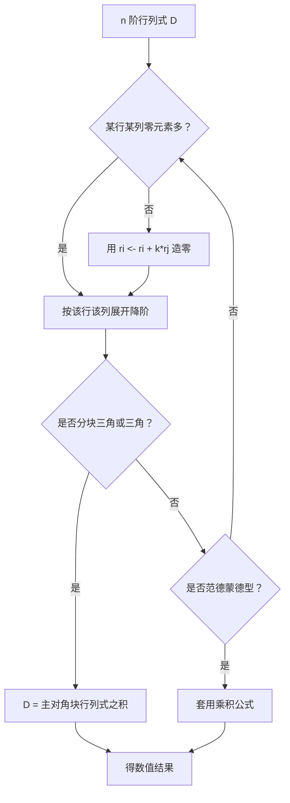

# 核心讲解

## 【行列式定义与性质】

- **本质**：$n$ 阶行列式是 $n!$ 项的代数和，每一项都从不同行不同列各取一个元素相乘。
- **通项符号**：由列指标的逆序数决定，记作 $\varepsilon(j_1j_2\cdots j_n)$（偶排列取 $+$，奇排列取 $-$）。
- **转置不变**：$|A^{T}|=|A|$，所以凡对「行」成立的性质对「列」同样成立。
- **换行变号**：交换两行（列），行列式只改变符号。
- **提公因子**：某行（列）有公因子 $k$ 时，$k$ 可提到行列式外。
- **倍加不变**：把某行（列）的 $k$ 倍加到另一行（列），行列式的值不变。
- **成比例为零**：两行（列）相同或成比例时，行列式等于 $0$。

【核心公式】

$$ |A^{T}|=|A|,\qquad |kA|=k^{n}|A|,\qquad |AB|=|A|\cdot|B| $$

**三类行变换对行列式值的影响**（对列同样成立）：

| 行变换 | 记号 | 对 $D$ 的影响 | 典型用途 |
| --- | --- | --- | --- |
| **互换**两行 | $r_i\leftrightarrow r_j$ | 变号，$D\to -D$ | 把主元换到非零位置 |
| 某行 **倍乘** $k$ | $r_i\to kr_i$ | 变成 $kD$，须在式外除以 $k$ | 把主元化为 $1$ |
| 某行 **倍加** | $r_i\to r_i+kr_j$ | **值不变** | 造零，最常用且无副作用 |
| **拆行** | 两行之和拆成两个行列式 | 分成两个行列式之和 | 处理元素为和式的情形 |
| 两行 **成比例** | —— | 直接得 $D=0$ | 一眼判零 |

【适用条件】

1. $|kA|=k^{n}|A|$ 只对 **$n$ 阶方阵** 成立，$k$ 要取 $n$ 次幂；
2. $|AB|=|A|\cdot|B|$ 要求 $A$、$B$ 是 **同阶方阵**，乘法可交换在数值上成立；
3. 造零只能使用 **倍加** 变换，一旦用了换行或提公因子，必须把符号或倍数记在式外。

> ⚠️ **秒杀技**：化三角形之前先观察——若某行（列）已有大量零元，直接按该行（列）展开降阶；若每行都有公共结构，先用倍加造出整行（列）为零，立刻判定 $D=0$，不必算到底。

## 【按行列展开】

- **余子式**：$M_{ij}$ 是划去第 $i$ 行第 $j$ 列后留下的 $n-1$ 阶行列式。
- **代数余子式**：$A_{ij}=(-1)^{i+j}M_{ij}$，符号由位置 $(i,j)$ 的奇偶决定。
- **展开定理**：$D$ 等于任一行（列）各元素与自己的代数余子式之积的和。
- **异行错配为零**：某行元素乘 **另一行** 的代数余子式，求和恒为 $0$。
- **造零优先**：展开前先用性质把选定的行（列）化出尽可能多的零，是唯一值得练熟的固定手法。

【核心公式】

$$ D=\sum_{j=1}^{n}a_{ij}A_{ij}=a_{i1}A_{i1}+a_{i2}A_{i2}+\cdots+a_{in}A_{in} $$

异行错配为零的结论写成一行是：

$$ \sum_{j=1}^{n}a_{kj}A_{ij}=0\quad(k\neq i) $$

【适用条件】

1. 行列式必须是 **$n$ 阶方阵** 对应的行列式；
2. 按第 $i$ 行展开时，只有 **第 $i$ 行** 的元素参与相乘；
3. 乘的却是其他行元素构成的余子式——这一步是符号与行列下标最容易错的地方。

> ⚠️ **易错点**：漏掉 $(-1)^{i+j}$ 是最高频的失分点。$M_{ij}$ 与 $A_{ij}$ 只差一个符号，务必先写符号棋盘再代数值。

## 【特殊行列式】

- **分块三角**：主对角块为 $A$（$m$ 阶）、$B$（$n$ 阶）时行列式为两块之积，与副对角块 $C$ 无关。
- **范德蒙德**：列向量是同一组数的幂次 $1,x,x^{2},\dots,x^{n-1}$ 时直接套乘积公式。
- **上（下）三角**：等于主对角线元素之连乘。
- **伴随矩阵行列式**：$|A^{*}|=|A|^{n-1}$，由 $AA^{*}=|A|E$ 两端取行列式即得。
- **伴随矩阵母公式**：$AA^{*}=A^{*}A=|A|E$，取逆公式 $A^{-1}=\frac{1}{|A|}A^{*}$ 只是它的推论。

【核心公式】

$$ \begin{vmatrix} A & C \\ O & B \end{vmatrix}=|A|\cdot|B|,\qquad \begin{vmatrix} A & O \\ C & B \end{vmatrix}=|A|\cdot|B| $$

$$ V=\begin{vmatrix}1&1&\cdots&1\\ x_1&x_2&\cdots&x_n\\ \vdots&\vdots&&\vdots\\ x_1^{n-1}&x_2^{n-1}&\cdots&x_n^{n-1}\end{vmatrix}=\prod_{1\le i<j\le n}(x_j-x_i) $$

【适用条件】

1. 分块三角结论要求一个对角块位置为 **零块**，否则结论不成立；
2. 范德蒙德公式要求 $x_1,\dots,x_n$ **互不相同** 时乘积 **不为 0**；
3. $|A^{*}|=|A|^{n-1}$ 中的指数是 $n-1$，其中 $n$ 是 $A$ 的阶数；
4. $A^{-1}=\frac{1}{|A|}A^{*}$ 的前提是 $|A|\neq 0$，即 $A$ **可逆**。

> ⚠️ **易错点**：$|A|=0$ 只能说明 $A$ **不可逆**，绝不能推出 $A^{*}=O$——当 $r(A)=n-1$ 时 $A^{*}\neq O$，这是伴随矩阵题目最容易丢分的分界点。

# 关键结论速记

- $|A|=0 \iff A$ 不可逆 $\iff r(A)<n \iff Ax=0$ 有非零解 —— 判定「行列式为零」必须换成秩或方程组语言，才接得上后续步骤
- $|AB|=|A|\cdot|B|$，$|kA|=k^{n}|A|$，$|A^{T}|=|A|$，$|A^{-1}|=|A|^{-1}$ —— 行列式与矩阵运算的换算表，注意 $|kA|$ 的 $k$ 要取 $n$ 次幂
- $\begin{vmatrix} A & C \ O & B \end{vmatrix}=|A|\cdot|B|$ —— 分块三角阵，无论 $C$ 是什么
- $AA^{}=A^{}A=|A|E$，$|A^{*}|=|A|^{n-1}$ —— 伴随矩阵的两条母公式，其余结论都由它们推
- $\prod_{1\le i<j\le n}(x_j-x_i)$ —— 范德蒙德行列式，互异则不为零
- $|A|=a_{11}A_{11}+a_{12}A_{12}+\cdots+a_{1n}A_{1n}$ —— 按行展开的定义式，符号由位置 $(i,j)$ 的奇偶决定

# 示意图


```text
+-------------------------------+     +-------------------------------+
|  +  |  -  |  +                |     |  a11  a12  a13  |  c11  c12   |
|  -  |  +  |  -                |     |  a21  a22  a23  |  c21  c22   |
|  +  |  -  |  +                |     |  ------+-------+------------- |
|                               |     |     O          |  b11  b12   |
|  sign of A(i,j) = (-1)^(i+j)  |     |                |  b21  b22   |
+-------------------------------+     +-------------------------------+
        cofactor sign board              block triangular partition
```

图左是代数余子式的符号棋盘，位置 $(i,j)$ 的符号为 $(-1)^{i+j}$；图右是分块上三角阵，其行列式等于两个主对角块行列式之积。

```text
Step 1   pick a row (or column) with the most zeros
Step 2   use  r_i <- r_i + k*r_j  to create more zeros in it
Step 3   expand along that row : D = sum a(i,j) * A(i,j)
Step 4   repeat until 2x2 or triangular, then multiply the diagonal
```



# 易错点

- 把「$|A|=0$」直接当成「$A$ 的所有子式全为零」。 错在混淆了行列式与秩。正确说法是 $|A|=0\iff r(A)\le n-1$；$A$ 完全可能有一个 $n-1$ 阶子式非零（此时 $r(A)=n-1$，$A^{*}\neq O$），这正是伴随矩阵相关题目的分界点。
- 代数余子式与余子式的符号搞混，或按行展开时误用了别的行的元素。 错在漏掉 $(-1)^{i+j}$，或写出 $\sum_j a_{kj}A_{ij}$（$k\neq i$）这种不成立的式子。正确做法：$A_{ij}=(-1)^{i+j}M_{ij}$，且按第 $i$ 行展开时只有第 $i$ 行的元素参与相乘，乘的却是其他行元素构成的余子式。
- 在行列式里做初等行变换时忘记倍加不改变值、换行要变号。 错在把矩阵的初等变换规则原样搬过来，或用「某行乘 $k$」后不把 $k$ 提出去。正确做法：倍加 $r_i+kr_j$ 不变值；交换两行提一个 $-1$；某行乘 $k$ 则必须在行列式外除以 $k$ 还原。
- 分块行列式一律写成 $|A||B|-|C||D|$ 之类。 错在把二阶行列式的展开式硬套到分块矩阵上。正确做法：只有分块三角（或分块对角）时才有 $|A||B|$ 这种干净结论，一般情形必须回到拉普拉斯展开或先消去一角。

# 真题示例

**2020 年真题改编（填空题，4 分）**

计算行列式 $\begin{vmatrix} a & 0 & -1 & 1 \\ 0 & a & 1 & -1 \\ -1 & 1 & a & 0 \\ 1 & -1 & 0 & a \end{vmatrix}=$ ______。

> 解析：第 1 行只有三个非零元，直接按第 1 行展开，$D=aA_{11}+(-1)A_{13}+1\cdot A_{14}$。三个三阶余子式都用「造零 + 展开」各降一阶，sympy 复算得 $M_{11}=a^{3}-2a$、$M_{13}=M_{14}=a^{2}$。代回并注意符号 $A_{13}=(-1)^{1+3}M_{13}=a^{2}$、$A_{14}=(-1)^{1+4}M_{14}=-a^{2}$：

$$
D=a(a^{3}-2a)+(-1)\cdot a^{2}+1\cdot(-a^{2})=a^{4}-4a^{2}.
$$

sympy 复算：$\det = a^4-4a^2=a^2(a-2)(a+2)$，取 $a=3$ 数值为 $45=9\times 5$，与 $a^{2}(a^{2}-4)$ 一致。结论 $a^{4}-4a^{2}$。
