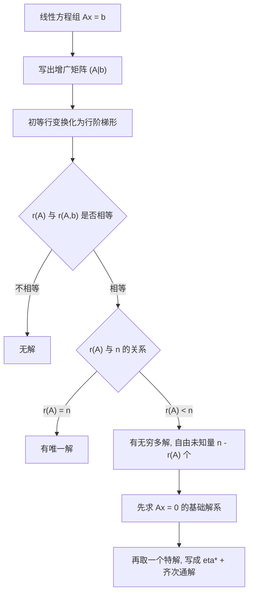

# 核心讲解

## 【有解判定】

- **只看两个秩**：$n$ 元线性方程组 $Ax=b$ 的有解性完全由 $r(A)$ 与 $r(A,b)$ 决定。
- **增广矩阵**：$(A,b)$ 是把常数项列添到系数矩阵右侧得到的矩阵。
- **未知数个数**：$r$ 与 $n$ 的比较决定解的 **个数**，与 $m$（方程个数）无关。
- **齐次的特权**：齐次方程组 $Ax=0$ 永远有零解，因此永远属于「有解」的两种情形。
- **定理的作用**：把「解方程组」彻底转化为「求两个矩阵的秩」。

【核心公式】

$$ Ax=b\ \text{有解}\iff r(A)=r(A,b)\iff b\in\operatorname{Col}(A) $$

$r(A)$ 与 $r(A,b)$ 的关系与解的情况对照如下（$n$ 为未知数个数）：

| $r(A)$ 与 $r(A,b)$ 的关系 | $r$ 与 $n$ 的关系 | 解的情况 | 自由未知量个数 |
| --- | --- | --- | --- |
| $r(A)<r(A,b)$ | —— | **无解** | —— |
| $r(A)=r(A,b)=r$ | $r=n$ | **唯一解** | $0$ |
| $r(A)=r(A,b)=r$ | $r<n$ | **无穷多解** | $n-r$ |

【适用条件】

1. 必须先对增广矩阵 $(A,b)$ 整体做初等 **行** 变换，不能只变换系数矩阵 $A$；
2. 「唯一解」的判据是 $r=n$，其中 $n$ 是 **未知数个数**；
3. 「有无穷多解」时自由未知量的个数恒为 $n-r$；
4. 方程个数 $m<n$ 时方程组若有解必为无穷多解，但完全可能 **无解**。

> ⚠️ **易错点**：把有解条件写成 $r(A)=r(A,b)=n$。有解条件只是 $r(A)=r(A,b)$，只有再加上 $r=n$ 才是唯一解。

## 【齐次解结构】

- **必有零解**：$Ax=0$ 至少有一个解 $x=0$，问题只在于有没有 **非零解**。
- **解集是子空间**：齐次方程组的解集对加法与数乘封闭，是 $\mathbb{R}^{n}$ 的一个子空间。
- **解空间维数**：维数等于 $n-r(A)$，也就是基础解系中向量的个数。
- **基础解系**：解空间的一组基，由 $n-r(A)$ 个 **线性无关** 的解向量组成。
- **通解形式**：基础解系的任意线性组合就是全部解。

【核心公式】

$$ \dim\{x\mid Ax=0\}=n-r(A) $$

$$ x=k_1\xi_1+k_2\xi_2+\cdots+k_{n-r}\xi_{n-r}\quad(k_i\ \text{任意常数}) $$

【适用条件】

1. 求基础解系的标准流程是对 $A$ 做初等行变换化为 **行最简形**；
2. 主元变量用自由未知量表示，自由未知量依次取单位向量，即得基础解系；
3. $Ax=0$ 只有零解 $\iff r(A)=n$，等价于 $A$ 的列向量组 **线性无关**；
4. 自由未知量的个数与基础解系的维数一致，都等于 $n-r(A)$。

> ⚠️ **易错点**：取自由未知量为单位向量之前必须把矩阵化成 **行最简形**，只在行阶梯形上取值会漏掉主元变量中的自由未知量成分。

## 【非齐次解结构】

- **解集不是子空间**：$Ax=b$（$b\neq 0$）的解集对加法、数乘都不封闭。
- **结构定理**：非齐次方程组的全部解 = 一个 **特解** + 对应齐次方程组的 **通解**。
- **两步走**：先求 $Ax=0$ 的基础解系，再找 $Ax=b$ 的一个特解，缺一不可。
- **特解不唯一**：任意一个满足 $A\eta^{*}=b$ 的向量都可以充当特解。
- **与线性表示的同一性**：矩阵方程与向量组的线性表示共用同一套判定。

【核心公式】

$$ x=\eta^{*}+k_1\xi_1+k_2\xi_2+\cdots+k_{n-r}\xi_{n-r}\quad(k_i\ \text{任意常数}) $$

其中 $\eta^{*}$ 是 $Ax=b$ 的一个特解，$\xi_1,\dots,\xi_{n-r}$ 是 $Ax=0$ 的基础解系。

【适用条件】

1. 必须先判定 $r(A)=r(A,b)$，确认 **有解** 之后再求通解；
2. 齐次通解部分与特解部分必须同时写出，并说明 $k_i$ 为任意常数；
3. 特解可以由自由未知量全取 $0$ 得到，也可以取任何一组方便的值；
4. 无穷多解时自由未知量的个数仍是 $n-r(A)$。

> ⚠️ **易错点**：只写特解或只写齐次通解，都漏掉了解结构的一半。答案必须是「特解 $+$ 齐次通解」的完整形式。

## 【克拉默法则】

- **适用前提**：方程个数等于未知数个数，且系数行列式 **不为 0**。
- **结论形式**：每个未知量都能写成一个行列式之商。
- **分母固定**：分母始终是 $|A|$，不随下标改变。
- **分子构造**：$|A_j|$ 是把 $A$ 的第 $j$ 列换成 $b$ 所得的矩阵的行列式。
- **失效情形**：$|A|=0$ 时克拉默法则完全失效，必须回到 **秩** 的判定。

【核心公式】

$$ |A|\neq 0\ \text{时}\quad x_j=\frac{|A_j|}{|A|}\quad(j=1,2,\dots,n) $$

$$ A_j=(\alpha_1,\dots,\alpha_{j-1},b,\alpha_{j+1},\dots,\alpha_n) $$

【适用条件】

1. 系数矩阵 $A$ 必须是 **$n$ 阶方阵**，即方程个数等于未知数个数；
2. 必须验证 $|A|\neq 0$ 才能使用；
3. $|A|=0$ 时要分「无解」与「无穷多解」两类讨论，并对参数取值分类；
4. 只有唯一解的情形才能用克拉默法则，无穷多解时它给不出答案。

> ⚠️ **秒杀技**：只问某一个未知量时用克拉默法则最快——分子只需算 $|A_j|$ 一个行列式，不必把整个方程组解出来。

# 关键结论速记

- $r(A)<r(A,b) \iff$ 无解；$r(A)=r(A,b)=n \iff$ 唯一解；$r(A)=r(A,b)<n \iff$ 无穷多解 —— 全部判定压缩成一句话
- 齐次解空间维数 $=n-r(A)$ —— 基础解系中向量的个数，$n$ 是未知数个数
- $Ax=0$ 只有零解 $\iff r(A)=n$ —— 等价于 $A$ 的列向量组线性无关
- $Ax=b$ 的通解 $=\eta^{*}+$ 对应齐次方程组的通解 —— 非齐次解集是「平移过的子空间」
- $|A|\neq0$ 时 $x_j=\frac{|A_j|}{|A|}$ —— 克拉默法则，仅适用于方程个数等于未知数个数且系数行列式非零
- $r(A)=r(A,b)=r \Rightarrow$ 自由未知量个数为 $n-r$ —— 自由未知量个数与基础解系维数一致
- $Ax=b$ 有解 $\iff r(A)=r(A,b) \iff b\in\operatorname{Col}(A)$ —— 有解的三种同义说法

# 示意图


```text
   coefficient matrix A          augmented matrix (A | b)
  +----+----+----+              +----+----+----+----+
  | a11| a12| a13|              | a11| a12| a13| b1 |
  +----+----+----+              +----+----+----+----+
  | a21| a22| a23|   ---->      | a21| a22| a23| b2 |
  +----+----+----+              +----+----+----+----+
  | a31| a32| a33|              | a31| a32| a33| b3 |
  +----+----+----+              +----+----+----+----+
                                         |
                      elementary row ops |
                                         v
  +----+----+----+----+          reduced row echelon form
  | 1  | 0  |  * |  * |          pivot columns -> basic vars
  +----+----+----+----+          non-pivot    -> free vars
  | 0  | 1  |  * |  * |          #free = n - r(A)
  +----+----+----+----+
  | 0  | 0  |  0 |  0 |
  +----+----+----+----+
```

把常数项列添到系数矩阵右侧即得增广矩阵 $(A,b)$；对 $(A,b)$ 整体做初等行变换化为行最简形后，主元所在列对应基本未知量，其余列对应自由未知量，自由未知量的个数等于 $n-r(A)$。



# 易错点

- 把有解条件写成 $r(A)=r(A,b)=n$。 错在把「有解」与「有唯一解」混为一谈。正确的有解条件只是 $r(A)=r(A,b)$，此时若 $r<n$ 就是无穷多解；只有当 $r=n$（即 $r$ 等于未知数个数）才是唯一解。
- 认为「方程个数少于未知数个数」时方程组必有无穷多解。 错在漏掉无解的情形。正确的是：方程个数少只保证 $r(A)\le m<n$，此时若有解必为无穷多解，但完全可能 $r(A)<r(A,b)$ 而无解；只有对齐次方程组才能断言必有非零解。
- $|A|=0$ 时仍用克拉默法则求 $x_j=\frac{|A_j|}{|A|}$。 错在分母为零时硬套公式。正确做法：$|A|=0$ 意味着 $r(A)<n$，必须回到增广矩阵用秩判定，分别讨论无解与无穷多解，并对参数取值分类。
- 求非齐次通解时只写特解，或只写齐次通解。 错在漏掉结构的一半。正确形式必须是 $\eta^{}+k_1\xi_1+\cdots+k_{n-r}\xi_{n-r}$，且要说明 $k_i$ 为任意常数；另外特解不唯一，任意一个满足 $A\eta^{}=b$ 的向量都可以。

# 真题示例

**2024 年数二第 22 题（解答题，12 分）**

设矩阵 $A=\begin{pmatrix} 0 & 1 & a \\ 1 & 0 & 1 \end{pmatrix}$，$B=\begin{pmatrix} 1 & 1 \\ 1 & 1 \\ b & 2 \end{pmatrix}$，二次型 $f(x_1,x_2,x_3)=x^{T}BAx$，已知方程组 $Ax=0$ 的解是 $B^{T}x=0$ 的解，但两个方程组不同解。

（1）求 $a,b$ 的值；（2）求正交矩阵 $Q$，使变换 $x=Qy$ 将 $f(x_1,x_2,x_3)$ 化为标准形。

> 解析（本示例只解第（1）问；第（2）问见「二次型」一章）：
>
> **第一步**，解 $Ax=0$，它的系数矩阵是 $2\times3$ 的，$r(A)=2$，
>
> 故解空间维数为 $3-2=1$。
>
> 由 $A$ 的两行解得 $x_1=-x_3$、$x_2=-ax_3$，
>
> 取自由未知量 $x_3=1$ 得基础解系
>
> $$\xi=(-1,-a,1)^{T}$$
>
> **第二步**，条件「$Ax=0$ 的解是 $B^{T}x=0$ 的解」即
>
> $\xi$ 必须满足 $B^{T}\xi=0$。
>
> 计算
>
> $$B^{T}=\begin{pmatrix}1&1&b\\1&1&2\end{pmatrix}$$
>
> 得
>
> $$B^{T}\xi=\begin{pmatrix}b-a-1\\ 1-a\end{pmatrix}$$
>
> 令其为零向量，由第二式得 $a=1$，代回第一式得 $b=2$。
>
> **第三步**，验证「两个方程组不同解」。
>
> $a=1$ 时
>
> $$B^{T}=\begin{pmatrix}1&1&2\\1&1&2\end{pmatrix}$$
>
> 两行相同，故 $r(B^{T})=1$；而 $r(A)=2$。
>
> 于是 $Ax=0$ 的解空间维数为 $3-2=1$，
>
> $B^{T}x=0$ 的解空间维数为 $3-1=2$，维数不同，两个方程组确实不同解。
>
> sympy 复算：$a=1,b=2$ 时 $A$ 的解空间为
>
> $$\{t(-1,-1,1)^{T}\}$$
>
> $B^{T}$ 的解空间为
>
> $$\{s(-1,1,0)^{T}+t(-2,0,1)^{T}\}$$
>
> 前者是一维后者是二维，且 $\xi=(-1,-1,1)^{T}$ 同时满足两个方程。结论 $a=1,\ b=2$。
