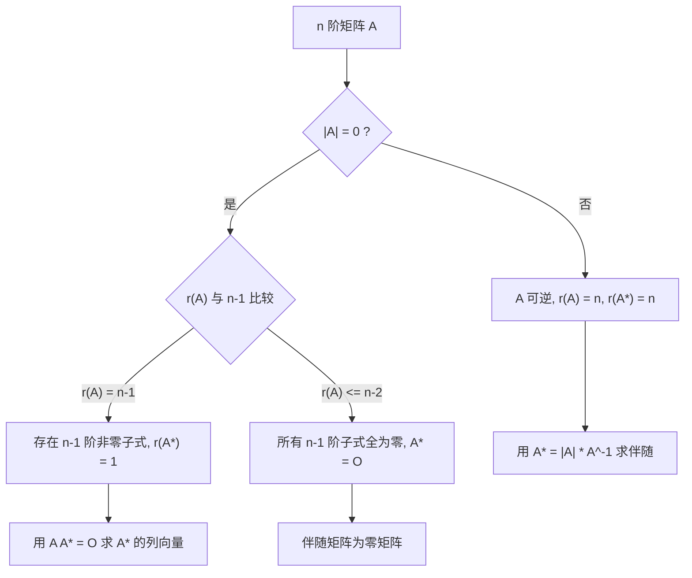

# 线性代数 · 矩阵

## 矩阵 [高频]

**考频统计**：考察次数 3 次；涉及年份：2023、2024（2023—2024 年数二真题逐题定章统计）；分数占比约 24%；主要题型：选择、填空（伴随矩阵、秩、初等变换、可逆判定）。

**核心讲解**：

## 【矩阵运算】

- **结合律成立**：$(AB)C=A(BC)$，多个矩阵连乘时可按方便的顺序结合。
- **分配律成立**：$A(B+C)=AB+AC$，$(A+B)C=AC+BC$。
- **交换律不成立**：一般 $AB\neq BA$，一切「先左乘还是先右乘」的区别都源于此。
- **转置反序**：$(AB)^{T}=B^{T}A^{T}$，转置后两个因子的顺序必须交换。
- **求逆反序**：$(AB)^{-1}=B^{-1}A^{-1}$，前提是 $A$、$B$ 都 **可逆**。
- **零因子现象**：$AB=O$ 推不出 $A=O$ 或 $B=O$，这是后面秩不等式与 $AB=O$ 型结论的出发点。

【核心公式】

$$ (AB)C=A(BC),\qquad (AB)^{T}=B^{T}A^{T},\qquad (AB)^{-1}=B^{-1}A^{-1} $$

【适用条件】

1. 乘法要求左矩阵的 **列数** 等于右矩阵的 **行数**；
2. 转置公式对任意可乘矩阵成立；
3. 求逆公式要求 $A$ 与 $B$ 均 **可逆**（同阶方阵）；
4. 使用「$AB=O\Rightarrow$ 秩不等式」时，必须补上三者的阶数关系。

> ⚠️ **易错点**：把 $(AB)^{T}$ 写成 $A^{T}B^{T}$ 是最常见的符号错误。只要记住「转置和求逆都让因子**反序**」，两个公式一起记就不会混。

## 【逆矩阵与伴随矩阵】

- **伴随矩阵定义**：$A^{*}=(A_{ji})$，即把每个元素换成它的 **代数余子式** 之后再 **转置**。
- **母公式**：$AA^{*}=A^{*}A=|A|E$，关于伴随的一切结论都由它推出。
- **求逆公式**：$|A|\neq 0$ 时 $A^{-1}=\frac{1}{|A|}A^{*}$。
- **行列式结论**：$|A^{*}|=|A|^{n-1}$。
- **可逆的判据群**：见下表，解题时按题目条件挑最好用的一条。
- **参数题与秩题的分工**：算参数通常用 $|A|\neq 0$，讨论秩通常用 $r(A)=n$。

【核心公式】

$$ AA^{*}=A^{*}A=|A|E,\qquad A^{-1}=\frac{1}{|A|}A^{*},\qquad |A^{*}|=|A|^{n-1} $$

**可逆的等价条件**（$A$ 为 $n$ 阶方阵）：

| 等价说法 | 表达形式 | 最适用的题型 |
| --- | --- | --- |
| 行列式 **不为 0** | $\lvert A\rvert\neq 0$ | 含参数的方阵求参数范围 |
| 满秩 | $r(A)=n$ | 抽象矩阵、秩的讨论 |
| 初等矩阵之积 | $A=P_1P_2\cdots P_s$ | 初等变换与等价标准形 |
| 齐次方程组只有零解 | $Ax=0$ 仅有 $x=0$ | 解的结构、基础解系 |
| 列（行）向量组 **线性无关** | $r(\alpha_1,\dots,\alpha_n)=n$ | 向量组相关性判定 |
| 与单位阵等价 | $A\cong E$ | 初等变换化简 |
| 特征值全 **不为 0** | $\lambda_i\neq 0$ | 相似、特征值综合题 |

**伴随矩阵的秩**（$A$ 为 $n$ 阶方阵，$n\ge 2$）：

| $r(A)$ 的情形 | $r(A^{*})$ | 关键理由 |
| --- | --- | --- |
| $r(A)=n$（$A$ **可逆**） | $r(A^{*})=n$ | $\lvert A^{*}\rvert=\lvert A\rvert^{n-1}\neq 0$ |
| $r(A)=n-1$ | $r(A^{*})=1$ | $A^{*}\neq O$ 但 $A^{*}A=\lvert A\rvert E=O$ |
| $r(A)\le n-2$ | $r(A^{*})=0$，即 $A^{*}=O$ | 所有 $n-1$ 阶子式全为 $0$ |

【适用条件】

1. 定义 $A^{*}=(A_{ji})$ 中 **转置** 这一步不能漏，漏掉就全盘出错；
2. $A^{-1}=\frac{1}{|A|}A^{*}$ 要求 $|A|\neq 0$，即 $A$ **可逆**；
3. $|A^{*}|=|A|^{n-1}$ 与 $r(A^{*})$ 的三段结论都要求 $A$ 是 **$n$ 阶方阵**；
4. $r(A)=n-1$ 时 $A^{*}\neq O$ 且 $r(A^{*})=1$，此时 $A^{*}$ 的每一行都是 $A^{*}A=O$ 所对应方程组的解。

> ⚠️ **易错点**：把「$|A|=0$」直接当成「$A^{*}=O$」。正确说法是 $r(A)=n-1$ 时 $r(A^{*})=1$，只有 $r(A)\le n-2$ 时才有 $A^{*}=O$——三段情形必须分清楚。

## 【初等变换与秩】

- **秩的定义**：$r(A)$ 是 $A$ 中 **非零子式** 的最高阶数。
- **秩的算法**：$r(A)$ 等于行阶梯形中 **非零行的行数**。
- **行秩等于列秩**：$r(A)$ 同时等于行向量组的秩与列向量组的秩。
- **初等变换不变秩**：$P$、$Q$ **可逆** 时 $r(PAQ)=r(A)$，这是「初等变换不改变秩」的一般形式。
- **三条件用**：求秩、求逆、求极大无关组，都可以通过初等行变换一次完成。

【核心公式】

$$ r(PAQ)=r(A)\quad(P,Q\ \text{可逆}) $$

$$ r(A+B)\le r(A)+r(B),\qquad r(AB)\le\min\{r(A),\,r(B)\} $$

$$ AB=O\ \Longrightarrow\ r(A)+r(B)\le n\quad(A\ \text{为}\ m\times n,\ B\ \text{为}\ n\times s) $$

【适用条件】

1. $r(PAQ)=r(A)$ 要求 $P$、$Q$ 都 **可逆**；
2. $r(A+B)\le r(A)+r(B)$ 对同型矩阵成立，等号一般不取；
3. $r(AB)\le\min\{r(A),r(B)\}$ 对任意可乘矩阵成立；
4. $AB=O$ 型不等式中的 $n$ 是 **中间维数**（$A$ 的列数、$B$ 的行数），不是 $A$ 或 $B$ 的阶数。

> ⚠️ **秒杀技**：见到 $AB=O$ 立刻写 $r(A)+r(B)\le n$；见到 $A^{*}\neq O$ 立刻把 $r(A)$ 锁定在 $n-1$。这两条能把抽象秩的填空题压缩成一步。

## 【分块矩阵】

- **分块乘法**：把大矩阵按相容的方式分块后，乘法规则与小矩阵完全一致。
- **分块转置**：转置的同时 **交换块的位置**，即把 $A$、$B$、$C$、$D$ 四块按 $\begin{pmatrix}A&B\\ C&D\end{pmatrix}^{T}=\begin{pmatrix}A^{T}&C^{T}\\ B^{T}&D^{T}\end{pmatrix}$ 重排。
- **分块对角求逆**：主对角块各自求逆，副对角块照抄位置。
- **分块对角行列式**：等于各主对角块行列式之连乘。
- **适用场景**：矩阵阶数较高、出现明显零块或重复结构时，分块能把高阶运算降成低阶运算。

【核心公式】

$$ \begin{pmatrix} A & O \\ O & B \end{pmatrix}^{-1}=\begin{pmatrix} A^{-1} & O \\ O & B^{-1} \end{pmatrix},\qquad \begin{vmatrix} A & O \\ O & B \end{vmatrix}=|A|\cdot|B| $$

$$ \begin{pmatrix} A & C \\ O & B \end{pmatrix}^{-1}=\begin{pmatrix} A^{-1} & -A^{-1}CB^{-1} \\ O & B^{-1} \end{pmatrix} $$

【适用条件】

1. 分块乘法要求相应块的 **阶数相容**；
2. 分块求逆要求每个对角块都 **可逆**；
3. 分块行列式的干净结论只在 **分块三角或分块对角** 时成立；
4. 副对角块情形要先通过换行换列把零块挪到正确位置，换一次记一个符号。

> ⚠️ **易错点**：把分块行列式一律写成 $|A||B|-|C||D|$，等于把二阶行列式展开式硬套到分块矩阵上。一般情形必须回到拉普拉斯展开或先消去一角。

**关键结论速记**：

- $(AB)^{-1}=B^{-1}A^{-1}$，$(AB)^{T}=B^{T}A^{T}$ —— 一律反序，逆与转置混合时要先转置后取逆再反序
- $A$ 可逆 $\iff |A|\neq0 \iff r(A)=n \iff Ax=0$ 仅有零解 —— 可逆判定的四个同义说法
- $AA^{}=A^{}A=|A|E$，$|A^{}|=|A|^{n-1}$，$|A|\neq0$ 时 $A^{-1}=\frac{1}{|A|}A^{}$ —— 伴随矩阵的两条母公式
- $r(A^{})=n\ (r(A)=n)$，$=1\ (r(A)=n-1)$，$=0\ (r(A)\le n-2)$ —— 伴随矩阵秩的三段公式，$|A|=0$ 并不等于 $A^{}=O$
- $r(A+B)\le r(A)+r(B)$，$r(AB)\le\min{r(A),r(B)}$ —— 和与积的秩只能变小
- $AB=O \Rightarrow r(A)+r(B)\le n$ —— 零乘积给出的秩约束，$n$ 是 $A$ 的列数（即 $B$ 的行数）
- $P^{T}AP$ 与 $A$ 同秩 —— 可逆阵左乘右乘不改变秩，是初等变换不改变秩的一般形式

**示意图**：


```text
      n columns                        r(A) = n   ->  r(A*) = n
 +-------------------+                 r(A) = n-1 ->  r(A*) = 1
 |  Er   |     O     |   r rows        r(A) <= n-2 ->  A* = O
 |-------+-----------|
 |  O    |     O     |                 det(A) != 0  =>  A* = det(A) * inv(A)
 +-------------------+                 det(A)  = 0  and  A* != O  is possible
      rank = r
  equivalent normal form
```

图左是 $m\times n$ 矩阵经初等变换得到的等价标准形，其中 $r=r(A)$；图右列出伴随矩阵的秩随 $r(A)$ 变化的三段结论。

```text
+---------+---------+---------+---------+
|  A11    |  A21    |  A31    |  A41    |   <- row 1 of adj(A)
+---------+---------+---------+---------+
|  A12    |  A22    |  A32    |  A42    |   Aij = (-1)^(i+j) * Mij
+---------+---------+---------+---------+
|  A13    |  A23    |  A33    |  A43    |   adj(A) = transpose of
+---------+---------+---------+---------+            the cofactor matrix
|  A14    |  A24    |  A34    |  A44    |
+---------+---------+---------+---------+
```



**易错点**：

- 由 $AB=O$ 直接推出 $A=O$ 或 $B=O$。 错在把数的乘法性质搬到矩阵上。正确结论只有秩的约束 $r(A)+r(B)\le n$。例如 $A=\begin{pmatrix}1&0\0&0\end{pmatrix}$、$B=\begin{pmatrix}0&0\0&1\end{pmatrix}$ 时 $AB=O$ 而两者都非零；进一步，若还知道 $A\neq O$ 且 $B\neq O$，只能推出 $r(A)<n$ 与 $r(B)<n$。
- 把 $A^{*}$ 写成代数余子式矩阵本身，漏掉转置。 错在记成 $A^{}=(A_{ij})$。正确的是 $A^{}=(A_{ji})$；相应地 $(A^{T})^{}=(A^{})^{T}$，而 $(kA)^{}=k^{n-1}A^{}$，指数是 $n-1$ 不是 $n$。
- 认为 $|A|=0$ 时一定有 $A^{*}=O$。 错在把行列式为零与伴随为零等同。正确的是 $r(A)=n-1$ 时 $A^{}\neq O$（此时 $r(A^{})=1$），只有 $r(A)\le n-2$ 才有 $A^{*}=O$。
- 求逆或转置时顺序写错。 错在写 $(AB)^{-1}=A^{-1}B^{-1}$ 或 $(AB)^{T}=A^{T}B^{T}$。正确是一律反序：$(AB)^{-1}=B^{-1}A^{-1}$，$(AB)^{T}=B^{T}A^{T}$。

**真题示例**：

**2024 年数二第 9 题（单项选择题，5 分）**

设 $A$ 为四阶矩阵，$A^{*}$ 为 $A$ 的伴随矩阵，若 $A(A-A^{*})=O$，且 $A\neq A^{*}$，则 $r(A)$ 的可能取值为（　）

A. 0 或 1　　B. 1 或 3　　C. 2 或 3　　D. 1 或 2

> 解析：第一步，化简条件。由 $AA^{*}=|A|E$：若 $|A|\neq0$，则 $A$ 可逆，在 $A(A-A^{*})=O$ 两边左乘 $A^{-1}$ 得 $A=A^{*}$，与 $A\neq A^{*}$ 矛盾，故 $|A|=0$，于是 $AA^{*}=O$，题设条件化为 $A^{2}=O$。
>
> 第二步，定出 $r(A)$ 的上界。设 $A^{2}=O$，把 $A$ 按列分块为 $A=(\alpha_1,\alpha_2,\alpha_3,\alpha_4)$，则每个 $\alpha_j$ 都满足 $A\alpha_j=0$，即 $\operatorname{Col}(A)\subseteq\operatorname{Null}(A)$，取维数得 $r(A)\le 4-r(A)$，故 $r(A)\le 2$。这一步同时排除了 $r(A)=4$（此时 $A$ 可逆，与 $|A|=0$ 矛盾）与 $r(A)=3$：秩 3 时 $\operatorname{Null}(A)$ 只有一维，而 $\operatorname{Col}(A)$ 有三维，包含关系要求 $3\le 1$，不可能。
>
> 第三步，验证 $r(A)=1$ 与 $r(A)=2$ 都能取到。取 $A=\operatorname{diag}(1,0,0,0)$，sympy 复算 $A^{*}=O$、$A^{2}=O$、$A\neq A^{*}$，此时 $r(A)=1$；取 $A=\begin{pmatrix}0&1&0&0\\0&0&0&0\\0&0&0&1\\0&0&0&0\end{pmatrix}$，sympy 复算同样有 $|A|=0$、$A^{*}=O$、$A^{2}=O$、$A\neq A^{*}$，而 $r(A)=2$。综上 $r(A)$ 的可能取值为 $1$ 或 $2$，选 D。

---
