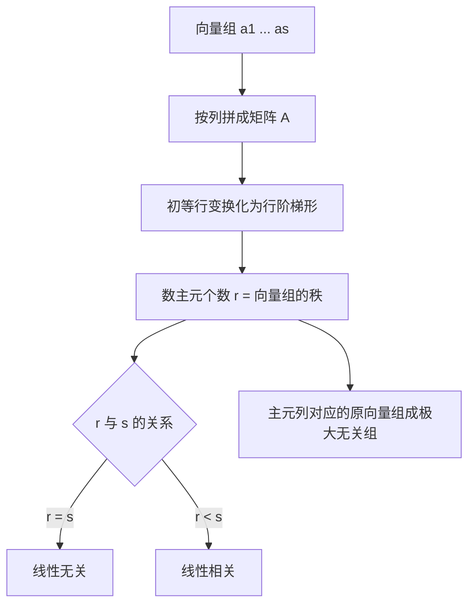

# 线性代数 · 向量与向量组

## 向量与向量组 [高频]

**考频统计**：考察次数 2 次；涉及年份：2023、2024（2023—2024 年数二真题逐题定章统计）；分数占比约 12%；主要题型：选择、填空（线性相关性、极大无关组、秩）。

**核心讲解**：

## 【线性相关性】

- **线性组合**：$\beta=k_1\alpha_1+\cdots+k_s\alpha_s$ 时称 $\beta$ 可由该向量组 **线性表示**。
- **线性表示的本质**：存在系数 $k_1,\dots,k_s$ 使等式成立，等价于方程组 $(\alpha_1,\dots,\alpha_s)x=\beta$ **有解**。
- **线性相关**：存在 **不全为零** 的数 $k_1,\dots,k_s$ 使 $k_1\alpha_1+\cdots+k_s\alpha_s=0$。
- **线性无关**：这样的系数只能全为 $0$，即只有零向量才能凑出零。
- **矩阵语言**：以这些向量为列作矩阵 $A=(\alpha_1,\dots,\alpha_s)$，则相关与秩的关系是相关 $\iff r(A)<s$。
- **方阵特例**：$n$ 个 $n$ 维向量 **线性无关** $\iff$ 以它们为列的行列式 **不为 0**。
- **个数判据**：$s>n$ 时 $n$ 维向量组必线性相关，即向量个数多于维数时必相关。

【核心公式】

$$ \beta=k_1\alpha_1+k_2\alpha_2+\cdots+k_s\alpha_s \iff (\alpha_1,\dots,\alpha_s)x=\beta\ \text{有解} $$

$$ \alpha_1,\dots,\alpha_s\ \text{线性相关}\iff r(A)<s,\qquad \text{线性无关}\iff r(A)=s\quad\bigl(A=(\alpha_1,\dots,\alpha_s)\bigr) $$

**线性相关与线性无关对照**（$A=(\alpha_1,\dots,\alpha_s)$，$s$ 为向量个数）：

| 对比项 | **线性相关** | **线性无关** |
| --- | --- | --- |
| 定义 | 存在 **不全为零** 的 $k_i$ 使 $\sum k_i\alpha_i=0$ | 只有 $k_1=\cdots=k_s=0$ 才使 $\sum k_i\alpha_i=0$ |
| 秩判据 | $r(A)<s$ | $r(A)=s$ |
| 方程组语言 | $Ax=0$ 有 **非零解** | $Ax=0$ 只有零解 |
| 方阵情形 | $\lvert A\rvert=0$ | $\lvert A\rvert\neq 0$ |
| 向量间关系 | **至少一个**向量可由其余向量线性表示 | 任一向量都不能由其余向量表示 |
| 含零向量 | 必相关 | 不可能含零向量 |
| 与维数 $n$ | $s>n$ 时必相关 | 必须有 $s\le n$ |

【适用条件】

1. 判定相关或无关时比较的对象是 **向量个数 $s$**，不是向量维数 $n$；
2. 只有当 $s=n$（方阵情形）时才可以用行列式 **不为 0** 判定无关；
3. 「其中至少一个向量可由其余向量线性表示」要求 $s\ge 2$；
4. 含有零向量的向量组必 **线性相关**，向量组只含一个向量时相关 $\iff$ 它是零向量。

> ⚠️ **易错点**：把「线性相关」与「任意一个向量都能由其余向量表示」等同。相关只保证 **至少一个** 向量可由其余向量表示。

## 【极大无关组与秩】

- **极大无关组**：向量组中「个数最多」的 **线性无关** 部分组。
- **秩的定义**：向量组的秩就是极大无关组中向量的个数，也等于以它们为列构成的矩阵的秩。
- **求法统一**：把向量按列拼成矩阵，只做初等 **行** 变换化为行阶梯形，主元所在的列对应的 **原** 向量即构成一个极大无关组。
- **行变换的理由**：初等行变换保持列向量之间的线性关系，所以主元列与原向量的对应关系不变。
- **等价的定义**：两个向量组能互相线性表示时称它们等价。
- **等价与秩**：等价向量组的秩相等，但仅凭秩相等不能推出等价。

【核心公式】

$$ r(\alpha_1,\dots,\alpha_s)=r(\alpha_1,\dots,\alpha_s,\beta)\iff\beta\ \text{可由该组线性表示} $$

$$ B\ \text{可由}\ A\ \text{线性表示}\iff r(A)=r(A,B) $$

【适用条件】

1. 求极大无关组必须且只能做初等 **行** 变换，列变换会打乱向量位置；
2. $r(A)=r(A,B)$ 中的 $(A,B)$ 是把两组向量都按列拼起来的大矩阵；
3. 断言两组等价需要同时满足秩相等与其中一组能由另一组线性表示 **两个条件**；
4. 极大无关组不唯一，但其中向量的 **个数** 唯一，即秩唯一。

> ⚠️ **秒杀技**：把向量按列拼成矩阵后直接做行变换，数主元个数得秩，取主元列得极大无关组——求秩与求极大无关组一次变换同时完成。

## 【内积与正交化】

- **内积**：$(\alpha,\beta)=\alpha^{T}\beta=a_1b_1+a_2b_2+\cdots+a_nb_n$。
- **正交**：$(\alpha,\beta)=0$ 时称 $\alpha$ 与 $\beta$ 正交。
- **模长**：$\|\alpha\|=\sqrt{(\alpha,\alpha)}$，模长为 $1$ 的向量称为单位向量。
- **正交向量组**：两两正交的 **非零** 向量组必 **线性无关**。
- **施密特正交化**：把一组线性无关向量逐个减去它在已有正交向量上的投影，得到正交向量组。
- **单位化**：正交化之后每个向量再除以自己的模长，才得到标准正交组。

【核心公式】

$$ (\alpha,\beta)=a_1b_1+a_2b_2+\cdots+a_nb_n,\qquad \|\alpha\|=\sqrt{(\alpha,\alpha)} $$

$$ \beta_2=\alpha_2-\frac{(\alpha_2,\beta_1)}{(\beta_1,\beta_1)}\beta_1,\qquad \beta_3=\alpha_3-\frac{(\alpha_3,\beta_1)}{(\beta_1,\beta_1)}\beta_1-\frac{(\alpha_3,\beta_2)}{(\beta_2,\beta_2)}\beta_2 $$

【适用条件】

1. 施密特正交化要求待处理的向量组 **线性无关**；
2. 正交化过程中不得出现零向量，否则说明原向量组线性相关；
3. 正交化只保证两两正交，要构成正交矩阵还必须再 **单位化**；
4. 判断正交只需算内积是否为 $0$，但要用正交矩阵必须同时满足两两正交与模长为 $1$。

> ⚠️ **易错点**：只做正交化而忘记 **单位化**，拼出的矩阵 $Q$ 不满足 $Q^{T}Q=E$，正交变换的前提立刻失效。

**关键结论速记**：

- $\alpha_1,\dots,\alpha_s$ 线性相关 $\iff r(A)<s$，无关 $\iff r(A)=s$ —— $s$ 是向量个数，与向量维数 $n$ 无关
- $n$ 个 $n$ 维向量线性无关 $\iff |A|\neq 0$ —— 方阵情形才能用行列式判定
- $r(\alpha_1,\dots,\alpha_s)=r(\alpha_1,\dots,\alpha_s,\beta) \iff \beta$ 可由该组线性表示 —— 有解判定，判别「能否表示」只看向量组的秩变不变
- $r(A)=r(A,B) \iff$ 组 $B$ 可由组 $A$ 线性表示 —— 大矩阵就是两组向量按列拼起来
- $r(A)=r(B)$ 且其中一组能由另一组表示 $\Rightarrow$ 两组等价 —— 只有秩相等还不够
- $s>n$ 时 $n$ 维向量组必线性相关 —— 向量个数多于维数，必相关
- $\alpha_1,\dots,\alpha_s$ 相关 $\iff$ 其中至少一个向量可由其余向量线性表示（$s\ge 2$）—— 通过「有没有多余向量」来理解相关性

**示意图**：


```text
       a1      a2      a3     ...     as         <- s column vectors
     +-------+-------+-------+-------+-------+
     |  *    |  *    |  *    |  ...  |  *    |   step 1: write vectors
     |  *    |  *    |  *    |  ...  |  *    |           as columns
     |  *    |  *    |  *    |  ...  |  *    |   step 2: elementary ROW
     +-------+-------+-------+-------+-------+           operations only
     |  *    |  *    |  *    |  ...  |  *    |
     +-------+-------+-------+-------+-------+

     after row reduction to echelon form:

     +-------+-------+-------+-------+-------+
     |  [1]  |  *    |  *    |  ...  |  *    |   [ ] = pivot column
     |  0    |  [1]  |  *    |  ...  |  *    |   pivots -> r(A) = r
     |  0    |  0    |  0    |  ...  |  *    |   pivot columns give a
     |  0    |  0    |  0    |  ...  |  0    |   maximal independent set
     +-------+-------+-------+-------+-------+
```

主干元（方括号所在列）对应的**原**向量组构成极大线性无关组，其个数即该向量组的秩；非主元列对应的向量可由主元列向量线性表示。



**易错点**：

- 把「线性相关」与「任意一个向量都能由其余向量表示」等同。 错在忽略「至少一个」与「每一个」的区别。正确说法是：相关只保证存在一个向量可由其余向量表示；像 $\alpha_1=(1,0)$、$\alpha_2=(2,0)$、$\alpha_3=(0,1)$ 这组中，$\alpha_3$ 就不能由 $\alpha_1,\alpha_2$ 表示。
- 用矩阵的初等列变换求极大无关组。 错在把行变换与列变换的效果混同。正确做法是只做初等行变换：行变换保持列向量之间的线性关系，主元列对应的原向量才是极大无关组；若对列做变换，列的位置被打乱，结论失效。
- 判定线性相关性时把矩阵的秩与向量个数或维数搞错。 错在拿 $r(A)$ 与 $n$（维数）比较。正确是与 $s$（向量个数）比较：$r(A)=s$ 无关，$r(A)<s$ 相关。例如 3 个 4 维向量，$r(A)$ 最大是 3，若算出 $r(A)=3$ 就说明无关。
- 由「两组向量秩相等」直接推出「两组等价」。 错在漏掉线性表示这一步。正确做法：先由 $r(A)=r(A,B)$ 或 $r(B)=r(A,B)$ 验证其中一组能由另一组表示，再断言等价；秩相等只是等价的必要条件。

**真题示例**：

**2024 年数二第 16 题（填空题，5 分）**

设向量 $\alpha_1=\begin{pmatrix}a\\1\\-1\\1\end{pmatrix}$，$\alpha_2=\begin{pmatrix}1\\1\\b\\a\end{pmatrix}$，$\alpha_3=\begin{pmatrix}1\\a\\-1\\1\end{pmatrix}$，若 $\alpha_1,\alpha_2,\alpha_3$ 线性相关，且其中任意两个向量均线性无关，则 $ab=$ ______。

> 解析：三个 4 维向量线性相关 $\iff$ 以它们为列的矩阵 $A$ 的全部三阶子式为零。
>
> 其中四个三阶子式为 $-(a-1)(a+2)$、$-(a-1)(ab+b+2)$、$(a-1)(a+b)$（后两个各出现两次，仅在哪些行被取到上不同）。
>
> 第一步，用其中两个最简单的子式定位参数：由 $-(a-1)^{2}(a+2)=0$ 得 $a=1$ 或 $a=-2$。
>
> 若 $a=1$，则 $\alpha_1=\alpha_3$，两个向量线性相关，与「任意两个向量均线性无关」矛盾，故 $a=-2$。
>
> 第二步，把 $a=-2$ 代入其余子式：
>
> $$(a-1)(ab+b+2)=(-3)(-2b+b+2)=-3(2-b)=0$$
>
> 得 $b=2$；同法
>
> $$(a-1)(a+b)=(-3)(-2+b)=0$$
>
> 也得 $b=2$。两条方程一致，$a=-2,\ b=2$。
>
> 第三步，回代检验。sympy 复算：$a=-2,b=2$ 时三个向量为
>
> $$\alpha_1=(-2,1,-1,1)^{T}$$
>
> $$\alpha_2=(1,1,2,-2)^{T}$$
>
> $$\alpha_3=(1,-2,-1,1)^{T}$$
>
> 全部四个三阶子式为零、$r=2$，三向量线性相关；且任意两列构成的矩阵秩均为 $2$，两两线性无关，完全符合题设。
>
> 结论 $ab=(-2)\times 2=-4$。

---
