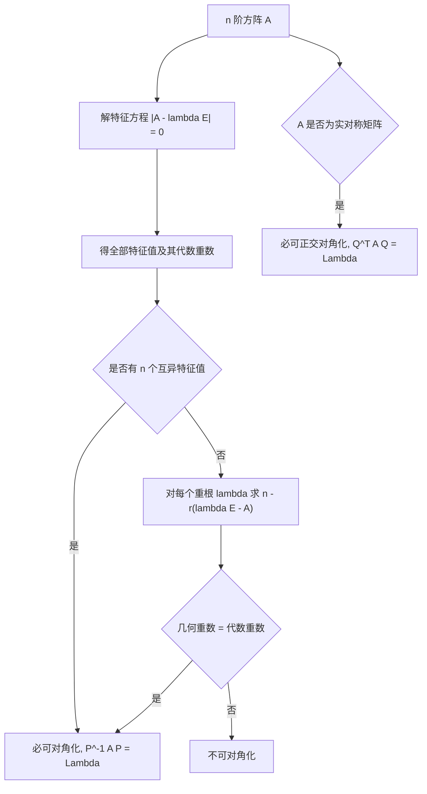

# 线性代数 · 特征值与特征向量

## 特征值与特征向量 [高频]

**考频统计**：考察次数 3 次；涉及年份：2023、2024（2023—2024 年数二真题逐题定章统计）；分数占比约 24%；主要题型：选择、解答（相似对角化、实对称矩阵）。

**核心讲解**：

## 【特征值与特征向量】

- **定义**：设 $A$ 为 $n$ 阶方阵，若存在数 $\lambda$ 与 **非零** 向量 $\alpha$ 使 $A\alpha=\lambda\alpha$，则 $\lambda$ 为特征值、$\alpha$ 为对应的特征向量。
- **特征方程**：把定义式移项得 $(A-\lambda E)\alpha=0$，由 $\alpha\neq 0$ 推出系数行列式必为 $0$。
- **特征多项式**：$|A-\lambda E|$ 是 $\lambda$ 的 $n$ 次多项式，它的根就是全部特征值。
- **求法固定两步**：先解 $|A-\lambda E|=0$ 得到全部特征值（含重数），再把每个 $\lambda$ 代入求基础解系。
- **特征向量的封闭性**：属于同一特征值的特征向量的任意 **非零线性组合** 仍是该特征值的特征向量。
- **重数概念**：代数重数是 $\lambda$ 作为特征方程根的重数，几何重数是 $n-r(\lambda E-A)$。

【核心公式】

$$ A\alpha=\lambda\alpha\quad(\alpha\neq 0)\iff |A-\lambda E|=0 $$

$$ \lambda_1+\lambda_2+\cdots+\lambda_n=\operatorname{tr}(A),\qquad \lambda_1\lambda_2\cdots\lambda_n=|A| $$

【适用条件】

1. $A$ 必须是 **$n$ 阶方阵**，非方阵没有特征值；
2. 特征向量必须 **非零**，零向量不算特征向量；
3. 把每个 $\lambda$ 代回 $(A-\lambda E)x=0$ 求基础解系，得到的是属于该 $\lambda$ 的线性无关特征向量；
4. 两条速算恒等式可用来验算求出的特征值，也可在只问「和」或「积」时跳过解方程。

> ⚠️ **秒杀技**：先用 $\sum\lambda_i=\operatorname{tr}(A)$ 与 $\prod\lambda_i=|A|$ 验算。若算出的特征值之和或积对不上，不必往下算，回头检查特征方程。

## 【相似对角化】

- **相似的定义**：存在 **可逆** 矩阵 $P$ 使 $P^{-1}AP=B$ 时称 $A$ 与 $B$ 相似。
- **对角化的含义**：找可逆矩阵 $P$ 使 $P^{-1}AP=\Lambda$，$\Lambda$ 为对角阵。
- **总判据**：$A$ 可对角化 $\iff$ $A$ 有 $n$ 个 **线性无关** 的特征向量。
- **重数语言**：对每个特征值，几何重数等于代数重数时即可对角化。
- **充分条件**：$n$ 阶方阵若有 $n$ 个互不相同的特征值，则必可对角化。
- **构造方法**：把 $n$ 个线性无关的特征向量按列排成 $P$，对角元 $\lambda_i$ 与第 $i$ 列一一对应。

【核心公式】

$$ P^{-1}AP=\Lambda=\operatorname{diag}(\lambda_1,\lambda_2,\dots,\lambda_n),\qquad P=(\alpha_1,\alpha_2,\dots,\alpha_n) $$

$$ \text{几何重数}=n-r(\lambda E-A)\le\text{代数重数} $$

**能否相似对角化的判定对照**：

| 判定角度 | 可对角化 | 不可对角化 |
| --- | --- | --- |
| 特征向量个数 | 有 $n$ 个 **线性无关** 的特征向量 | 线性无关特征向量不足 $n$ 个 |
| 几何重数与代数重数 | 每个特征值都有 **几何重数 $=$ 代数重数** | 存在某个特征值几何重数 $<$ 代数重数 |
| 几何重数之和 | $\sum$ 几何重数 $=n$ | $\sum$ 几何重数 $<n$ |
| 特征值互异情形 | $n$ 个互异特征值 $\Rightarrow$ 必可对角化 | 互异特征值不可能出现 |
| 重根情形 | 重根也能补足几何重数（如 $E$ 本身） | 重根补不足（如 $\begin{pmatrix}1&1\\0&1\end{pmatrix}$） |
| 实对称矩阵 | **实对称** 必可对角化，且可正交对角化 | 实对称不会不可对角化 |

【适用条件】

1. $\lambda_i$ 与 $P$ 的第 $i$ 列必须一一对应，顺序可调换但不能错配；
2. 求几何重数用 $n-r(\lambda E-A)$，注意是 $\lambda E-A$ 而不是 $A-\lambda E$ 的秩（两者相同，但符号要一致）；
3. 特征值互异只是可对角化的 **充分条件**，有重根时仍可能可对角化；
4. 不同特征值对应的特征向量必 **线性无关**，重根内部才需要另行检验。

> ⚠️ **易错点**：认为「有重特征值就一定不能对角化」。只有几何重数 **小于** 代数重数时才不可对角化。

## 【实对称矩阵】

- **必可对角化**：**实对称** 矩阵一定可以对角化，且特征值全为实数。
- **正交对角化**：存在 **正交矩阵** $Q$ 使 $Q^{-1}AQ=Q^{T}AQ=\Lambda$。
- **正交矩阵的性质**：$Q^{T}Q=E$，即 $Q^{-1}=Q^{T}$。
- **自动正交**：属于 **不同** 特征值的特征向量必正交，无需再做施密特正交化。
- **重根内部**：只有同一个重根对应的特征子空间内部才需要做施密特正交化。
- **单位化不可省**：正交化之后每个向量必须单位化，才能拼出正交矩阵 $Q$。

【核心公式】

$$ Q^{-1}AQ=Q^{T}AQ=\Lambda,\qquad Q^{T}Q=E\iff Q^{-1}=Q^{T} $$

【适用条件】

1. $A$ 必须是 **实对称** 矩阵，即 $A^{T}=A$；
2. $Q$ 的每一列必须是一组 **标准正交** 的特征向量（两两正交且模长为 $1$）；
3. 不同特征值的特征向量自动正交，重根内部才需要施密特正交化；
4. 单位化这一步不可省略，漏掉就得不到正交矩阵。

> ⚠️ **秒杀技**：判定「能否正交对角化」先看 $A^{T}=A$ 是否成立。**实对称** 直接下结论「必可正交对角化」，不必再逐个算几何重数。

**关键结论速记**：

- $A\alpha=\lambda\alpha$（$\alpha\neq0$）$\iff |A-\lambda E|=0$ —— 特征值由特征方程确定，特征向量必须非零
- $\sum\lambda_i=\operatorname{tr}(A)$，$\prod\lambda_i=|A|$ —— 特征值的和等于迹、积等于行列式，用于验算
- $A$ 可对角化 $\iff$ 有 $n$ 个线性无关的特征向量 $\iff$ 每个特征值的几何重数 $=$ 代数重数 —— 对角化的总判据
- 几何重数 $=n-r(\lambda E-A)$ —— 属于 $\lambda$ 的线性无关特征向量的最大个数
- $n$ 个互异特征值 $\Rightarrow$ 必可对角化 —— 充分不必要，有重根时仍可能可对角化
- $P^{-1}AP=\Lambda$，$P=(\alpha_1,\dots,\alpha_n)$ —— 特征向量按列排，顺序要与对角元 $\lambda_i$ 一一对应
- 实对称矩阵必可对角化，且存在正交阵 $Q$ 使 $Q^{T}AQ=\Lambda$ —— 不同特征值的特征向量自动正交

**示意图**：


```text
      A         *      P          =      P        *     Lambda
  +-------+   +-------+       +-------+-------+   +-------+-------+
  |       |   |   |   |       |   |   |   |   |   | l1    |   0   |
  |   n   | * | a1| a2|   =   | a1| a2| a1| a2| * |   0   |  l2   |
  |       |   |   |   |       |   |   |   |   |   |       |       |
  +-------+   +-------+       +-------+-------+   +-------+-------+
                  |                                   ^
                  |  columns are the n                |
                  |  independent eigenvectors         +-- lambda_i matches
                  |                                      column alpha_i
                  v
     A * alpha_i = lambda_i * alpha_i   for each column

     +-----------------------------------------------+
     |  tr(A) = l1 + l2 + ... + ln                   |
     |  det(A) = l1 * l2 * ... * ln                  |
     +-----------------------------------------------+
```

图中 $P$ 的每一列是一个特征向量，$A\alpha_i=\lambda_i\alpha_i$ 逐个成立；对角阵 $\Lambda$ 的第 $i$ 个对角元必须与 $P$ 的第 $i$ 列对应，顺序可以调换但不能错配。



**易错点**：

- 把特征向量只写成「$(\lambda E-A)x=0$ 的解」而漏掉非零要求。 错在把零向量也算作特征向量。正确的是特征向量必须非零；$(A-\lambda E)x=0$ 的零解不算，我们要的是它的基础解系中的非零向量。
- 认为「有重特征值就一定不能对角化」。 错在把「有重根」与「不可对角化」等同。正确做法是再看几何重数：例如 $J=\begin{pmatrix}1&1\0&1\end{pmatrix}$ 的二重特征值 $1$ 只对应一个线性无关特征向量（$2-r(E-J)=2-1=1$），故不可对角化；而 $E=\begin{pmatrix}1&0\0&1\end{pmatrix}$ 的二重特征值 $1$ 却对应两个线性无关特征向量，它本身已是对角阵。真正的判据是几何重数是否等于代数重数。
- 认为「可对角化」等价于「特征值互异」。 错在把充分条件当充要条件。正确说法：互异特征值只是可对角化的充分条件；有重根时只要每个重根的几何重数补足，仍可对角化，例如单位矩阵 $E$ 只有特征值 $1$，但它本身已是对角阵。
- 写出 $P^{-1}AP=\Lambda$ 后不核对列与对角元的对应关系。 错在把特征向量的顺序与特征值的顺序随意调换。正确做法：$P$ 的第 $i$ 列必须是对角阵第 $i$ 个对角元对应的特征向量；另外要注意 $P^{-1}AP$ 与 $PAP^{-1}$ 是两个不同的式子，前者才是相似变换。

**真题示例**：

**2024 年数二第 10 题（单项选择题，5 分）**

设 $A,B$ 均为 2 阶矩阵，且 $AB=BA$，则「$A$ 有两个不相等的特征值」是「$B$ 可对角化」的（　）

A. 充要条件　　B. 充分非必要条件　　C. 必要非充分条件　　D. 既非充分又非必要条件

> 解析：先证充分性。
>
> 设 $A$ 的两个特征值 $\lambda_1\neq\lambda_2$。
>
> 对应特征向量 $\alpha_1,\alpha_2$ 线性无关，构成 $\mathbb{R}^2$ 的一组基。
>
> 由 $AB=BA$ 得
>
> $$A(B\alpha_i)=B(A\alpha_i)=\lambda_i(B\alpha_i)$$
>
> 即 $B\alpha_i$ 仍是属于 $\lambda_i$ 的特征向量，而属于不同特征值的特征向量空间都是一维的。
>
> 故 $B\alpha_i=\mu_i\alpha_i$（$i=1,2$）。
>
> 这说明 $\alpha_1,\alpha_2$ 也是 $B$ 的特征向量，$B$ 有 2 个线性无关的特征向量，可对角化。
>
> 充分性成立。
>
> 再看必要性。取 $A=B=E$。
>
> sympy 复算：$AE-EA=O$，且 $A$ 的特征值为 $\{1,1\}$（不互异）。
>
> 而 $B=E$ 本身是对角阵、可对角化，说明「$B$ 可对角化」推不出「$A$ 有两个不相等的特征值」。
>
> 再用 sympy 验证一遍正面情形：取
>
> $$A=\operatorname{diag}(1,2)$$
>
> $$B=\operatorname{diag}(1,5)$$
>
> 则 $AB-BA=O$、$A$ 特征值为 $\{1,2\}$ 互异。
>
> 且 $B$ 可对角化，与充分性结论一致。
>
> 故该条件是充分非必要条件，选 B。

---
