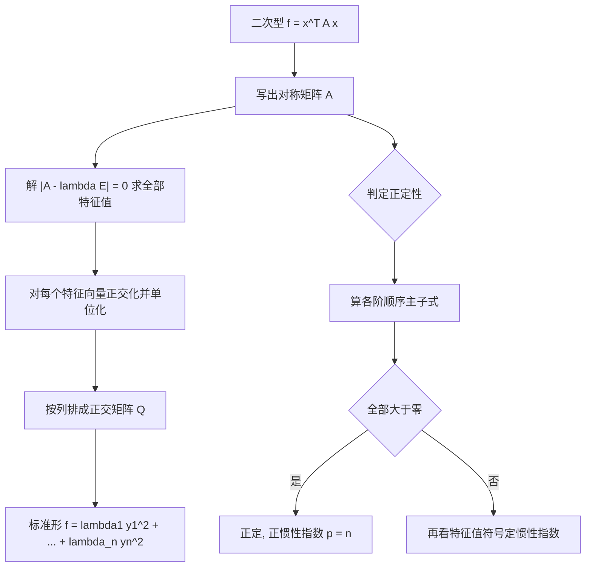

# 线性代数 · 二次型

## 二次型 [高频]

**考频统计**：考察次数 3 次；涉及年份：2023、2024（2023—2024 年数二真题逐题定章统计）；分数占比约 12%；主要题型：选择、解答（正交变换化标准形、正定性、惯性指数）。

**核心讲解**：

## 【二次型与矩阵表示】

- **二次型定义**：含 $n$ 个变量的二次齐次多项式 $f(x_1,\dots,x_n)=\sum_{i=1}^{n}\sum_{j=1}^{n}a_{ij}x_ix_j$。
- **对称约定**：约定 $a_{ij}=a_{ji}$，于是交叉项的系数必须 **对半分** 给对称位置。
- **矩阵形式**：$f=x^{T}Ax$，其中 $A$ 是 **对称** 矩阵，称为该二次型的矩阵。
- **二次型的秩**：$r(A)$ 称为二次型的秩。
- **写矩阵的关键**：$a_{ii}$ 是 $x_i^{2}$ 的系数，$a_{ij}=a_{ji}$ 是 $x_ix_j$ 系数的一半。
- **合同关系**：$A$ 与 $C^{T}AC$（$C$ **可逆**）合同，合同保持秩与惯性指数。

【核心公式】

$$ f(x_1,\dots,x_n)=\sum_{i=1}^{n}\sum_{j=1}^{n}a_{ij}x_ix_j=x^{T}Ax,\qquad A^{T}=A $$

【适用条件】

1. $A$ 必须写成 **对称** 矩阵，即 $A^{T}=A$；
2. $x_ix_j$ 的系数必须拆成 $a_{ij}=a_{ji}=\frac{c}{2}$ 两半；
3. $C^{T}AC$ 中的 $C$ 必须 **可逆**，否则秩与惯性指数都可能改变；
4. 二次型研究的等价关系是合同，不是相似。

> ⚠️ **易错点**：把交叉项系数直接填进 $a_{ij}$。写成非对称矩阵后特征值全错，正交变换也就无从谈起。

## 【标准形与规范形】

- **标准形**：只含平方项、不含交叉项的二次型，形如 $d_1y_1^{2}+\cdots+d_ny_n^{2}$。
- **规范形**：系数只取 $1,-1,0$ 的标准形。
- **配方法**：对应一般的 **可逆** 线性变换 $x=Cy$，只要求 $C$ 可逆。
- **正交变换法**：取 $C=Q$ 为 **正交矩阵**，即 $x=Qy$，其步骤与实对称矩阵正交对角化完全一致。
- **正交变换法的系数**：标准形的系数恰为 $A$ 的 **全部特征值**，且 $Q$ 的列与系数一一对应。
- **重根处理**：不同特征值的特征向量自动正交，只需在重根内部做施密特正交化。

【核心公式】

$$ x=Qy\ \Longrightarrow\ f=x^{T}Ax=\lambda_1y_1^{2}+\lambda_2y_2^{2}+\cdots+\lambda_ny_n^{2},\qquad Q^{T}AQ=\Lambda $$

**正交变换法与配方法对照**：

| 对比项 | 正交变换法 | 配方法 |
| --- | --- | --- |
| 所用变换 | $x=Qy$，$Q$ 为 **正交矩阵** | $x=Cy$，$C$ 只要求 **可逆** |
| 标准形系数 | 恰为 $A$ 的 **特征值** | 由配方过程决定，一般不是特征值 |
| 是否需要求特征值 | 必须先解 $\lvert A-\lambda E\rvert=0$ | 不需要 |
| 是否需要正交化、单位化 | 重根内部需要，且必须 **单位化** | 完全不需要 |
| 变换的唯一性 | 系数顺序可调，系数集合唯一 | 结果不唯一，与配方顺序有关 |
| 计算量 | 较大，但结论规范 | 较小，适合只求标准形 |
| 典型用途 | 要求写出 $Q$、或需要标准形系数 | 只需判惯性指数或求标准形 |

【适用条件】

1. 配方法中的 $C$ 必须 **可逆**，配完后要做可逆性检验；
2. 正交变换法要求先求出 $A$ 的全部特征值；
3. 重根内部必须做施密特正交化，不同特征值之间不必再做；
4. 单位正交特征向量按列拼成 $Q$，$Q^{T}AQ=\Lambda$ 才成立。

> ⚠️ **秒杀技**：只要求标准形、不要求写出变换矩阵时，用配方法最快，完全绕过特征值；一旦题目要求正交矩阵 $Q$，就必须走特征值这条路。

## 【惯性定理与正定性】

- **惯性定理**：无论用哪种可逆线性变换，标准形中正平方项的个数 $p$（正惯性指数）与负平方项的个数 $q$（负惯性指数）都 **唯一确定**。
- **指数关系**：$p+q=r(A)$，$p-q$ 称为符号差。
- **规范形唯一**：$y_1^{2}+\cdots+y_p^{2}-y_{p+1}^{2}-\cdots-y_{p+q}^{2}$ 是唯一确定的规范形。
- **正定定义**：对任意 $x\neq 0$ 都有 $x^{T}Ax>0$。
- **正定的判据群**：特征值全为正、正惯性指数 $p=n$、各阶顺序主子式全大于零（Sylvester 判据）。
- **负定与不定**：负定的判定是 $-f$ 正定；若 $f$ 既能取到正值又能取到负值，则是不定的。

【核心公式】

$$ p+q=r(A),\qquad \text{规范形}=y_1^{2}+\cdots+y_p^{2}-y_{p+1}^{2}-\cdots-y_{p+q}^{2} $$

$$ f\ \text{正定}\iff x^{T}Ax>0\ (\forall x\neq 0)\iff \lambda_i>0\iff p=n\iff \text{各阶顺序主子式全}>0 $$

**正定、半正定、负定、不定判定对照**（$A$ 为 **实对称** 矩阵）：

| 类型 | 定义（对任意 $x\neq 0$） | 特征值符号 | 惯性指数 | 顺序主子式 | 典型例子 |
| --- | --- | --- | --- | --- | --- |
| **正定** | $x^{T}Ax>0$ | 全 $>0$ | $p=n,\ q=0$ | 各阶全 $>0$ | $\begin{pmatrix}2&0\\0&3\end{pmatrix}$ |
| **半正定** | $x^{T}Ax\ge 0$，且存在 $x\neq 0$ 使等号成立 | 全 $\ge 0$，含 $0$ | $p=r<n,\ q=0$ | 各阶 $\ge 0$ | $\begin{pmatrix}1&0\\0&0\end{pmatrix}$ |
| **负定** | $x^{T}Ax<0$ | 全 $<0$ | $p=0,\ q=n$ | 奇数阶 $<0$、偶数阶 $>0$ | $\begin{pmatrix}-1&0\\0&-2\end{pmatrix}$ |
| **不定** | 既有 $x$ 使 $>0$，又有 $x$ 使 $<0$ | 有正有负 | $p>0,\ q>0$ | 无固定规律 | $\begin{pmatrix}1&0\\0&-1\end{pmatrix}$ |

**正定的等价说法**：

| 等价说法 | 表达形式 | 最适用的题型 |
| --- | --- | --- |
| 定义式 | 对任意 $x\neq 0$ 有 $x^{T}Ax>0$ | 证明题 |
| 特征值判据 | $\lambda_i>0\ (i=1,\dots,n)$ | 已知特征值或易求特征值 |
| 惯性指数判据 | $p=n$，即 $p+q=n$ | 已知规范形或标准形 |
| 顺序主子式判据 | 各阶顺序主子式全 $>0$ | 含参数的矩阵求参数范围 |
| 合同于单位阵 | $A$ 合同于 $E$ | 抽象合同讨论 |

【适用条件】

1. 判定正定前必须先确认 $A$ 是 **实对称** 矩阵；
2. Sylvester 判据要求「各阶 **顺序** 主子式」全大于零，不能只验一部分；
3. $r(A)<n$ 时二次型必不可能是正定或负定，秩亏立刻排除；
4. 负定的顺序主子式是 **奇数阶为负、偶数阶为正**，与正定的全正不同。

> ⚠️ **易错点**：把「特征值非负」当成正定，那是半正定。反例 $\begin{pmatrix}1&0\\0&0\end{pmatrix}$ 半正定但不正定。

**关键结论速记**：

- $f=x^{T}Ax$，$A=A^{T}$，$a_{ii}$ 是 $x_i^{2}$ 的系数，$a_{ij}=a_{ji}$ 是 $x_ix_j$ 系数的一半 —— 写二次型矩阵时最易错的一步
- 正交变换 $x=Qy$ $\Rightarrow$ $f=\lambda_1y_1^{2}+\cdots+\lambda_ny_n^{2}$ —— 标准形系数就是 $A$ 的全部特征值
- $p+q=r(A)$，规范形唯一 —— 惯性定理，正负惯性指数与所用变换无关
- 正定 $\iff$ 特征值全正 $\iff$ 正惯性指数 $p=n \iff$ 各阶顺序主子式全大于零 —— 正定判定的四条等价说法
- $A$ 与 $C^{T}AC$ 合同（$C$ 可逆），合同的矩阵秩与惯性指数相同 —— 二次型研究的等价关系是合同而非相似
- 实对称矩阵必存在正交阵 $Q$ 使 $Q^{T}AQ=\Lambda$ —— 正交变换法的全部依据
- $r(A)<n$ 时二次型必不可能是正定或负定 —— 秩亏立刻排除正定

**示意图**：


```text
  general form            congruence              standard form
 +-----------------+     +-------------+     +-----------------+
 |  x^T A x        | --> |  x = C y    | --> |  d1 y1^2 + ...  |
 |  A symmetric    |     |  C invertible|    |  + dn yn^2      |
 +-----------------+     +-------------+     +-----------------+
        |                                              |
        |  orthogonal case:  x = Q y,  Q^T Q = E        |
        v                                              v
 +-----------------+                          +-----------------+
 | Q^T A Q = Lambda|  --------------------->  | l1 y1^2 + ...   |
 | Lambda diagonal |                          | + ln yn^2       |
 +-----------------+                          +-----------------+
        |                                              |
        +---- eigenvalues of A are the coefficients ----+

 normal form:  coefficients are only 1, -1, 0
 +--------------------------------------------------+
 | y1^2 + ... + yp^2 - y(p+1)^2 - ... - y(p+q)^2     |
 | p = positive index, q = negative index, p+q = r(A)|
 +--------------------------------------------------+
```

图中横向是「一般二次型 $\to$ 可逆线性变换 $\to$ 标准形」的合同路线，纵向是正交变换这一特殊情形；正交变换下标准形的系数就是 $A$ 的特征值，而规范形的系数只有 $1,-1,0$，由惯性指数 $p,q$ 唯一决定。



**易错点**：

- 写二次型矩阵时把交叉项系数直接填进 $a_{ij}$。 错在忘记对称位置要各分一半。正确做法：$x_ix_j$ 的系数 $c$ 要拆成 $a_{ij}=a_{ji}=\frac{c}{2}$，例如 $f=2x_1x_2$ 的矩阵是 $\begin{pmatrix}0&1\1&0\end{pmatrix}$ 而不是 $\begin{pmatrix}0&2\2&0\end{pmatrix}$。写成非对称矩阵后特征值全错，正交变换也就无从谈起。
- 把正交变换下的标准形系数写成任意数，或与特征值顺序错配。 错在脱离特征值去配系数。正确做法：正交变换 $x=Qy$ 下标准形的系数只能是 $A$ 的特征值，且 $Q$ 的第 $i$ 列必须对应第 $i$ 个系数；若只要求写出标准形（不要求写出 $Q$），系数顺序可以任意排列。
- 判定正定时只看部分主子式、或把「特征值非负」当成正定。 错在把半正定与正定混淆，也错把「顺序主子式」偷换成「一般主子式」。正确做法：正定必须验证各阶顺序主子式全大于零，或等价地验证特征值全为正。反例：$\begin{pmatrix}1&0\0&0\end{pmatrix}$ 的一阶主子式为 $1,0$，它半正定但不正定；再看 $\begin{pmatrix}-1&0\0&-2\end{pmatrix}$ 这种特征值全负的矩阵，它是负定而非正定。
- 把合同的矩阵当成相似矩阵来处理。 错在混用两种等价关系。正确做法：二次型化标准形用的是合同变换 $C^{T}AC$（保持秩与惯性指数），不保持特征值；只有正交变换这一特殊情形才同时是相似变换，此时系数才等于特征值。

**真题示例**：

**2024 年数二第 22 题（解答题，12 分）**

设矩阵 $A=\begin{pmatrix} 0 & 1 & a \\ 1 & 0 & 1 \end{pmatrix}$，$B=\begin{pmatrix} 1 & 1 \\ 1 & 1 \\ b & 2 \end{pmatrix}$，二次型 $f(x_1,x_2,x_3)=x^{T}BAx$，已知方程组 $Ax=0$ 的解是 $B^{T}x=0$ 的解，但两个方程组不同解。

（1）求 $a,b$ 的值；（2）求正交矩阵 $Q$，使变换 $x=Qy$ 将 $f(x_1,x_2,x_3)$ 化为标准形。

> 解析（本例只解第（2）问，$a=1,b=2$ 由第（1）问得到，见「线性方程组」一章）：
>
> **第一步**，代入 $a=1,b=2$ 算出二次型矩阵。
>
> $$BA=\begin{pmatrix}1&1&2\\1&1&2\\2&2&4\end{pmatrix}$$
>
> 它本身已经是对称矩阵，故 $f=x^{T}(BA)x$ 的矩阵就是
>
> $$S=\begin{pmatrix}1&1&2\\1&1&2\\2&2&4\end{pmatrix}$$
>
> **第二步**，求 $S$ 的特征值：
>
> $$|S-\lambda E|=\lambda^{2}(\lambda-6)$$
>
> sympy 复算特征值为 $6,0,0$，于是二次型的标准形只含一个平方项，系数为 $6$。
>
> **第三步**，求正交矩阵。
>
> $\lambda=6$ 对应特征向量 $(1,1,2)^{T}$，单位化得
>
> $$q_1=\frac{1}{\sqrt6}(1,1,2)^{T}$$
>
> $\lambda=0$ 的特征子空间由 $(-1,1,0)^{T}$、$(-2,0,1)^{T}$ 张成，对其做施密特正交化并单位化得
>
> $$q_2=\frac{1}{\sqrt2}(1,-1,0)^{T}$$
>
> $$q_3=\frac{1}{\sqrt3}(-1,-1,1)^{T}$$
>
> sympy 复算 $Q^{T}Q=E$ 且 $Q^{T}SQ=\operatorname{diag}(6,0,0)$。
>
> **第四步**，写出结论：取
>
> $$Q=\begin{pmatrix}\frac{1}{\sqrt6}&\frac{1}{\sqrt2}&-\frac{1}{\sqrt3}\\ \frac{1}{\sqrt6}&-\frac{1}{\sqrt2}&-\frac{1}{\sqrt3}\\ \frac{2}{\sqrt6}&0&\frac{1}{\sqrt3}\end{pmatrix}$$
>
> 则正交变换 $x=Qy$ 把 $f$ 化为标准形 $f=6y_1^{2}$。

---
