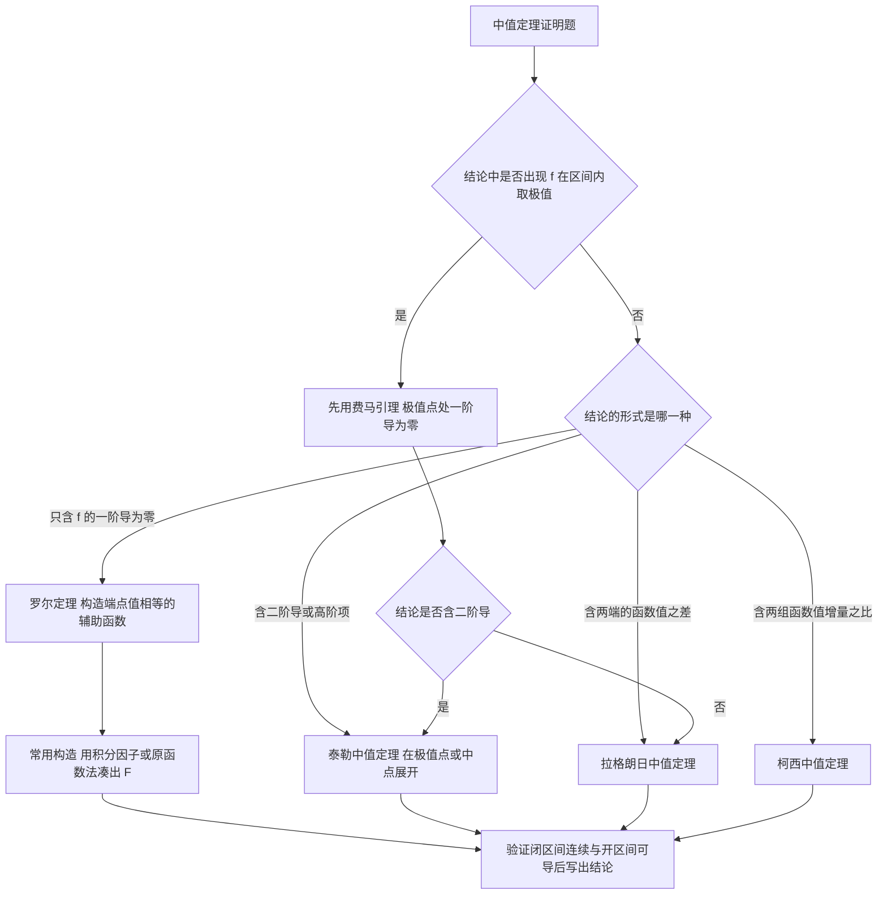

# 高等数学 · 中值定理与导数应用

## 中值定理与导数应用 [高频]

**考频统计**：考察次数 4 次；涉及年份：2023、2024（2023—2024 年数二真题逐题定章统计）；分数占比约 13%；主要题型：选择、解答（证明题常出于此）。

**核心讲解**：

## 【三大中值定理】

- **共同条件**：闭区间 $[a,b]$ 上**连续**、开区间 $(a,b)$ 内**可导**，端点处只要求连续。
- **罗尔定理**比另外两条多一个端点值相等的条件。
- **拉格朗日中值定理**只去掉端点相等这一条，是罗尔定理的推广。
- **柯西中值定理**把两个函数放在一起，取 $g(x)=x$ 时就退化为拉格朗日中值定理。
- 三条定理都只断言 $\xi$ 的**存在性**，不给出 $\xi$ 的具体位置。

| 定理 | 适用条件 | 结论 |
| --- | --- | --- |
| **罗尔定理** | $[a,b]$ 上**连续**，$(a,b)$ 内**可导**，且 $f(a)=f(b)$ | 存在 $\xi\in(a,b)$ 使 $f'(\xi)=0$ |
| **拉格朗日中值定理** | $[a,b]$ 上**连续**，$(a,b)$ 内**可导** | 存在 $\xi\in(a,b)$ 使 $f(b)-f(a)=f'(\xi)(b-a)$ |
| **柯西中值定理** | $f$ 与 $g$ 在 $[a,b]$ 上**连续**、在 $(a,b)$ 内**可导**，且 $g'(x)\neq 0$ | 存在 $\xi\in(a,b)$ 使两个函数的增量之比等于导数之比 |
| **泰勒中值定理** | $f$ 在含 $x_0$ 的区间内具有 $n+1$ 阶导数 | 展开到 $n$ 阶，余项含 $f^{(n+1)}(\xi)$，$\xi$ 介于 $x_0$ 与 $x$ 之间 |

【核心公式】

$$ f'(\xi)=0 $$

$$ f(b)-f(a)=f'(\xi)(b-a) $$

$$ \frac{f(b)-f(a)}{g(b)-g(a)}=\frac{f'(\xi)}{g'(\xi)} $$

【适用条件】

1. $f$ 在**闭区间** $[a,b]$ 上**连续**；
2. $f$ 在**开区间** $(a,b)$ 内**可导**；
3. 罗尔定理还需 $f(a)=f(b)$，柯西中值定理还需 $g'(x)\neq 0$（保证分母**不为 0**）。

> ⚠️ **易错点**：不验证条件就套用中值定理。$f(x)=|x|$ 在 $[-1,1]$ 上**连续**，但在 $x=0$ 处**不可导**，对它用拉格朗日中值定理是错误的。

## 【泰勒中值定理】

- 泰勒中值定理是**拉格朗日定理的推广**，把函数写成多项式与余项之和。
- 条件是 $f$ 在含 $x_0$ 的区间内具有 $n+1$ 阶导数。
- 余项中的 $\xi$ 介于 $x_0$ 与 $x$ 之间，**随 $x$ 而变**，形式与拉格朗日余项一致。
- 最常用的是 $n=1$ 的形式，即在 $x_0$ 处展开到**一阶**。
- 当题设只给到**二阶导数连续**时，余项可由**积分余项**配合积分中值定理得到。

【核心公式】

$$ f(x)=\sum_{k=0}^{n}\frac{f^{(k)}(x_0)}{k!}(x-x_0)^k+\frac{f^{(n+1)}(\xi)}{(n+1)!}(x-x_0)^{n+1} $$

$$ f(x)=f(x_0)+f'(x_0)(x-x_0)+\frac{f''(\xi)}{2}(x-x_0)^2 $$

$$ \int_{x_0}^{x}(x-t)f''(t)\,\mathrm{d}t $$

【适用条件】

1. $f$ 在含 $x_0$ 的区间内具有 $n+1$ 阶**导数**；
2. 余项中的 $\xi$ 介于 $x_0$ 与 $x$ 之间，可写成 $\xi=x_0+\theta(x-x_0)$，其中 $0<\theta<1$；
3. 题设只给到二阶导**连续**时，改用**积分余项**加积分中值定理，结论形式不变。

> ⚠️ **秒杀技**：结论含 $f''(\xi)$ 时，就在**极值点或区间中点**处展开 —— 这两处的奇数阶项在相加减时正好抵消，能把要证的等式凑出来。

## 【单调性、极值与凹凸性】

- 三条判定各看一个符号：**单调性**看 $f'$ 的符号，**极值**看 $f'$ 的零点与两侧符号，**凹凸**看 $f''$ 的符号。
- $f'(x_0)=0$ 或 $f'(x_0)$ 不存在只是极值点的**必要条件**，不是充分条件。
- $f''(x_0)=0$ 或 $f''(x_0)$ 不存在只是拐点的**必要条件**，不是充分条件。
- **第一充分条件**：$f'$ 在 $x_0$ 两侧**变号**。
- **第二充分条件**：$f'(x_0)=0$ 且 $f''(x_0)\neq 0$。

| 判定对象 | 条件 | 结论 |
| --- | --- | --- |
| **单调增** | 区间上 $f'(x)>0$ | $f$ 在该区间上严格单调增 |
| **单调减** | 区间上 $f'(x)<0$ | $f$ 在该区间上严格单调减 |
| **极值点（第一充分条件）** | $f'$ 在 $x_0$ 两侧**变号** | $x_0$ 为极值点 |
| **极值点（第二充分条件）** | $f'(x_0)=0$ 且 $f''(x_0)\neq 0$ | $f''(x_0)>0$ 时为极小值点，$f''(x_0)<0$ 时为极大值点 |
| **拐点** | $f''$ 在 $x_0$ 两侧**变号** | 点 $(x_0,f(x_0))$ 为拐点 |

【核心公式】

$$ f'(x)>0\ \Longrightarrow\ f\ \text{严格单调增},\qquad f'(x)<0\ \Longrightarrow\ f\ \text{严格单调减} $$

$$ f'(x_0)=0,\quad f''(x_0)\neq 0\ \Longrightarrow\ x_0\ \text{为极值点} $$

$$ f''(x)>0\ \Longrightarrow\ \text{曲线是凹的};\qquad f''\ \text{在}\ x_0\ \text{两侧变号}\ \Longrightarrow\ x_0\ \text{为拐点} $$

【适用条件】

1. 判定单调性与极值要求 $f$ 在区间上**可导**；
2. 判定凹凸性与使用第二充分条件要求 $f$ 具有**二阶导数**；
3. 当 $f''(x_0)=0$ 时第二充分条件**失效**，必须回到 $f'$ 是否变号来判断。

> ⚠️ **易错点**：由 $f'(x_0)=0$ 直接断言 $x_0$ 是极值点。$y=x^3$ 在 $x=0$ 处 $f'(0)=0$ 却不是极值点；由 $f''(x_0)=0$ 直接断言拐点同样错，$y=x^4$ 在 $x=0$ 处 $f''(0)=0$，而 $f''=12x^2$ 在两侧同号。

## 【渐近线】

- 渐近线分三类：**水平渐近线**、**竖直渐近线**、**斜渐近线**。
- 水平渐近线来自 $x\to\infty$ 时函数趋于**有限值**。
- 竖直渐近线来自 $x\to x_0$ 时函数趋于**无穷大**。
- 斜渐近线要先求斜率，再求截距，**两者都存在**时才有斜渐近线。
- 斜率不存在时就没有斜渐近线，不必再算截距。

【核心公式】

$$ y=A\ \text{为水平渐近线}\iff \lim_{x\to\infty}f(x)=A $$

$$ x=x_0\ \text{为竖直渐近线}\iff \lim_{x\to x_0}f(x)=\infty $$

$$ k=\lim_{x\to\infty}\frac{f(x)}{x},\qquad b=\lim_{x\to\infty}[f(x)-kx],\qquad y=kx+b $$

$$ y=x\ln\left(e+\frac{1}{x-1}\right)\ \text{的斜渐近线为}\ y=x+\frac1e $$

【适用条件】

1. 求水平渐近线要分别看 $x\to+\infty$ 与 $x\to-\infty$，两侧可以不同；
2. 求竖直渐近线先找函数的**无定义点**与分段函数的分界点；
3. 斜渐近线要求斜率与截距**都存在**且为有限值。

> ⚠️ **秒杀技**：先算 $k=\lim_{x\to\infty}\frac{f(x)}{x}$。算出的 $k=0$ 时斜渐近线退化为**水平渐近线**；$k$ 不存在就直接排除斜渐近线。

## 【证明题的辅助函数构造】

- 核心思路：把结论中的**中值点**看成某个**辅助函数的驻点**。
- 要证 $f'(\xi)=0$：构造满足 $F(a)=F(b)$ 的辅助函数 $F$，再用罗尔定理。
- 要证含 $f(b)-f(a)$ 的等式：用**拉格朗日中值定理**。
- 要证含两组函数值增量之比的等式：用**柯西中值定理**。
- 要证含 $f''(\xi)$ 的等式：在**极值点或区间中点**处用**泰勒公式**。
- 常用构造：要证 $f'(\xi)+\lambda f(\xi)=0$ 就取 $F(x)=e^{\lambda x}f(x)$，这是**原函数法**。

【核心公式】

$$ F(x)=e^{\lambda x}f(x),\qquad F'(\xi)=0\ \Longrightarrow\ f'(\xi)+\lambda f(\xi)=0 $$

【适用条件】

1. 辅助函数 $F$ 必须在 $[a,b]$ 上**连续**、在 $(a,b)$ 内**可导**；
2. 必须验证 $F(a)=F(b)$ 才能使用罗尔定理；
3. 两个不同的中值点必须**分别记为不同字母**，并写清各自所在的开区间。

> ⚠️ **易错点**：证明题中两个不同的中值点共用一个字母。正确做法是先得 $\xi_1\in(0,a)$、$\xi_2\in(-a,0)$，再在 $(\xi_2,\xi_1)$ 内用介值定理。

**关键结论速记**：

- 罗尔定理：闭区间连续 + 开区间可导 + $f(a)=f(b)$ $\Rightarrow$ 存在 $\xi\in(a,b)$ 使 $f'(\xi)=0$ —— 三个条件缺一不可，端点处只要求连续。
- 拉格朗日：$f(b)-f(a)=f'(\xi)(b-a)$ —— 见到两端函数值之差就用它，$f(x)=|x|$ 在 $[-1,1]$ 上当反例。
- 柯西：$\frac{f(b)-f(a)}{g(b)-g(a)}=\frac{f'(\xi)}{g'(\xi)}$ —— 两个函数增量之比，前提是 $g'(x)\neq 0$。
- $f'(x_0)=0$ 且 $f''(x_0)>0$ $\Rightarrow$ $x_0$ 为极小值点 —— 第二充分条件，$f''(x_0)=0$ 时失效，要回到 $f'$ 是否变号判断。
- 拐点判定：$f''$ 在 $x_0$ 两侧变号 —— $f''(x_0)=0$ 只是必要条件，$y=x^4$ 在 $x=0$ 处 $f''=12x^2$ 不变号，不是拐点。
- 斜渐近线 $y=kx+b$：$k=\lim_{x\to\infty}\frac{f(x)}{x}$，$b=\lim_{x\to\infty}[f(x)-kx]$ —— $k$ 不存在时没有斜渐近线。
- 构造辅助函数：要证 $f'(\xi)+\lambda f(\xi)=0$ 就取 $F(x)=e^{\lambda x}f(x)$ —— 原函数法，$F$ 的端点值相等即可用罗尔定理。

**示意图**：

**易错点**：

- **错在不验证条件就套用中值定理，例如对 $f(x)=|x|$ 在 $[-1,1]$ 上使用拉格朗日中值定理。**正确做法是先核对闭区间上连续与开区间内可导，此处 $x=0$ 处不可导，定理失效（事实上 $\frac{f(1)-f(-1)}{2}=0$ 却不存在使 $f'(\xi)=0$ 的点）。
- **错在由 $f'(x_0)=0$ 直接断言 $x_0$ 是极值点，例如 $y=x^3$ 在 $x=0$ 处 $f'(0)=0$ 但不是极值点。**正确做法是看 $f'$ 在 $x_0$ 两侧是否变号，或验证 $f''(x_0)\neq 0$。
- **错在由 $f''(x_0)=0$ 直接断言 $x_0$ 是拐点，例如 $y=x^4$ 在 $x=0$ 处 $f''(0)=0$ 而 $f''=12x^2$ 在两侧同号。**正确做法是验证 $f''$ 在 $x_0$ 两侧变号，或者验证 $f'''$ 存在且 $f'''(x_0)\neq 0$。
- **错在证明题中两个不同的中值点共用一个字母。**正确做法是分区间使用时分别记为 $\xi$ 与 $\eta$，并写清各自所在的开区间，例如先得 $\xi_1\in(0,a)$、$\xi_2\in(-a,0)$，再在 $(\xi_2,\xi_1)$ 内用介值定理。

**真题示例**：

**2023 年数二第 21 题（解答题，12 分）**

设函数 $f(x)$ 在 $[-a,a]$ 上具有 2 阶连续导数，证明：

（I）若 $f(0)=0$，则存在 $\xi\in(-a,a)$，使得 $f''(\xi)=\frac{1}{a^2}[f(a)+f(-a)]$；

（II）若 $f(x)$ 在 $(-a,a)$ 内取得极值，则存在 $\eta\in(-a,a)$，使得 $|f''(\eta)|\ge\frac{1}{2a^2}|f(a)-f(-a)|$。

> 解析：（I）由 $f''$ 连续，对 $f$ 在 $x=0$ 处用带拉格朗日余项的泰勒公式，分别取 $x=a$ 与 $x=-a$ 得 $f(a)=f(0)+f'(0)a+\frac{f''(\xi_1)}{2}a^2$ 与 $f(-a)=f(0)-f'(0)a+\frac{f''(\xi_2)}{2}a^2$，其中 $\xi_1\in(0,a)$、$\xi_2\in(-a,0)$。两式相加并用 $f(0)=0$ 得 $f(a)+f(-a)=\frac{a^2}{2}[f''(\xi_1)+f''(\xi_2)]$，再由 $f''$ 的连续性用介值定理，存在 $\xi\in(\xi_2,\xi_1)\subset(-a,a)$ 使 $f''(\xi)=\frac{f''(\xi_1)+f''(\xi_2)}{2}=\frac{f(a)+f(-a)}{a^2}$。（II）设 $f$ 在 $c\in(-a,a)$ 处取得极值，由费马引理 $f'(c)=0$，在 $x=c$ 处展开得 $f(a)=f(c)+\frac{f''(\eta_1)}{2}(a-c)^2$ 与 $f(-a)=f(c)+\frac{f''(\eta_2)}{2}(a+c)^2$；两式相减并取绝对值，记 $M=\max\{|f''(\eta_1)|,|f''(\eta_2)|\}$，则 $|f(a)-f(-a)|\le\frac{M}{2}[(a-c)^2+(a+c)^2]=M(a^2+c^2)\le 2a^2M$，于是 $M\ge\frac{|f(a)-f(-a)|}{2a^2}$，取使 $|f''(\eta)|=M$ 的那个点即得结论。

---
