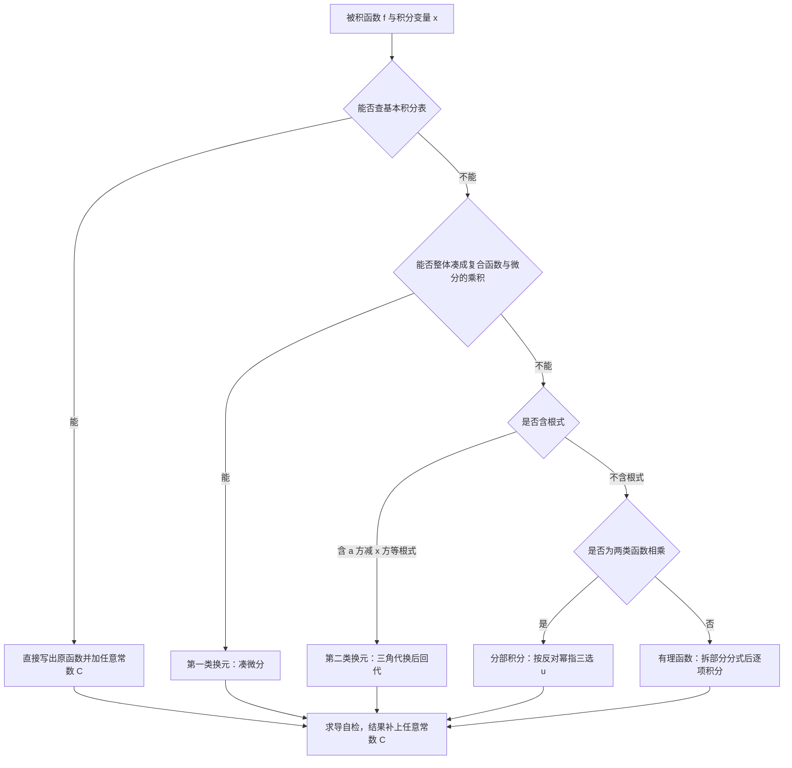

# 高等数学 · 不定积分

## 不定积分

**考频统计**：考察次数 考频待补充；涉及年份：见下方说明；分数占比约 7%；主要题型：少单独命题，多为定积分与微分方程解答题的中间步骤。

> **考频说明**：本章在 2023—2024 年样本中未单独命题：官方从不公布考频，本资料亦无法核实其独立考察次数，故标注「考频待补充」。但基本积分表、换元法与分部积分法是定积分、微分方程与二重积分计算的**必备前置**，不可跳过。

**核心讲解**：

## 【原函数与基本积分表】

- **原函数的定义**：若 $F'(x)=f(x)$ 在区间 $I$ 上**处处成立**，则称 $F$ 是 $f$ 在 $I$ 上的一个原函数。
- **原函数存在定理**给出的是**充分条件**：$f$ 在区间 $I$ 上**连续**时必有原函数。
- 此时**变限积分**就是一个原函数，同一被积函数的任意两个原函数只相差一个常数。
- 所以不定积分表示的是**函数族**，结果必须写成 $F(x)+C$。
- 不定积分的计算完全建立在**基本积分表**上，基本公式必须背到条件反射。

| 间断点类型 | 是否有原函数 | 理由 |
| --- | --- | --- |
| **连续**（无间断点） | **必有**原函数 | 变限积分即为一个原函数 |
| **第一类间断点**（可去、跳跃） | **没有**原函数 | 导数不可能出现第一类间断点 |
| **无穷间断点**（第二类） | **没有**原函数 | 原函数在该点附近无界，与可导矛盾 |
| **振荡间断点**（第二类） | **可能有**原函数 | 振荡不影响原函数的存在性 |

【核心公式】

$$ \int f(x)\,\mathrm{d}x=F(x)+C,\qquad F'(x)=f(x) $$

$$ \int x^{\mu}\,\mathrm{d}x=\frac{x^{\mu+1}}{\mu+1}+C\ (\mu\neq-1),\qquad \int\frac{\mathrm{d}x}{x}=\ln|x|+C $$

$$ \int e^x\,\mathrm{d}x=e^x+C,\qquad \int\frac{\mathrm{d}x}{1+x^2}=\arctan x+C,\qquad \int\frac{\mathrm{d}x}{\sqrt{1-x^2}}=\arcsin x+C $$

$$ y=\frac{x^2}{2}+C\ \text{是}\ f(x)=x\ \text{的原函数族}:\quad C=-1,0,1\ \text{三条曲线在}\ x=1\ \text{处的切线斜率都等于}\ f(1)=1 $$

【适用条件】

1. $F'(x)=f(x)$ 要在区间 $I$ 上**处处成立**；
2. 求不定积分时被积函数应在区间上**连续**，以保证原函数存在；
3. 含**第一类间断点或无穷间断点**的函数，在含该点的区间上**没有**原函数。

> ⚠️ **易错点**：漏写任意常数 $C$，或把两个不同的常数写成同一个。不定积分是**函数族**而不是单个函数；分段函数求原函数时，两段的常数不能取成同一个，要由分段点处原函数**连续**解出两段常数之差。

## 【换元积分法】

- **第一类换元法（凑微分）**的依据是复合函数求导公式的逆用。
- 操作上就是把被积表达式整体凑成**复合函数与微分的乘积**。
- **线性代换**是最常用的一条，结果中**不要漏掉系数**。
- **第二类换元法**用来**消去根式**，算完必须把 $t$ **回代**为 $x$。
- 三角代换有固定对应：平方差用**正弦**、平方和用**正切**、被减平方用**正割**。
- 选路原则：能把微分凑进去就用第一类，凑不进去就作第二类代换。

| 换元方法 | 适用情形 | 关键要求 | 典型形式 |
| --- | --- | --- | --- |
| **第一类换元（凑微分）** | 被积式能整体凑成复合函数与微分的乘积 | $\varphi(x)$ **可导**，$f$ **有原函数** | 把被积式凑成 $f(\varphi(x))\,\mathrm{d}\varphi(x)$ |
| **第二类换元（三角代换）** | 被积函数含 $\sqrt{a^2-x^2}$、$\sqrt{a^2+x^2}$、$\sqrt{x^2-a^2}$ 三类根式 | 代换 $x=\psi(t)$ **单调可导**且 $\psi'(t)$ **不为 0** | 分别令 $x=a\sin t$、$x=a\tan t$、$x=a\sec t$ |
| **第二类换元（根式代换）** | 被积函数含 $\sqrt[n]{ax+b}$ 一类的整根式 | 代换后必须能**回代**为 $x$ | 令 $t=\sqrt[n]{ax+b}$，把根式化为有理式 |

【核心公式】

$$ \int f(\varphi(x))\varphi'(x)\,\mathrm{d}x=\int f(u)\,\mathrm{d}u=F(u)+C=F(\varphi(x))+C $$

$$ \int f(ax+b)\,\mathrm{d}x=\frac1aF(ax+b)+C $$

$$ \sqrt{a^2-x^2}\ \to\ x=a\sin t,\qquad \sqrt{a^2+x^2}\ \to\ x=a\tan t,\qquad \sqrt{x^2-a^2}\ \to\ x=a\sec t $$

$$ \int\frac{\mathrm{d}x}{x(1+\ln x)}=\ln|1+\ln x|+C,\qquad \int xe^{x^2}\,\mathrm{d}x=\frac12e^{x^2}+C $$

$$ \int\sqrt{4-x^2}\,\mathrm{d}x=\frac x2\sqrt{4-x^2}+2\arcsin\frac x2+C $$

【适用条件】

1. 第一类换元要求 $\varphi(x)$ **可导**且 $f$ **有原函数**；
2. 线性代换中 $a$ **不为 0**，结果必须带因子 $\frac1a$；
3. 第二类换元要求 $x=\psi(t)$ **单调可导**且 $\psi'(t)$ **不为 0**；
4. 算完必须用反函数把 $t$ **回代**为 $x$，结果可以直接**求导自检**。

> ⚠️ **易错点**：凑微分时把 $\int f(ax+b)\,\mathrm{d}x$ 写成 $F(ax+b)+C$。正确结果是 $\frac1aF(ax+b)+C$，例如 $\int e^{2x}\,\mathrm{d}x=\frac12e^{2x}+C$ 而不是 $e^{2x}+C$。

## 【分部积分与有理函数积分】

- **分部积分**处理的是**两类不同函数相乘**的被积函数。
- 选 $u$ 的次序为“**反三角、对数、幂函数、指数、三角**”，谁排在前面谁作 $u$。
- 选 $u$ 的原则是：**求导后变简单的作 $u$**，容易积分的作 $\mathrm{d}v$。
- **有理函数**有固定路线：假分式先做**多项式除法**拆出整式。
- 真分式按分母的**因式分解**拆成**部分分式**，再逐项积分。
- 因此有理函数的不定积分**一定可以用初等函数表出**。

【核心公式】

$$ \int u\,\mathrm{d}v=uv-\int v\,\mathrm{d}u $$

$$ \int(x+1)\cos x\,\mathrm{d}x=(x+1)\sin x+\cos x+C,\qquad \int\ln x\,\mathrm{d}x=x\ln x-x+C $$

【适用条件】

1. 被积函数是**两类不同函数**的乘积；
2. $u$ 与 $v$ 都**可导**，且 $\int v\,\mathrm{d}u$ 要比原积分更容易算；
3. 有理函数拆分前必须先把**假分式**化为整式与真分式之和。

> ⚠️ **秒杀技**：按“反、对、幂、指、三”的次序选 $u$。例如 $\int\ln x\,\mathrm{d}x$ 必须把 $\ln x$ 当作 $u$，否则会绕回原积分。

**关键结论速记**：

- $\int f(ax+b)\,\mathrm{d}x=\frac1aF(ax+b)+C$ —— 线性代换只差常数因子 $\frac1a$，是最常见的凑微分。
- $\int u\,\mathrm{d}v=uv-\int v\,\mathrm{d}u$ —— 选 $u$ 按“反、对、幂、指、三”，排在前面的一律放进 $u$。
- $\int\frac{\mathrm{d}x}{x^2+a^2}=\frac1a\arctan\frac xa+C$，$\int\frac{\mathrm{d}x}{\sqrt{x^2\pm a^2}}=\ln\left|x+\sqrt{x^2\pm a^2}\right|+C$ —— 比基本积分表更常用的两条补充公式。
- $\int\sqrt{a^2-x^2}\,\mathrm{d}x=\frac x2\sqrt{a^2-x^2}+\frac{a^2}{2}\arcsin\frac xa+C$ —— 三角代换的标准产物，结果同时含根式与反正弦。
- 连续函数必有原函数，含第一类或无穷间断点的函数无原函数 —— 判断原函数是否存在，只看间断点的类型。
- 分段函数的原函数必须在分段点连续 —— 各段分别积分后，用分段点的连续性定出两段常数之差，两段只允许相差一个常数。
- 初等函数在其定义区间上连续因而有原函数，但原函数未必是初等函数 —— 如 $\int e^{-x^2}\,\mathrm{d}x$、$\int\frac{\sin x}{x}\,\mathrm{d}x$ 都不能用初等函数表出。

**示意图**：

**易错点**：

- 漏写任意常数 $C$，或把两个不同的常数写成同一个。 错在把不定积分当成一个函数：$\int f(x)\,\mathrm{d}x$ 是函数族，必须写 $+C$；分段函数求原函数时，两段的常数不能取成同一个，要由分段点处原函数连续解出两段常数之差。
- 凑微分时把 $\int f(ax+b)\,\mathrm{d}x$ 写成 $F(ax+b)+C$。 正确结果是 $\frac1aF(ax+b)+C$，因为 $\mathrm{d}(ax+b)=a\,\mathrm{d}x$，例如 $\int e^{2x}\,\mathrm{d}x=\frac12e^{2x}+C$ 而不是 $e^{2x}+C$。
- 第二类换元后忘记把 $t$ 回代为 $x$，或忽略代换必须单调可导。 正确做法是算完立即用 $t=\arcsin\frac xa$ 等反函数回代，并在作代换时说明 $t$ 的取值范围，保证 $x=\psi(t)$ 单调、$\psi'(t)\neq0$。
- 认为分段函数的原函数就是把两段分别积分。 错在忽略了原函数必须可导、从而必须连续：分别在两段上积分后要补一个常数修正，使左右极限相等，例如右支积出 $(x+1)\sin x+\cos x+C_2$（在 $x=0$ 处值为 $1+C_2$）时，左支的常数必须是 $C_1=1+C_2$，否则原函数在 $x=0$ 处间断。

**真题示例**：

**2023 年数二第 2 题（选择题，5 分）**

函数 $f(x)=\begin{cases}\dfrac{1}{\sqrt{1+x^2}},& x\leqslant 0,\\ (x+1)\cos x,& x>0\end{cases}$ 的一个原函数是（　）

> 解析：
> 1. 原函数 $F(x)$ 必须在 $(-\infty,+\infty)$ 上可导且 $F'(x)=f(x)$，可导必连续，所以先分段积分再在 $x=0$ 处拼接。
> 2. $x\leqslant0$ 时 $\int\frac{\mathrm{d}x}{\sqrt{1+x^2}}=\ln\left(x+\sqrt{1+x^2}\right)+C_1$；$x>0$ 时 $\int(x+1)\cos x\,\mathrm{d}x=(x+1)\sin x+\cos x+C_2$。
> 3. 由 $x=0$ 处连续得 $\ln 1+C_1=1+C_2$，即 $C_1=1+C_2$；取 $C_2=-1$，则 $F(0)=0$，此时
> $$F(x)=\begin{cases}\ln\left(x+\sqrt{1+x^2}\right),& x\leqslant 0,\\ (x+1)\sin x+\cos x-1,& x>0.\end{cases}$$
> 4. 检验可导：$F'_{-}(0)=\left.\frac{1}{\sqrt{1+x^2}}\right|_{x=0}=1$，$F'_{+}(0)=(0+1)\cos 0=1$，两段在 $x=0$ 处光滑拼接，故 $F(x)$ 确为 $f(x)$ 的一个原函数（$F(1)=2\sin1+\cos1-1\approx1.2232$）。
> 结论：原函数在分段点必须连续，正确选项就是上面这段 $F(x)$。

---
