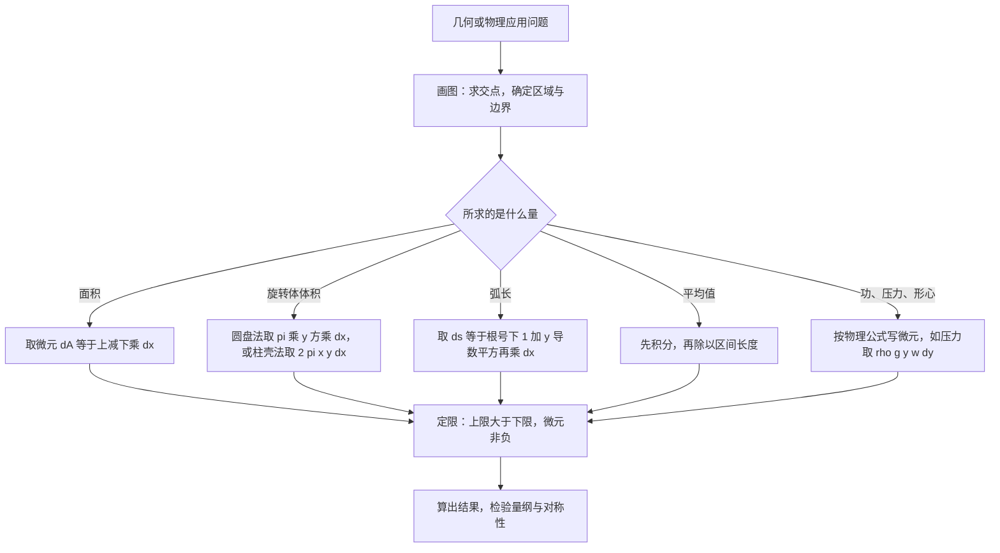

# 高等数学 · 定积分的几何与物理应用

## 定积分的几何与物理应用 [高频]

**考频统计**：考察次数 2 次；涉及年份：2023、2024（2023—2024 年数二真题逐题定章统计）；分数占比约 9%；主要题型：选择、填空、解答（面积、体积、弧长、平均值、物理量）。

**核心讲解**：

## 【微元法：四步框架与定限】

- **本质**：把所求量 $Q$ 写成 $\int_a^b\mathrm{d}Q$，即"分割、近似、求和、取极限"四步的浓缩形式。
- **可加性**：$Q$ 对区间必须**可加**——大区间上的量等于各小区间上量之和，这是能用定积分表示的前提。
- **微元精度**：微元 $\mathrm{d}Q=f(x)\,\mathrm{d}x$ 与小区间上真实部分量之差必须是 $\mathrm{d}x$ 的**高阶无穷小**。
- **定限**：上限必须大于下限，且微元 $\mathrm{d}Q$ **不变号**（取正），否则算出的不是几何量或物理量。
- **通式**：$\displaystyle Q=\int_a^b\mathrm{d}Q$，其中 $\mathrm{d}Q$ 按所求量的几何或物理意义确定。

【核心公式】

$$ Q=\int_a^b\mathrm{d}Q $$

【适用条件】

1. $Q$ 对区间具有**可加性**；
2. 微元与真实部分量之差是 $\mathrm{d}x$ 的**高阶无穷小**；
3. 积分上限大于下限，微元**不变号**。

**四类常见量的微元与定限对照**（画图定性、按量选微元）：

| 所求量 | 微元 $\mathrm{d}Q$ | 定限方式 | 易错处 |
| --- | --- | --- | --- |
| **面积** $A$ | $[f(x)-g(x)]\,\mathrm{d}x$（上减下） | 解 $f(x)=g(x)$ 定交点，再定积分限 | 不先求交点，或全程只用一个"上减下" |
| **旋转体体积** $V_x$ | $\pi[f^2(x)-g^2(x)]\,\mathrm{d}x$（圆盘法） | 沿 $x$ 轴定限，取 $x\in[a,b]$ | 写成 $\pi\left(\int_a^bf\,\mathrm{d}x\right)^2$，先积分后平方 |
| **旋转体体积** $V_y$ | $2\pi xf(x)\,\mathrm{d}x$（柱壳法） | 沿 $x$ 轴定限，要求 $a\geqslant0$、$f(x)\geqslant0$ | 漏掉因子 $x$（壳的周长） |
| **弧长** $s$ | $\sqrt{1+y'^2}\,\mathrm{d}x$ | 沿 $x$ 定限；参数式沿 $t$ 定限 | 忘开根号，或把它写成 $\mathrm{d}x+\mathrm{d}y$ |
| **功与压力** | $F(x)\,\mathrm{d}x$；$\rho g\,y\,w(y)\,\mathrm{d}y$ | 沿位移定限；水深从水面量起 | 水深起点取错，$F$ 与位移反向时忘取负号 |

> ⚠️ **秒杀技**：先画图求交点、再按所求量选微元、最后定限。微元选对之后上下限只是"看图写数"，真正的难点全在选微元这一步。

## 【平面图形的面积与旋转体体积】

- **面积**：直角坐标下"上减下"，若 $f(x)\geqslant g(x)$ 在 $[a,b]$ 上成立，则 $A=\int_a^b[f(x)-g(x)]\,\mathrm{d}x$。
- **$y$ 型区域**：同一区域若改按 $y$ 定限，面积写成"右减左" $\int_c^d[\varphi(y)-\psi(y)]\,\mathrm{d}y$。
- **面积实例**：$y=\sqrt{x}$ 与 $y=x^2$ 交于 $(0,0)$、$(1,1)$，故 $A=\int_0^1(\sqrt{x}-x^2)\,\mathrm{d}x=\frac13$。
- **代数和陷阱**：曲线在区间内**穿过** $x$ 轴时必须分段计算或对 $|f(x)|$ 积分，否则得到的是面积的代数和。
- **圆盘法与柱壳法**：曲边梯形 $0\leqslant g(x)\leqslant f(x)$、$x\in[a,b]$ 绕 $x$ 轴旋转用 $V_x=\pi\int_a^b[f^2(x)-g^2(x)]\,\mathrm{d}x$；绕 $y$ 轴旋转用 $V_y=2\pi\int_a^bxf(x)\,\mathrm{d}x$。
- **已知截面面积**：若立体在 $x$ 处垂直于 $x$ 轴的截面面积为 $A(x)$，则 $V=\int_a^bA(x)\,\mathrm{d}x$。
- **体积实例**：$y=\sqrt{x}$ 与 $y=x^2$ 围成的图形绕 $x$ 轴旋转，$V_x=\pi\int_0^1(x-x^4)\,\mathrm{d}x=\frac{3\pi}{10}\approx0.9425$。

【核心公式】

$$ A=\int_a^b[f(x)-g(x)]\,\mathrm{d}x,\qquad V_x=\pi\int_a^b[f^2(x)-g^2(x)]\,\mathrm{d}x,\qquad V_y=2\pi\int_a^bxf(x)\,\mathrm{d}x $$

$$ V=\int_a^bA(x)\,\mathrm{d}x $$

【适用条件】

1. 面积公式要求 $f(x)$ 与 $g(x)$ 在 $[a,b]$ 上**连续**且 $f(x)\geqslant g(x)$；
2. 计算前必须先解 $f(x)=g(x)$ 求出交点，并由交点确定积分限；
3. 柱壳法要求 $a\geqslant0$、$f(x)\geqslant0$（否则 $2\pi xf(x)$ 变号，"壳"失去意义）；
4. 圆盘法要求外层曲线 $f$ 与内层曲线 $g$ 满足 $0\leqslant g(x)\leqslant f(x)$；
5. 曲线在区间内变号时必须**分段**计算或改用 $|f(x)|$。

**两条路线的选择对照**：

| 情形 | 选法 | 公式 | 前提 |
| --- | --- | --- | --- |
| 图形绕 $x$ 轴旋转 | **圆盘法**（切片） | $V_x=\pi\int_a^b[f^2(x)-g^2(x)]\,\mathrm{d}x$ | 半径沿 $x$ 方向可读出 |
| 图形绕 $y$ 轴旋转 | **柱壳法** | $V_y=2\pi\int_a^bxf(x)\,\mathrm{d}x$ | $a\geqslant0$、$f(x)\geqslant0$ |
| 截面面积已知 | 切片法 | $V=\int_a^bA(x)\,\mathrm{d}x$ | $A(x)$ 在 $[a,b]$ 上**连续** |

> ⚠️ **易错点**：柱壳法漏掉因子 $x$ 是最高频失分点。$2\pi x$ 是壳的周长、$f(x)$ 是壳的高、$\mathrm{d}x$ 是厚度，三项缺一不可；另外 $\pi\left(\int_a^bf(x)\,\mathrm{d}x\right)^2$ 是错的，正确写法是 $\pi\int_a^bf^2(x)\,\mathrm{d}x$——**先平方再积分**。

## 【弧长、极坐标面积与平均值】

- **直角坐标弧长**：$y=y(x)$ 在 $[a,b]$ 上有一阶**连续**导数时，$s=\int_a^b\sqrt{1+y'^2}\,\mathrm{d}x$。
- **参数方程弧长**：曲线由 $x=x(t),y=y(t)$（$\alpha\leqslant t\leqslant\beta$）给出且 $x'(t),y'(t)$ **连续**、不同时为零时，$s=\int_\alpha^\beta\sqrt{x'^2(t)+y'^2(t)}\,\mathrm{d}t$。
- **实例**：上半圆 $y=\sqrt{1-x^2}$ 在 $[-1,1]$ 上的弧长为 $\pi$。
- **极坐标曲边扇形**：由 $r=r(\theta)$、$\theta\in[\alpha,\beta]$ 围成时，$A=\frac12\int_\alpha^\beta r^2(\theta)\,\mathrm{d}\theta$。
- **平均值**：连续函数 $f$ 在 $[a,b]$ 上的平均值是 $\bar y=\frac1{b-a}\int_a^bf(x)\,\mathrm{d}x$，即"总量除以区间长度"。
- **平均值实例**：$v(t)=t+k\sin\pi t$ 在 $[0,3]$ 上的平均速度是 $\frac13\int_0^3v(t)\,\mathrm{d}t$，不是 $\frac{v(0)+v(3)}{2}$。

【核心公式】

$$ s=\int_a^b\sqrt{1+y'^2}\,\mathrm{d}x,\qquad s=\int_\alpha^\beta\sqrt{x'^2(t)+y'^2(t)}\,\mathrm{d}t $$

$$ A=\frac12\int_\alpha^\beta r^2(\theta)\,\mathrm{d}\theta,\qquad \bar y=\frac1{b-a}\int_a^bf(x)\,\mathrm{d}x $$

【适用条件】

1. 弧长公式要求 $y(x)$ 在 $[a,b]$ 上有一阶**连续**导数；
2. 参数式弧长要求 $x'(t)$ 与 $y'(t)$ **连续**且**不同时为零**（否则曲线出现尖点或静止点）；
3. 极坐标面积公式要求 $r(\theta)$ 在 $[\alpha,\beta]$ 上**连续**，且 $\alpha<\beta$；
4. 平均值公式要求 $f$ 在 $[a,b]$ 上**连续**（可积），且 $a\neq b$。

> ⚠️ **秒杀技**：平均值的分母是**区间长度**不是取样个数。填空题里凡出现"平均速度""平均浓度"，一律写成 $\frac1{b-a}\int_a^b(\cdot)\,\mathrm{d}x$，比逐段求算术平均稳得多。

## 【物理应用：变力做功、水压力与形心】

- **变力做功**：$W=\int_a^bF(x)\,\mathrm{d}x$，其中 $F$ 取位移方向为正。
- **水压力**：$P=\int_0^h\rho g\,y\,w(y)\,\mathrm{d}y$，其中 $y$ 是水深（水面取 $0$、向下为正），$w(y)$ 是该深度处平板的宽度，$\rho$ 是水的密度，$g$ 是重力加速度。
- **水压力实例**：斜边长为 $2a$ 的等腰直角三角形平板铅直放入水中、斜边与水面相齐，深度 $y$ 处宽度为 $w(y)=2(a-y)$，故 $P=2\rho g\int_0^a y(a-y)\,\mathrm{d}y=\frac13\rho ga^3$。
- **形心横坐标**：均匀薄片可用 $\bar x=\frac{\int_a^bx f(x)\,\mathrm{d}x}{\int_a^bf(x)\,\mathrm{d}x}$ 求。
- **形心纵坐标**：$\bar y=\frac{\frac12\int_a^bf^2(x)\,\mathrm{d}x}{\int_a^bf(x)\,\mathrm{d}x}$，对应 $f(x)\geqslant0$ 时曲线与 $x$ 轴所夹的曲边梯形。
- **列式套路**：微元乘以力臂即得矩微元，分子是矩、分母是总量（面积）。

【核心公式】

$$ W=\int_a^bF(x)\,\mathrm{d}x,\qquad P=\int_0^h\rho g\,y\,w(y)\,\mathrm{d}y,\qquad \bar x=\frac{\int_a^bx f(x)\,\mathrm{d}x}{\int_a^bf(x)\,\mathrm{d}x},\qquad \bar y=\frac{\frac12\int_a^bf^2(x)\,\mathrm{d}x}{\int_a^bf(x)\,\mathrm{d}x} $$

【适用条件】

1. 做功要求 $F(x)$ 在位移区间上**连续**，且 $F$ 与位移同向时取正、反向时取负；
2. 水压力要求平板铅直置于液体中，$y$ 一律从**水面**量起、向下为正；
3. $w(y)$ 是该深度处平板的**水平宽度**，必须由几何关系先求出；
4. 形心公式要求 $f(x)$ 在 $[a,b]$ 上**连续**且 $f(x)\geqslant0$，分母 $\int_a^bf(x)\,\mathrm{d}x$ **不为 0**。

> ⚠️ **易错点**：水压力公式里 $y$ 是**水深**而不是坐标值，水深一律从水面量起；宽度函数 $w(y)$ 写错（例如把三角形斜边当成竖直边）会让结果整体差一个系数，列式前先在图上标出 $y$ 与 $w(y)$ 的关系。

**关键结论速记**：

- $A=\int_a^b[f(x)-g(x)]\,\mathrm{d}x$（$f\geqslant g$ 于 $[a,b]$） —— 面积永远“上减下”，与 $x$ 轴的位置无关。
- $V_x=\pi\int_a^b[f^2(x)-g^2(x)]\,\mathrm{d}x$ —— 绕 $x$ 轴旋转用圆盘法，微元是圆环面积 $\pi(f^2-g^2)\,\mathrm{d}x$。
- $V_y=2\pi\int_a^bxf(x)\,\mathrm{d}x$ —— 绕 $y$ 轴旋转用柱壳法，$2\pi x$ 是壳的周长，$f(x)$ 是高，$\mathrm{d}x$ 是厚度。
- $s=\int_a^b\sqrt{1+y'^2}\,\mathrm{d}x=\int_\alpha^\beta\sqrt{x'^2+y'^2}\,\mathrm{d}t$ —— 弧长微元 $\mathrm{d}s=\sqrt{\mathrm{d}x^2+\mathrm{d}y^2}$，两种写法同源。
- $\bar y=\frac1{b-a}\int_a^bf(x)\,\mathrm{d}x$ —— 平均值是“总量除以区间长度”，不是两端点的算术平均。
- $P=\int_0^h\rho g\,y\,w(y)\,\mathrm{d}y$ —— 水压力微元等于压强 $\rho gy$ 乘面积微元 $w(y)\,\mathrm{d}y$，水深一律从水面量起。
- $W=\int_a^bF(x)\,\mathrm{d}x$ —— 变力做功；$F(x)$ 与位移方向相反时取负号。

**示意图**：

**易错点**：

- 求面积时不先求交点、不判断上下关系。 错在把两条曲线围成的面积写成 $\int_a^b[f(x)+g(x)]\,\mathrm{d}x$，或全程只用同一个“上减下”；正确做法是先解 $f(x)=g(x)$ 定出积分限，再逐段确认谁在上，用 $\int(\text{上}-\text{下})\,\mathrm{d}x$。
- 把旋转体体积写成 $\pi\left(\int_a^bf(x)\,\mathrm{d}x\right)^2$，或漏掉内圈。 正确是 $V_x=\pi\int_a^bf^2(x)\,\mathrm{d}x$，先平方后积分；两条曲线围成的图形绕 $x$ 轴旋转时，微元是圆环面积 $\pi[f^2(x)-g^2(x)]\,\mathrm{d}x$。
- 用柱壳法求 $V_y$ 时漏掉因子 $x$。 正确是 $V_y=2\pi\int_a^bxf(x)\,\mathrm{d}x$：$2\pi x$ 是壳的周长、$f(x)$ 是壳的高、$\mathrm{d}x$ 是厚度，三项缺一不可。
- 把平均值当成两端点的算术平均。 正确是 $\bar y=\frac1{b-a}\int_a^bf(x)\,\mathrm{d}x$，例如 $v(t)=t+k\sin\pi t$ 在 $[0,3]$ 上的平均速度是 $\frac13\int_0^3v(t)\,\mathrm{d}t$，而不是 $\frac{v(0)+v(3)}{2}$。

**真题示例**：

**2024 年数二第 15 题（填空题，5 分）**

某物体以速度 $v(t)=t+k\sin\pi t$ 做直线运动，若它从 $t=0$ 到 $t=3$ 的时间段内平均速度是 $\frac52$，则 $k=$ ________。

> 解析：
> 1. 平均速度是速度函数在时间区间上的平均值：$\bar v=\frac1{3-0}\int_0^3v(t)\,\mathrm{d}t$。
> 2. 计算积分：$\int_0^3\left(t+k\sin\pi t\right)\mathrm{d}t=\left[\frac{t^2}{2}-\frac{k}{\pi}\cos\pi t\right]_0^3=\frac92+\frac{2k}{\pi}$。
> 3. 由 $\frac13\left(\frac92+\frac{2k}{\pi}\right)=\frac52$ 得 $\frac{2k}{3\pi}=1$，故 $k=\frac{3\pi}{2}\approx4.712$。
> 结论：$k=\frac{3\pi}{2}$；此时总位移为 $\int_0^3v(t)\,\mathrm{d}t=\frac{15}{2}$，平均速度恰为 $\frac52$。

---
