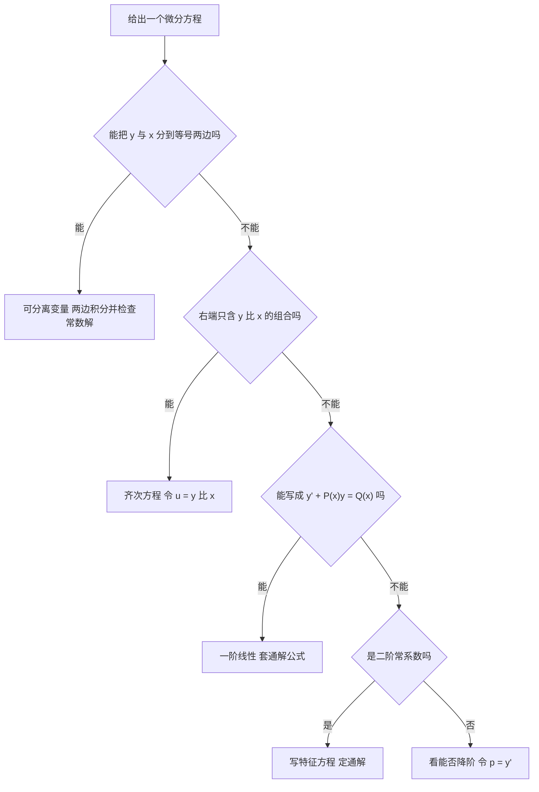

# 高等数学 · 微分方程

## 微分方程 [高频]

**考频统计**：考察次数 3 次；涉及年份：2023、2024（2023—2024 年数二真题逐题定章统计）；分数占比约 8%；主要题型：选择、填空、解答（一阶与二阶常系数、几何应用）。

**核心讲解**：

## 【一阶微分方程：三种类型与通解】

- **可分离变量方程**：形如 $\frac{dy}{dx}=f(x)g(y)$，把两个变量分到等号两侧后分别积分。
- **齐次方程**：形如 $\frac{dy}{dx}=\varphi\left(\frac{y}{x}\right)$，令 $u=\frac{y}{x}$（即 $y=ux$、$y'=u+xu'$）后化为可分离变量方程。
- **一阶线性方程**：形如 $y'+P(x)y=Q(x)$，通解由公式直接给出。
- **准齐次型**：凡形如 $y'=f(ax+by+c)$ 的方程，令 $u=ax+by+c$ 即可化为可分离变量方程。
- **定常数**：求出通解后必须用初始条件定出 $C$；初始条件里含 $y'$ 的要先求导再代入。
- **判类型优先**：拿到方程先判类型再套公式，比硬凑积分快得多。

【核心公式】

$$ y=e^{-\int P(x)\,dx}\left(\int Q(x)e^{\int P(x)\,dx}\,dx+C\right) $$

$$ \frac{dy}{dx}=f(x)g(y)\ \Longrightarrow\ \frac{dy}{g(y)}=f(x)\,dx,\qquad \frac{dy}{dx}=\varphi\left(\frac{y}{x}\right)\ \xrightarrow{\ u=y/x\ }\ u+xu'=\varphi(u) $$

【适用条件】

1. $P(x)$、$Q(x)$ 在求解区间上**连续**；
2. 方程已写成 $y'$ 的系数为 $1$ 的标准形 $y'+P(x)y=Q(x)$；
3. 可分离变量在分离前先检查 $g(y)=0$ 是否给出**常数解**；
4. 齐次方程要求右端只含 $\frac{y}{x}$ 的组合；
5. 求出通解后必须用初始条件定出 $C$。

> ⚠️ **易错点**：没化成标准形就套通解公式。例如 $xy'+y=x^2$ 必须先除以 $x$ 写成 $y'+\frac{1}{x}y=x$，此时 $P(x)=\frac{1}{x}$；直接用原式的系数当 $P$ 会取错，算 $\int P\,dx$ 时也只需在最后写一个常数 $C$。

## 【可降阶的高阶方程（三种标准形）】

- **$y''=f(x)$ 型**：右端只含 $x$，连续积分两次即可。
- **$y''=f(x,y')$ 型**：方程中不出现 $y$，令 $p=y'$，化为关于 $p$ 的一阶方程 $p'=f(x,p)$。
- **$y''=f(y,y')$ 型**：方程中不出现 $x$，仍令 $p=y'$，但必须把 $p$ 看成 $y$ 的函数。
- **关键替换**：缺 $x$ 型要用 $y''=p\frac{dp}{dy}$ 代入，这一步写错整个方程就解不下去。
- **通解常数个数**：二阶方程的通解含两个任意常数，缺一个就说明积分漏了一次。

【核心公式】

$$ y''=f(x)\ \Longrightarrow\ y'=\int f(x)\,dx+C_1,\qquad y''=f(x,y')\ \xrightarrow{\ p=y'\ }\ p'=f(x,p),\qquad y''=f(y,y')\ \xrightarrow{\ p=y',\ y''=p\frac{dp}{dy}}\ p\frac{dp}{dy}=f(y,p) $$

【适用条件】

1. 只有上述三种标准形可以直接降阶，其它高阶方程先尝试别的办法；
2. 缺 $x$ 型必须把 $p$ 视为 $y$ 的函数，**不能**把 $y''$ 写成 $p'$；
3. 每积分一次补一个任意常数，二阶方程最后应有两个**任意常数**。

> ⚠️ **易错点**：解 $y''=f(y,y')$ 时把 $y''$ 写成 $p'$，等于凭空多出一个自变量 $x$，方程无法求解；正确写法是 $y''=p\frac{dp}{dy}$，其中 $p$ 是 $y$ 的函数。

## 【二阶常系数齐次线性方程：特征根三种情形】

- **特征方程**：由 $y''+py'+qy=0$ 写出 $\lambda^2+p\lambda+q=0$，解出两个特征根。
- **相异实根**：通解由两个指数项相加。
- **二重实根**：通解在指数项前乘一次多项式，即在 $e^{\lambda x}$ 之外补一个 $x$。
- **共轭复根**：通解是指数因子 $e^{\alpha x}$ 乘三角函数的组合。
- **先看判别式**：$p^2-4q$ 的符号直接决定走哪一支，写通解前先算它。

【核心公式】

$$ \lambda^2+p\lambda+q=0 $$

| 特征根情形 | 通解形式 | 记忆要点 |
| --- | --- | --- |
| **相异实根** $\lambda_1\neq\lambda_2$ | $y=C_1e^{\lambda_1x}+C_2e^{\lambda_2x}$ | 两个根各配一个指数项 |
| **二重实根** $\lambda_1=\lambda_2=\lambda$ | $y=(C_1+C_2x)e^{\lambda x}$ | 重根要补一个 $x$ |
| **共轭复根** $\alpha\pm\beta i$ | $y=e^{\alpha x}(C_1\cos\beta x+C_2\sin\beta x)$ | 实部进指数、虚部进三角 |

【适用条件】

1. 方程必须是**常系数**且右端为 $0$ 的齐次线性方程；
2. $p$、$q$ 为实常数，特征方程是二次方程，必有两个根（含重根）；
3. 复根情形中 $\alpha$ 是实部、$\beta$ 是虚部且 $\beta\neq0$；
4. 通解必须出现两个**任意常数** $C_1$、$C_2$，其中 $C_1,C_2$ 为任意常数。

> ⚠️ **易错点**：二重根情形写成 $C_1e^{\lambda x}+C_2e^{\lambda x}$ 等于只有一个任意常数，通解必须补上因子 $x$，写成 $(C_1+C_2x)e^{\lambda x}$。

## 【二阶常系数非齐次线性方程：特解设法】

- **通解结构**：$y''+py'+qy=f(x)$ 的通解是 $y=Y+y^*$，其中 $Y$ 是相应齐次方程的通解、$y^*$ 是原方程的一个特解。
- **自由项为指数型**：$f(x)=P_m(x)e^{\lambda x}$ 时设 $y^*=x^{k}Q_m(x)e^{\lambda x}$，$Q_m$ 是与 $P_m$ 同次的多项式。
- **重数决定 $k$**：$k$ 取 $\lambda$ 作为特征根的重数——不是特征根取 $k=0$，是单根取 $k=1$，是二重根取 $k=2$。
- **自由项为三角型**：$f(x)=e^{\alpha x}\left[P_l(x)\cos\beta x+Q_n(x)\sin\beta x\right]$ 时设 $y^*=x^{k}e^{\alpha x}\left[R_m(x)\cos\beta x+S_m(x)\sin\beta x\right]$。
- **次数取大**：三角型中 $m=\max\{l,n\}$，$R_m$ 与 $S_m$ 都是 $m$ 次多项式且系数待定。
- **叠加原理**：自由项是几项之和时分别求特解再相加。

【核心公式】

$$ y=Y+y^* $$

$$ f(x)=P_m(x)e^{\lambda x}\ \Longrightarrow\ y^*=x^{k}Q_m(x)e^{\lambda x},\qquad f(x)=e^{\alpha x}\left[P_l(x)\cos\beta x+Q_n(x)\sin\beta x\right]\ \Longrightarrow\ y^*=x^{k}e^{\alpha x}\left[R_m(x)\cos\beta x+S_m(x)\sin\beta x\right] $$

| 自由项类型 | 特解设法 | $k$ 的取法 | 典型错误 |
| --- | --- | --- | --- |
| $P_m(x)e^{\lambda x}$ | $y^*=x^{k}Q_m(x)e^{\lambda x}$ | $\lambda$ 作为特征根的**重数**（$0,1,2$） | $y''-y=e^{x}$ 中 $\lambda=1$ 是单根却设 $Ae^{x}$，应设 $Axe^{x}$ |
| $e^{\alpha x}\left[P_l\cos\beta x+Q_n\sin\beta x\right]$ | $y^*=x^{k}e^{\alpha x}\left[R_m\cos\beta x+S_m\sin\beta x\right]$ | $\alpha\pm\beta i$ 是特征根取 $k=1$，不是取 $k=0$ | 只设 $\cos$ 项不设 $\sin$ 项，或误取 $m=\min\{l,n\}$ |

【适用条件】

1. $p$、$q$ 为实常数，右端 $f(x)$ 属于上表两种可设型；
2. $Q_m(x)$ 与 $P_m(x)$ 同次，$R_m$、$S_m$ 的次数 $m=\max\{l,n\}$；
3. 指数型的 $k$ 由 $\lambda$ 与特征根的关系定，三角型的 $k$ 由 $\alpha\pm\beta i$ 是否为特征根决定；
4. 求出 $y^*$ 后必须代回原方程比较系数，定出全部待定系数；
5. 通解必须写全 $Y+y^*$，缺一项都不完整。

> ⚠️ **易错点**：非齐次方程只写 $Y$ 或只写 $y^*$ 都不对，通解必须是 $Y+y^*$；自由项的 $\lambda$ 恰是特征根时特解必须乘 $x^{k}$，例如 $y''-y=e^{x}$ 中 $\lambda=1$ 是**单根**，应设 $Axe^{x}$ 而不是 $Ae^{x}$。

## 【几何与物理应用：把题面翻译成方程】

- **切线斜率**：题面给出某点切线斜率就等价于给出 $y'$。
- **坐标轴截距**：切线在 $y$ 轴上的截距是 $y-xy'$，在 $x$ 轴上的截距是 $x-\frac{y}{y'}$。
- **列式套路**：设所求曲线为 $y=y(x)$，把题面中关于切线斜率、截距、面积、旋转体体积、速度的每一句话翻译成含 $y'$ 或含变限积分的等式，再化成微分方程求解。
- **变限积分条件**：由 $\int_0^xf(t)\,dt=g(x)$ 定义的条件两边对 $x$ 求导即得 $f(x)=g'(x)$。
- **隐含初始条件**：题中未直接给出的初始条件往往藏在积分下限处，即 $x=0$ 时 $g(0)=0$。
- **回代定常数**：解出含 $C$ 的通解后必须代回定出 $C$，否则答案不唯一。

【核心公式】

$$ b_y=y-xy',\qquad b_x=x-\frac{y}{y'},\qquad \int_0^xf(t)\,dt=g(x)\ \Longrightarrow\ f(x)=g'(x) $$

【适用条件】

1. 求截距时要求 $y'$ **不为 0**（切线不与坐标轴平行）；
2. 变限积分上限是**变量**，求导前先确认被积函数对 $t$ **连续**；
3. 列式前先设 $y=y(x)$，把题面每一句话都翻译成含 $y'$ 或含变限积分的等式；
4. 曲线过某点、某时刻的位移与速度都是**初始条件**，最后必须代回定出 $C$。

> ⚠️ **秒杀技**：几何应用题的翻译只需抓住两句话——截距就是"切线方程里令另一个坐标为 $0$"，条件里有变限积分就两边对 $x$ 求导。翻译成等式之后再判类型，比边翻译边解方程稳。

**关键结论速记**：

- `一阶线性通解` —— $y=e^{-\int P\,dx}\left(\int Qe^{\int P\,dx}dx+C\right)$。使用前必须把 $y'$ 的系数化成 $1$，否则 $P$ 会取错。
- `可分离变量` —— $\frac{dy}{dx}=f(x)g(y)$ 分离为 $\frac{dy}{g(y)}=f(x)\,dx$ 后两边积分；积分前先单独检查 $g(y)=0$ 是否给出被丢掉的常数解。
- `齐次方程` —— $\frac{dy}{dx}=\varphi\left(\frac{y}{x}\right)$ 令 $u=\frac{y}{x}$，得 $u+xu'=\varphi(u)$，分离变量解出 $u$ 后回代。
- `特征方程` —— $\lambda^2+p\lambda+q=0$。相异实根 $\Rightarrow C_1e^{\lambda_1x}+C_2e^{\lambda_2x}$；二重根 $\Rightarrow (C_1+C_2x)e^{\lambda x}$；共轭复根 $\alpha\pm\beta i\Rightarrow e^{\alpha x}(C_1\cos\beta x+C_2\sin\beta x)$。
- `非齐次通解` —— $y=Y+y^*$。特解形式必须乘 $x^{k}$，$k$ 等于自由项中的 $\lambda$（或 $\alpha\pm\beta i$）作为特征根的重数。
- `缺 x 型降阶` —— $y''=f(y,y')$ 令 $p=y'$，并用 $y''=p\frac{dp}{dy}$；若写成 $y''=p'$ 就凭空多出一个自变量，方程无法求解。
- `几何应用` —— 切线在 $y$ 轴上的截距是 $y-xy'$，在 $x$ 轴上的截距是 $x-\frac{y}{y'}$；把题给的等量关系写成这类式子即可列出方程。

**示意图**：

图 1 画的是方程 $y'+y=x$ 的解曲线族 $y=x-1+Ce^{-x}$：四条曲线分别取 $C=-1,0,1,2$，其中 $C=1$ 的那条是过点 $(0,0)$ 的特解，它在 $x=1$ 处取值为 $e^{-1}\approx0.3679$；直线 $y=x-1$（图中虚线，即 $C=0$ 的解）是全部解曲线的斜渐近线，任何一条解曲线与它的竖直距离都是 $Ce^{-x}$，当 $x\to+\infty$ 时趋于 $0$ 但永不等于 $0$。

图 2 是拿到方程后判定类型、选择解法的流程。

**易错点**：

- **错在解可分离变量方程时直接除以 $g(y)$，漏掉常数解。** 正确做法是先检查 $g(y)=0$：若 $g(y_0)=0$，则 $y\equiv y_0$ 也是解，它常常在通解中取不到（因为解出通解时除以了 $g(y)$）。
- **错在没把方程化成标准形就用通解公式。** 例如 $xy'+y=x^2$ 必须先除以 $x$ 写成 $y'+\frac{1}{x}y=x$，此时 $P=\frac{1}{x}$；若直接用原式的 $P$ 就取错了。另外算 $\int P\,dx$ 时不要漏掉积分常数以外的化简，$C$ 只需在最后写一个。
- **错在非齐次方程只写 $Y$ 或只写 $y^*$。** 通解必须是 $Y+y^*$；当自由项的 $\lambda$ 恰是特征根时，特解必须乘 $x^{k}$——例如 $y''-y=e^{x}$ 中 $\lambda=1$ 是单根，应设 $Axe^{x}$ 而不是 $Ae^{x}$。
- **错在几何应用题里丢掉初始条件或单位。** 曲线过某点、某时刻的位移与速度都是初始条件，列式时先设 $y=y(x)$ 再翻译题面；解出含 $C$ 的通解后必须代回定出 $C$，否则答案不唯一。

**真题示例**：

**2024 年数二第 13 题（填空题，5 分）**

微分方程 $y'=\dfrac{1}{(x+y)^2}$ 满足 $y(1)=0$ 的解为 ______。

> 解析：
>
> 1. 方程右端只依赖 $x+y$，属 $y'=f(ax+by+c)$ 型，令 $u=x+y$，则 $y=u-x$、$y'=u'-1$，方程化为 $u'-1=\frac{1}{u^2}$，即 $\frac{du}{dx}=\frac{u^2+1}{u^2}$。
> 2. 分离变量得 $\frac{u^2}{u^2+1}\,du=dx$，两边积分（左边拆项为 $1-\frac{1}{u^2+1}$）得 $u-\arctan u=x+C$。
> 3. 回代 $u=x+y$，得隐式通解 $y=\arctan(x+y)+C$；代入 $x=1,y=0$（此时 $u=1$）得 $1-\frac{\pi}{4}=1+C$，故 $C=-\frac{\pi}{4}$。
> 4. 结论：所求特解为 $\displaystyle y=\arctan(x+y)-\frac{\pi}{4}$（隐式解），也可写成等价形式 $\tan\left(y+\frac{\pi}{4}\right)=x+y$。
>
> 验证：对 $y=\arctan(x+y)-\frac{\pi}{4}$ 两边求导得 $y'=\frac{1+y'}{1+(x+y)^2}$，整理即 $y'=\frac{1}{(x+y)^2}$；且 $x=1,y=0$ 时 $\arctan(1)-\frac{\pi}{4}=0$，初始条件成立。

---
