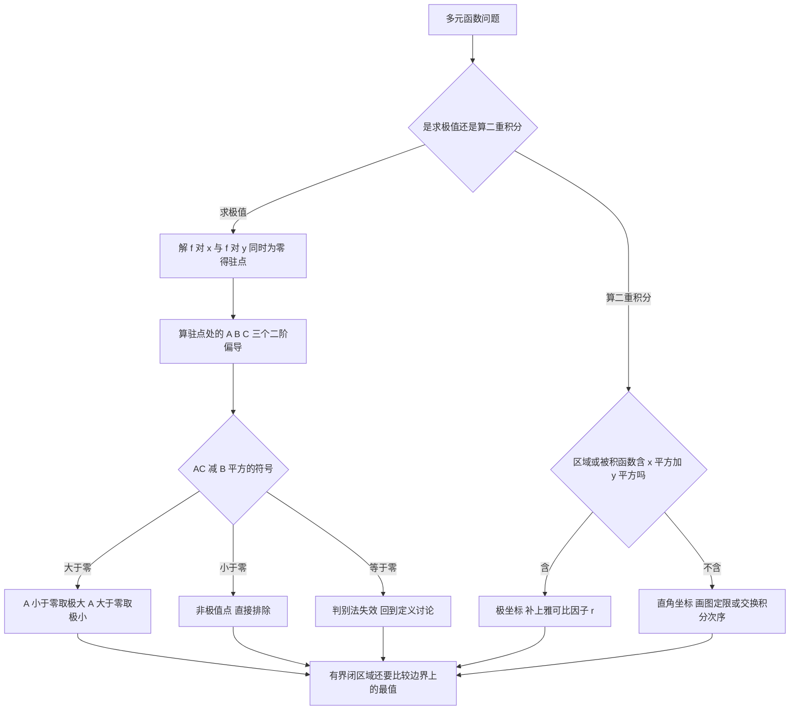

# 高等数学 · 多元函数微积分学

## 多元函数微积分学 [高频]

**考频统计**：考察次数 7 次；涉及年份：2023、2024（2023—2024 年数二真题逐题定章统计）；分数占比约 14%；主要题型：选择、填空、解答（偏导数、全微分、极值、二重积分）。

**核心讲解**：

## 【二元函数的极限与连续】

- **极限的定义**：$\lim\limits_{(x,y)\to(x_0,y_0)}f(x,y)=A$ 要求点按**任意路径**趋近 $(x_0,y_0)$ 时函数值都趋于同一个 $A$。
- **否定判据**：找两条不同路径得到两个不同的极限，即可断定极限不存在。
- **典型反例**：$\frac{xy}{x^2+y^2}$ 沿直线 $y=kx$ 的极限是 $\frac{k}{1+k^2}$，随 $k$ 变化，故该极限不存在。
- **连续的定义**：$f$ 在 $(x_0,y_0)$ 的某去心邻域内有定义，且 $\lim\limits_{(x,y)\to(x_0,y_0)}f(x,y)=f(x_0,y_0)$。
- **最值定理**：**有界闭区域**上**连续**的二元函数一定取到最大值与最小值。
- **两步法依据**：多元最值问题"内部驻点 + 边界"的做法正来自最值定理。

【核心公式】

$$ \lim_{(x,y)\to(x_0,y_0)}f(x,y)=A,\qquad \frac{xy}{x^2+y^2}\Big|_{y=kx}=\frac{k}{1+k^2} $$

【适用条件】

1. 讨论极限要求 $(x_0,y_0)$ 的某去心邻域内有定义；
2. 断言极限存在必须证明**任意路径**都趋于同一个值，只验证一条路径不算证明；
3. 断言极限不存在只需给出两条路径的两个不同极限；
4. 连续要求极限值恰好等于该点的函数值 $f(x_0,y_0)$。

> ⚠️ **易错点**：用一条路径的极限就断言二元极限存在。一元函数只需两侧趋近，二元函数要沿任意路径；沿 $y=kx$ 算出 $\frac{xy}{x^2+y^2}\to\frac{k}{1+k^2}$ 随 $k$ 变化，就足以断定该极限不存在。

## 【偏导数、全微分与隐函数求导】

- **偏导数**：$f_x(x_0,y_0)=\lim\limits_{\Delta x\to0}\frac{f(x_0+\Delta x,y_0)-f(x_0,y_0)}{\Delta x}$，是把 $y$ 固定后的一元导数。
- **分段函数求偏导**：在分界点处求偏导必须回到**定义式**去算。
- **全微分的定义**：$\Delta z=A\Delta x+B\Delta y+o(\rho)$，其中 $\rho=\sqrt{\Delta x^2+\Delta y^2}$。
- **可微的必要结论**：可微时必有 $A=f_x(x_0,y_0)$、$B=f_y(x_0,y_0)$。
- **判定链条**：偏导数在点附近存在且**连续** $\Rightarrow$ 可微 $\Rightarrow$ 偏导数存在且函数**连续**，两个反向箭头都不成立。
- **混合偏导**：二阶混合偏导 $f_{xy}$ 与 $f_{yx}$ 在区域内都**连续**时相等。
- **复合函数求导**：用链式法则，先画出变量关系图，再沿每条通路相乘、把所有通路相加。
- **隐函数求导**：由 $F(x,y,z)=0$ 确定的隐函数 $z=z(x,y)$ 满足 $\frac{\partial z}{\partial x}=-\frac{F_x}{F_z}$、$\frac{\partial z}{\partial y}=-\frac{F_y}{F_z}$。

【核心公式】

$$ \Delta z=A\Delta x+B\Delta y+o(\rho),\qquad \rho=\sqrt{\Delta x^2+\Delta y^2},\qquad \frac{\partial z}{\partial x}=-\frac{F_x}{F_z},\qquad \frac{\partial z}{\partial y}=-\frac{F_y}{F_z} $$

【适用条件】

1. 偏导数存在只要求沿坐标轴方向的两条路径，**不能**推出可微或连续；
2. 可微的充分条件是偏导数在点附近存在且**连续**；
3. $f_{xy}=f_{yx}$ 要求两个混合偏导在区域内都**连续**；
4. 隐函数求导要求 $F$ 有连续偏导且 $F_z$ **不为 0**；
5. 全微分定义中的 $A$、$B$ 与 $x$、$y$ 无关，$o(\rho)$ 是对 $\rho$ 的高阶无穷小。

> ⚠️ **易错点**：把"偏导存在"当成"可微"。典型反例是 $f(x,y)=\frac{xy}{\sqrt{x^2+y^2}}$（补 $f(0,0)=0$），原点处两个偏导都为 $0$，但沿 $y=x$ 有 $\frac{\Delta z-f_x\Delta x-f_y\Delta y}{\rho}=\frac{1}{2}\not\to0$，故不可微；判别时可算 $\Delta z-f_x\Delta x-f_y\Delta y$ 是否为 $\rho$ 的高阶无穷小。

## 【二元函数的极值与最值】

- **必要条件**：二元函数无条件极值的必要条件是 $f_x(x_0,y_0)=f_y(x_0,y_0)=0$。
- **三个记号**：求出驻点后记 $A=f_{xx}$、$B=f_{xy}$、$C=f_{yy}$ 在该点的值。
- **极值判别**：由 $AC-B^2$ 的符号判定，$AC-B^2=0$ 时判别法失效、须回到定义讨论。
- **判别实例**：$f(x,y)=2x^3-9x^2-6y^4+12x+24y$ 只有 $(1,1)$ 与 $(2,1)$ 两个驻点，在 $(1,1)$ 处 $A=-6,B=0,C=-72$，$AC-B^2=432>0$ 且 $A<0$，是极大值点；在 $(2,1)$ 处 $A=6,B=0,C=-72$，$AC-B^2=-432<0$，不是极值点。
- **有界闭区域上的最值**：把内部驻点的函数值与边界上的最大值、最小值放在一起比较，边界条件代入后化为一元函数的最值问题。
- **条件极值**：带约束 $\varphi(x,y)=0$ 时用拉格朗日乘数法，作 $L=f+\lambda\varphi$，解方程组 $L_x=0,L_y=0,L_\varphi=0$，再比较全部候选点的函数值。
- **嫌疑点**：拉格朗日乘数法给出的只是"嫌疑点"，结论必须靠比较（或由实际意义）得出。

【核心公式】

$$ A=f_{xx},\qquad B=f_{xy},\qquad C=f_{yy},\qquad L=f+\lambda\varphi,\qquad L_x=L_y=L_\varphi=0 $$

| $AC-B^2$ 的情形 | 判定结论 | 附加条件 | 处理办法 |
| --- | --- | --- | --- |
| $AC-B^2>0$ | 是**极值点** | $A<0$ 为极大值点，$A>0$ 为极小值点 | 直接写出极值与极值点坐标 |
| $AC-B^2<0$ | **不是**极值点 | 无需再看 $A$ 的符号 | 直接排除该驻点 |
| $AC-B^2=0$ | 判别法**失效** | 二阶判别式给不出信息 | 回到**定义**讨论（比较该点邻域内函数值） |

【适用条件】

1. 求无条件极值先解 $f_x=f_y=0$ 求出全部驻点，再逐点算 $A$、$B$、$C$；
2. $AC-B^2$ 判别法要求 $f$ 在驻点附近有二阶**连续**偏导数；
3. $AC-B^2=0$ 时**不能**下结论，必须回到定义或改用其它方法；
4. 求**有界闭区域**上的最值必须同时处理内部驻点与边界，两者都算完才能比较；
5. 拉格朗日乘数法要求约束 $\varphi$ 有连续偏导且 $\nabla\varphi$ **不为 0**，最后必须比较候选点函数值。

> ⚠️ **秒杀技**：先在驻点处算 $A$、$B$、$C$ 三个数，只盯 $AC-B^2$ 的符号——正号看 $A$ 定极大极小，负号直接排除，零号回去用定义。

## 【二重积分：直角坐标与极坐标】

- **X 型区域**：若 $D$ 满足 $a\le x\le b$、$\varphi_1(x)\le y\le\varphi_2(x)$，则先对 $y$ 积分。
- **Y 型区域**：若 $D$ 满足 $c\le y\le d$、$\psi_1(y)\le x\le\psi_2(y)$，则先对 $x$ 积分。
- **定限口诀**：外层是常数限、内层是函数限，内层上限减下限。
- **画图**：画图是唯一可靠的办法，交换积分次序时必须重新用不等式描述同一区域再重新定限。
- **禁止操作**：绝不能把两个积分号连同上下限直接对调。
- **极坐标变换**：$x=r\cos\theta$、$y=r\sin\theta$ 下面积元素为 $dxdy=r\,drd\theta$，那个雅可比因子 $r$ 不能漏。
- **优先用极坐标**：区域是圆、扇形、圆环，或被积函数含 $x^2+y^2$ 时优先用极坐标。
- **对称性**：若 $D$ 关于 $x$ 轴对称且 $f(x,-y)=-f(x,y)$，则积分为 $0$；若 $D$ 关于直线 $y=x$ 对称，则 $\iint_Df(x,y)\,dxdy=\iint_Df(y,x)\,dxdy$，可把被积函数换成 $\frac{1}{2}\left[f(x,y)+f(y,x)\right]$ 后再算。

【核心公式】

$$ \iint_Df(x,y)\,dxdy=\int_a^bdx\int_{\varphi_1(x)}^{\varphi_2(x)}f(x,y)\,dy=\int_\alpha^\beta d\theta\int_{r_1(\theta)}^{r_2(\theta)}f(r\cos\theta,r\sin\theta)\,r\,dr $$

$$ \iint_Df(x,y)\,dxdy=\iint_Df(y,x)\,dxdy\ \ (D\ \text{关于}\ y=x\ \text{对称}) $$

| 坐标系 / 区域类型 | 适用情形 | 定限方式 | 注意点 |
| --- | --- | --- | --- |
| **直角坐标 X 型** | $D$ 可写成 $a\le x\le b$、$\varphi_1(x)\le y\le\varphi_2(x)$ | 外层 $x$ 取常数限，内层 $y$ 取函数限 | 内层上限减下限，先对 $y$ 积分 |
| **直角坐标 Y 型** | $D$ 可写成 $c\le y\le d$、$\psi_1(y)\le x\le\psi_2(y)$ | 外层 $y$ 取常数限，内层 $x$ 取函数限 | 先对 $x$ 积分；交换次序必须重新定限 |
| **极坐标** | 区域是圆、扇形、圆环，或被积函数含 $x^2+y^2$ | 外层 $\theta\in[\alpha,\beta]$，内层 $r\in[r_1(\theta),r_2(\theta)]$ | 面积元素是 $r\,drd\theta$，因子 $r$ 不能漏 |

【适用条件】

1. 化累次积分前先画出区域图，判断是 X 型还是 Y 型（或需要分块）；
2. X 型要求 $\varphi_1(x)\le\varphi_2(x)$ 在 $[a,b]$ 上成立，Y 型同理；
3. 极坐标要求 $r_1(\theta)\le r_2(\theta)$ 在 $[\alpha,\beta]$ 上成立，且变换是一一的；
4. 用对称性时先确认区域确实关于相应直线对称，再确认被积函数的奇偶性；
5. 交换积分次序必须重新用不等式描述同一区域，**不能**把两个积分号连同上下限直接对调。

> ⚠️ **易错点**：极坐标换元时漏掉雅可比因子 $r$。面积元素是 $dxdy=r\,drd\theta$ 而不是 $drd\theta$，漏掉 $r$ 会让结果整体差一个量级；另一个高频错误是交换积分次序时不重新定限。

**关键结论速记**：

- `二元极限` —— $\lim\limits_{(x,y)\to(x_0,y_0)}f(x,y)=A$ 要求沿**任意路径**极限都相同；找两条路径极限不同即可断定极限不存在（常用 $y=kx$）。
- `可微的定义` —— $\Delta z=f_x\Delta x+f_y\Delta y+o(\rho)$，$\rho=\sqrt{\Delta x^2+\Delta y^2}$；判别链条是"偏导连续 $\Rightarrow$ 可微 $\Rightarrow$ 偏导存在且函数连续"，两个反向箭头都不成立。
- `隐函数求导` —— 由 $F(x,y,z)=0$ 确定 $z=z(x,y)$ 时 $\frac{\partial z}{\partial x}=-\frac{F_x}{F_z}$、$\frac{\partial z}{\partial y}=-\frac{F_y}{F_z}$，条件是 $F_z\neq0$；分子的负号最易漏。
- `二元极值判别` —— 驻点处记 $A=f_{xx},B=f_{xy},C=f_{yy}$：$AC-B^2>0$ 是极值点（$A<0$ 极大、$A>0$ 极小），$AC-B^2<0$ 不是极值点，$AC-B^2=0$ 判别法失效。
- `拉格朗日乘数法` —— 作 $L=f+\lambda\varphi$，解 $L_x=L_y=L_\varphi=0$；解出的只是候选点，必须比较函数值后才能下结论。
- `二重积分化累次积分` —— $\iint_Df\,dxdy=\int_a^bdx\int_{\varphi_1(x)}^{\varphi_2(x)}f\,dy$（X 型，内层上下限是 $x$ 的函数）；交换次序必须重新画图定限。
- `极坐标` —— $\iint_Df\,dxdy=\int_\alpha^\beta d\theta\int_{r_1(\theta)}^{r_2(\theta)}f(r\cos\theta,r\sin\theta)\,r\,dr$，雅可比因子 $r$ 不能漏。
- `对称性` —— $D$ 关于 $x$ 轴对称且 $f(x,-y)=-f(x,y)$ 时积分为 $0$；关于 $y=x$ 对称时可把 $f(x,y)$ 换成 $\frac{1}{2}[f(x,y)+f(y,x)]$。

**示意图**：

图 1 是区域 $D=\left\{(x,y):\frac{1}{3}\le xy\le3,\ \frac{1}{3}\le\frac{y}{x}\le3,\ x>0,\ y>0\right\}$ 在第一象限的图像，四条边界曲线的交点为 $\left(\frac{1}{3},1\right)$、$\left(1,\frac{1}{3}\right)$、$(3,1)$、$(1,3)$：$\left(\frac{1}{3},1\right)$ 是 $xy=\frac{1}{3}$ 与 $y=3x$ 的交点，$\left(1,\frac{1}{3}\right)$ 是 $xy=\frac{1}{3}$ 与 $y=\frac{1}{3}x$ 的交点，$(3,1)$ 是 $xy=3$ 与 $y=\frac{1}{3}x$ 的交点，$(1,3)$ 是 $xy=3$ 与 $y=3x$ 的交点。图中同时画出 $u=xy$、$v=\frac{y}{x}$ 的等值线，这族双曲线与射线把 $D$ 映成 $uv$ 平面上以 $\frac{1}{3}$ 与 $3$ 为边的正方形。

图 2 是多元函数极值判定与二重积分计算的路线图。

**易错点**：

- **错在用一条路径的极限就断言二元极限存在。** 一元函数只需两侧趋近，二元函数要沿任意路径；沿 $y=kx$ 算出 $\frac{xy}{x^2+y^2}\to\frac{k}{1+k^2}$ 随 $k$ 变化，就足以断定该极限不存在。
- **错在把"偏导存在"当成"可微"。** 偏导存在只保证沿坐标轴方向的两条路径，可微要求所有方向；典型反例是 $f(x,y)=\frac{xy}{\sqrt{x^2+y^2}}$（补 $f(0,0)=0$），原点处两个偏导都为 $0$，但沿 $y=x$ 有 $\frac{\Delta z-f_x\Delta x-f_y\Delta y}{\rho}=\frac{1}{2}\not\to0$，故不可微。判别时可算 $\Delta z-f_x\Delta x-f_y\Delta y$ 是否为 $\rho$ 的高阶无穷小。
- **错在极坐标换元时漏掉雅可比因子 $r$。** 面积元素是 $dxdy=r\,drd\theta$，不是 $drd\theta$；漏掉 $r$ 会让结果整体差一个量级。
- **错在交换积分次序时不重新定限。** 必须重新用不等式描述同一区域再定新的上下限，不能把两个积分号连同上下限直接对调；画图是唯一可靠的办法，定限口诀是"外层常数限、内层函数限，内层上限减下限"。

**真题示例**：

**2024 年数二第 17 题（解答题，10 分）**

设已知区域 $D$ 是第一象限内的有界区域，它由 $xy=\dfrac{1}{3}$、$xy=3$、$y=\dfrac{1}{3}x$、$y=3x$ 围成，计算 $\displaystyle\iint_D(1+x-y)\,dxdy$。

> 解析：
>
> 1. 区域由两族双曲线 $xy=$ 常数与两族射线 $\frac{y}{x}=$ 常数围成，作变换 $u=xy$、$v=\frac{y}{x}$，则 $D$ 的边界恰是 $u=\frac{1}{3},u=3,v=\frac{1}{3},v=3$，即 $D$ 被映成 $uv$ 平面上的矩形 $D'=\left[\frac{1}{3},3\right]\times\left[\frac{1}{3},3\right]$。
> 2. 反解 $x=\sqrt{\frac{u}{v}}$、$y=\sqrt{uv}$，由链式法则算得 $\frac{\partial x}{\partial u}=\frac{1}{2\sqrt{uv}}$、$\frac{\partial x}{\partial v}=-\frac{1}{2}\sqrt{\frac{u}{v^3}}$、$\frac{\partial y}{\partial u}=\frac{1}{2}\sqrt{\frac{v}{u}}$、$\frac{\partial y}{\partial v}=\frac{1}{2}\sqrt{\frac{u}{v}}$，于是雅可比行列式 $\frac{\partial(x,y)}{\partial(u,v)}=\frac{1}{2\sqrt{uv}}\cdot\frac{1}{2}\sqrt{\frac{u}{v}}-\left(-\frac{1}{2}\sqrt{\frac{u}{v^3}}\right)\cdot\frac{1}{2}\sqrt{\frac{v}{u}}=\frac{1}{2v}>0$，即 $dxdy=\frac{1}{2v}\,dudv$。
> 3. 代入得 $\iint_D(1+x-y)\,dxdy=\int_{1/3}^{3}\!\!\int_{1/3}^{3}\left(1+\sqrt{\frac{u}{v}}-\sqrt{uv}\right)\frac{1}{2v}\,du\,dv$，其中常数项积分为 $\frac{1}{2}\cdot\frac{8}{3}\cdot\ln 9=\frac{8}{3}\ln 3$，而含 $\sqrt{\frac{u}{v}}$ 与含 $\sqrt{uv}$ 的两项分别为 $\frac{1}{2}\int_{1/3}^{3}\sqrt{u}\,du\int_{1/3}^{3}v^{-3/2}dv$ 与 $\frac{1}{2}\int_{1/3}^{3}\sqrt{u}\,du\int_{1/3}^{3}v^{-1/2}dv$，两个 $v$ 积分都等于 $\frac{4\sqrt{3}}{3}$，故两项都等于 $\frac{104}{27}$ 而正负相消。
> 4. 结论：$\displaystyle\iint_D(1+x-y)\,dxdy=\frac{8}{3}\ln 3\approx2.9296$。

---
